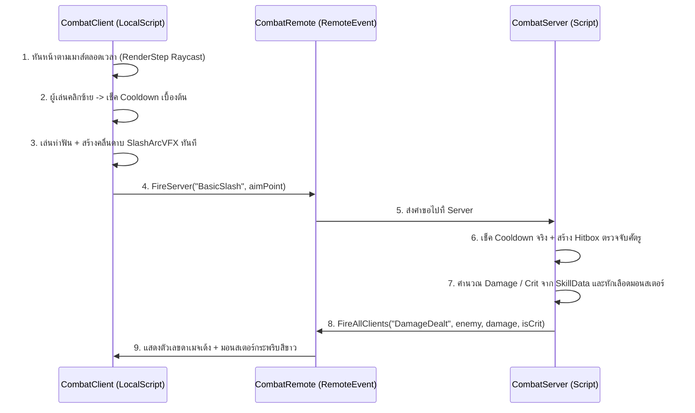

# Project PoE — Game Architecture & Structure

เอกสารสรุปโครงสร้างตัวเกม **Project PoE** (แนว 2.5D Isometric Top-down ARPG สไตล์ Anime / Cel-Shaded) สำหรับใช้อ้างอิงเวลาแก้ไขปรับปรุงระบบหรือเพิ่มฟีเจอร์ใหม่

---

## 1. แผนผังโครงสร้างใน Roblox Studio (Explorer Hierarchy)

```text
📦 game (Project poe - placeId: 840433853)
 ┣ 📂 Workspace                        <-- [โลก 3D ในฉาก]
 ┃  ┣ 🧱 Baseplate / SpawnLocation     <-- พื้นแมพและจุดเกิด
 ┃  ┗ 📂 Enemies                       <-- โฟลเดอร์รวมมอนสเตอร์ในฉาก
 ┃     ┗ 🧍 TrainingDummy (Model)      <-- หุ่นซ้อมมือ R15 (HP: 500, ตายแล้วรีเลือดเอง)
 ┃
 ┣ 💡 Lighting                         <-- [แสงและบรรยากาศแมพ]
 ┃  ┗ (ตั้งค่าสว่างคมชัด ClockTime = 14.5, Brightness = 2.2)
 ┃
 ┣ 📂 ReplicatedStorage                <-- [โซนกลาง: เห็นทั้ง Client และ Server]
 ┃  ┣ 📜 _ARCHITECTURE (ModuleScript)  <-- โน้ตสรุปโครงสร้างเกมใน Studio
 ┃  ┣ 📂 Remotes                       <-- โฟลเดอร์เก็บท่อส่งข้อมูล (RemoteEvents)
 ┃  ┃  ┗ ⚡ CombatRemote (RemoteEvent)  <-- สายส่งข้อมูลระบบต่อสู้
 ┃  ┗ 📂 Modules                       <-- โฟลเดอร์เก็บข้อมูลกลางที่ใช้ร่วมกัน
 ┃     ┗ 📜 SkillData (ModuleScript)    <-- ตารางค่าสถานะสกิล (Damage, Cooldown, Hitbox)
 ┃
 ┣ 📂 ServerScriptService              <-- [โซน Server: ความลับ 100% กันโปร]
 ┃  ┗ 📜 CombatServer (Script)          <-- ตรวจคูลดาวน์จริง, เช็ค Hitbox, คำนวณดาเมจ, ลดเลือดศัตรู
 ┃
 ┗ 📂 StarterPlayer                    <-- [ตั้งค่าตัวละคร & สคริปต์ฝั่งผู้เล่น]
    ┣ 🧍 StarterCharacter (Model)       <-- หุ่นพื้นฐาน R15 Blocky สไตล์ Anime + เส้นขอบ CelShadeOutline
    ┗ 📂 StarterPlayerScripts          <-- โฟลเดอร์สคริปต์ฝั่ง Client (รันทันทีที่เข้าเกม)
       ┣ 📜 CameraScript (LocalScript)  <-- ล็อกกล้องมุมสูง 2.5D Isometric + ซูมเข้าออกสมูท
       ┗ 📜 CombatClient (LocalScript)  <-- หันหน้าตามเมาส์, รับคลิกซ้าย, เล่น VFX ฟัน, เลขดาเมจเด้ง
```

---

## 2. รายละเอียดแต่ละไฟล์ & คู่มือว่า "อยากแก้ตรงไหน ให้ไปที่ไฟล์อะไร"

### 🟦 ฝั่ง Client (`StarterPlayer > StarterPlayerScripts`)
รันบนเครื่องผู้เล่นแต่ละคน ทำหน้าที่รับ Input (เมาส์/คีย์บอร์ด), บังคับกล้อง, และแสดงผลภาพ/เอฟเฟกต์ให้ลื่นไหลทันที (0 ms)

1. **`CameraScript` (`LocalScript`)**
   * **หน้าที่:** ล็อกมุมกล้องแบบ 2.5D Isometric ตามตัวละครแบบนุ่มนวล (Smooth Lerp) และรับลูกกลิ้งเมาส์ (`MouseWheel`) เพื่อซูมเข้า-ออก
   * **จุดที่ปรับแก้บ่อย:**
     * `BASE_OFFSET`: มุมก้มเงยและทิศทางของกล้อง (`Vector3.new(25, 35, 25)`)
     * `FIELD_OF_VIEW`: ความแบนของมุมมอง Isometric (ค่าเริ่มต้น `40`)
     * `MIN_ZOOM_DISTANCE` / `MAX_ZOOM_DISTANCE`: ระยะซูมใกล้สุด (`20`) และไกลสุด (`90`)
     * `FOLLOW_SMOOTH_SPEED` / `ZOOM_SMOOTH_SPEED`: ความนุ่มนวลเวลาเดินและซูม

2. **`CombatClient` (`LocalScript`)**
   * **หน้าที่:**
     * ยิง Raycast จากกล้องผ่านตำแหน่งเมาส์ลงพื้น เพื่อหมุนตัวละคร (`HumanoidRootPart`) ให้หันหน้าตามเมาส์ตลอดเวลา
     * ดักจับการคลิกซ้าย (`MouseButton1`) เช็คคูลดาวน์เบื้องต้น แล้วเล่นท่าฟันสลับซ้าย-ขวา พร้อมสร้างคลื่นดาบ `SlashArcVFX` ทันที
     * ส่งคำสั่ง `CombatRemote:FireServer("BasicSlash", aimPoint)` ไปให้ Server
     * รอรับสัญญาณ `DamageDealt` จาก Server เพื่อแสดงตัวเลขดาเมจเด้ง (`BillboardGui`) และไฟกระพริบที่ตัวมอนสเตอร์

---

### 🟨 โซนตรงกลาง (`ReplicatedStorage`)
ทั้ง Client และ Server มองเห็นและเรียกใช้ร่วมกันได้

1. **`Remotes > CombatRemote` (`RemoteEvent`)**
   * **หน้าที่:** เป็นสะพานส่งข้อความระหว่าง `CombatClient` กับ `CombatServer`
   * **Client -> Server:** ส่ง `("BasicSlash", aimPoint)` เมื่อผู้เล่นคลิกโจมตี
   * **Server -> All Clients:**
     * ส่ง `("ReplicateSlash", attackerChar, aimPoint, step)` เพื่อให้ผู้เล่นคนอื่นเห็นคลื่นดาบของเรา
     * ส่ง `("DamageDealt", enemyModel, finalDamage, isCrit)` เพื่อสั่งเด้งเลขดาเมจบนหัวมอนสเตอร์

2. **`Modules > SkillData` (`ModuleScript`)**
   * **หน้าที่:** เก็บค่าตัวเลขของสกิลและท่าโจมตีทั้งหมดไว้ที่เดียว
   * **จุดที่ปรับแก้บ่อย:**
     * อยากแก้ **ความเร็วในการตี** -> แก้ `Cooldown`
     * อยากแก้ **ความแรง / โอกาสคริติคอล** -> แก้ `MinDamage`, `MaxDamage`, `CritChance`, `CritMultiplier`
     * อยากแก้ **ระยะฟันใกล้-ไกล / กว้าง-แคบ** -> แก้ `HitboxSize` และ `HitboxForwardOffset`

---

### 🟥 ฝั่ง Server (`ServerScriptService`)
รันบนเซิร์ฟเวอร์ของ Roblox เท่านั้น ผู้เล่นและโปรโกงไม่สามารถมองเห็นหรือแก้ไขได้

1. **`CombatServer` (`Script`)**
   * **หน้าที่:**
     * **Anti-Exploit Check:** ตรวจชนิดข้อมูลที่ส่งมา, ตรวจว่าตัวละครยังมีชีวิตอยู่ไหม, และเช็คเวลาคูลดาวน์จริงบน Server (`playerCooldowns`)
     * **Server Hitbox:** ใช้ `workspace:GetPartBoundsInBox` สร้างกล่องตรวจจับด้านหน้าตัวละครผู้เล่น เพื่อหาว่ามีมอนสเตอร์ตัวไหนอยู่ในระยะฟันจริง
     * **Damage & Health:** สุ่มดาเมจและคริติคอลตามค่าใน `SkillData` แล้วสั่งลดเลือดมอนสเตอร์ (`enemyHumanoid:TakeDamage(finalDamage)`)

---

### 🧍 หุ่นตัวละครพื้นฐาน (`StarterPlayer > StarterCharacter`)
* **หน้าที่:** บังคับให้ผู้เล่นทุกคนที่เข้าเกมใช้หุ่น R15 Blocky สัดส่วน Anime เดียวกันทั้งหมด
* **องค์ประกอบสำคัญในตัวหุ่น:**
  * `CelShadeOutline` (`Highlight`): เส้นตัดขอบสีดำรอบตัวละครสไตล์การ์ตูนอนิเมะ
  * `Humanoid`: ตั้งค่า `WalkSpeed = 18` และปิดการแสดงชื่อบนหัว (`DisplayDistanceType = None`)

---

## 3. ลำดับการทำงานของระบบต่อสู้ (Client-Server Flow)


