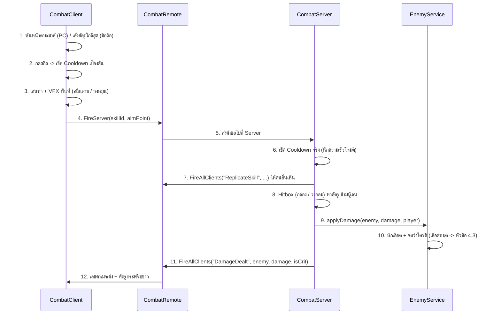
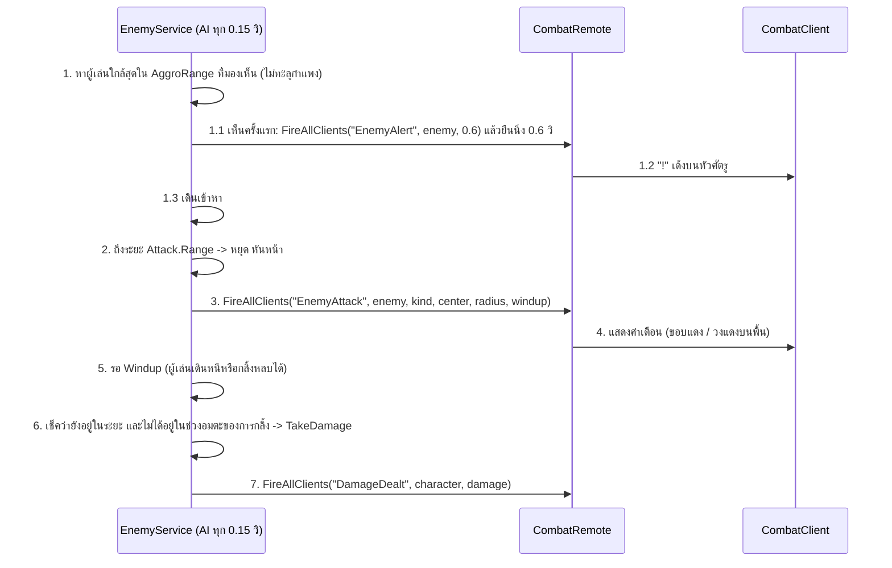

# Project PoE — Game Architecture & Structure

เอกสารสรุปโครงสร้างตัวเกม **Project PoE** (แนว 2.5D Isometric Top-down ARPG สไตล์ Anime / Cel-Shaded) สำหรับใช้อ้างอิงเวลาแก้ไขปรับปรุงระบบหรือเพิ่มฟีเจอร์ใหม่

---

## 0. สถานะ: เวอร์ชันแรก (MVP)

| ขอบเขต MVP | ทำแล้วที่ไหน |
|---|---|
| ตัวละคร 1 แบบ สกิลโจมตี 1-2 อย่าง | `SkillData`: **Slash** (`BasicSlash`) + **Spin Slash** (`SpinSlash`) / `CombatClient` + `CombatServer` |
| ศัตรู 1-2 ชนิด | `EnemyData`: **Stone Grunt** (`Grunt`) + บอส **Stone Guardian** (`Brute`) / `EnemyService` |
| ไอเทมที่มี affix 2-3 แบบ | `ItemData`: ดาเมจ, เลือดสูงสุด (Prefix) + ความเร็วโจมตี (Suffix) / สุ่มใน `Loot` |
| อินเวนทอรีพื้นฐาน | `InventoryClient` (กด **B**) + `PlayerData` (เซิร์ฟเวอร์เป็นคนตัดสิน) |
| บันทึกข้อมูลผู้เล่น | `PlayerData`: DataStore เก็บเลเวล, EXP, กระเป๋า, ของที่สวมใส่ |
| ด่านเล็ก 1 ด่าน | `DungeonMap` + `EnemySpawns` (Lobby + ประตูวาร์ปรีเซ็ตด่าน: `Grunt` 10 + 10 ตัว + บอส `Brute` 1 ตัว) / `EnemyService` |

เพิ่มเติมนอกรายการ MVP ที่จำเป็นต่อการเล่นครบลูป: เลเวล/EXP, ผู้เล่นตายแล้วเกิดใหม่, แถบเลือดศัตรู, มินิแมพ (`MinimapClient` มุมขวาบน + กด `M` ขยายกลางจอ + ปุ่ม `SET` ตั้งค่าแบ่งหมวดหมู่และวาร์ปกลับ Lobby กด `P`), กลิ้งหลบ (Dodge แทนการกระโดด), ปุ่มบนมือถือ

---

## 1. แผนผังโครงสร้างใน Roblox Studio (Explorer Hierarchy)

```text
📦 game (Project poe - placeId: 840433853)
 ┣ 📂 Workspace                        <-- [โลก 3D ในฉาก: แก้ใน Studio]
 ┃  ┣ 🧱 Baseplate / SpawnLocation     <-- พื้นแมพและจุดเกิดในโซน Lobby
 ┃  ┣ 📂 DungeonMap                    <-- โซนปลอดภัย (Lobby), ประตูวาร์ปเข้าด่าน/กลับเมือง, กำแพงด่าน
 ┃  ┣ 📂 Enemies                       <-- มอนสเตอร์ทั้งหมด (EnemyService สร้างตอนเริ่มเกม/รีเซ็ตด่าน)
 ┃  ┃  ┗ 🧍 TrainingDummy (Model)      <-- หุ่นซ้อมมือ R15 (HP: 500, ตายแล้วรีเลือดเอง, ไม่ให้ EXP/ของ)
 ┃  ┣ 📂 EnemySpawns                   <-- Part บอกจุดเกิดศัตรูในด่าน (Grunt 20 จุด, Brute 1 จุด)
 ┃  ┗ 📂 Drops                         <-- ของที่ดรอปบนพื้น (Loot สร้างตอนเล่น)
 ┃
 ┣ 💡 Lighting                         <-- [แสงและบรรยากาศแมพ]
 ┃
 ┣ 📂 ReplicatedStorage                <-- [โซนกลาง: เห็นทั้ง Client และ Server]
 ┃  ┣ 📜 _ARCHITECTURE DON (ModuleScript) <-- โน้ต + CHANGELOG ของ DON (chwwy)
 ┃  ┣ 📜 _ARCHITECTURE WEE (ModuleScript) <-- โน้ต + CHANGELOG ของ WEE (Weerapap3006)
 ┃  ┣ 📂 Remotes
 ┃  ┃  ┣ ⚡ CombatRemote (RemoteEvent)    <-- ใช้สกิล, เลขดาเมจ, ท่าโจมตีศัตรู
 ┃  ┃  ┣ ⚡ InventoryRemote (RemoteEvent) <-- สวมใส่/ถอด/ทิ้งของ + ส่งข้อมูลกระเป๋า
 ┃  ┃  ┣ ⚡ DodgeRemote (RemoteEvent)     <-- กลิ้งหลบ (ขอช่วงอมตะจาก Server + ให้คนอื่นเห็นท่ากลิ้ง)
 ┃  ┃  ┣ ⚡ NotifyRemote (RemoteEvent)    <-- ข้อความกลางจอ (ได้ของ, เลเวลอัป, เคลียร์ด่าน)
 ┃  ┃  ┗ ⚡ TeleportRemote (RemoteEvent)  <-- คำขอวาร์ปกลับโซนปลอดภัย (Lobby) จากหน้าต่างตั้งค่า
 ┃  ┗ 📂 Modules                       <-- ข้อมูลกลาง (ปรับตัวเลขเกมที่นี่)
 ┃     ┣ 📜 SkillData                  <-- ค่าสกิล (ดาเมจ, คูลดาวน์, ระยะ)
 ┃     ┣ 📜 EnemyData                  <-- ค่าศัตรู (เลือด, ความเร็ว, ท่าโจมตี, EXP, ตารางดรอป)
 ┃     ┣ 📜 ItemData                   <-- ไอเทมพื้นฐาน, affix, ความหายาก
 ┃     ┣ 📜 PlayerStats                <-- สเตตัสพื้นฐาน, เลือด/ดาเมจต่อเลเวล, EXP ที่ต้องใช้
 ┃     ┗ 📜 Ui                         <-- สี/ฟอนต์/ตัวช่วยสร้าง UI (Client ใช้)
 ┃
 ┣ 📂 ServerScriptService              <-- [โซน Server: ความลับ 100% กันโปร]
 ┃  ┣ 📜 CombatServer (Script)          <-- ตรวจคูลดาวน์จริง, Hitbox, คำนวณดาเมจ
 ┃  ┣ 📜 EnemyServer (Script)           <-- สั่ง EnemyService.start()
 ┃  ┗ 📜 PlayerDataServer (Script)      <-- สั่ง PlayerData.start()
 ┃
 ┣ 📂 ServerStorage                    <-- [โซน Server: โมดูลที่ Client ห้ามเห็น]
 ┃  ┗ 📂 Modules
 ┃     ┣ 📜 PlayerData                 <-- เลเวล, EXP, กระเป๋า, เซฟ/โหลด DataStore
 ┃     ┣ 📜 EnemyService               <-- เกิดศัตรู, AI ไล่ตี, ตาย -> EXP + ดรอป, รีเซ็ตด่าน & วาร์ปกลับ Lobby
 ┃     ┗ 📜 Loot                       <-- สุ่มไอเทม + affix, วางของบนพื้นให้เก็บ
 ┃
 ┗ 📂 StarterPlayer
    ┣ 🧍 StarterCharacter (Model)       <-- หุ่น R15 Blocky สไตล์ Anime + เส้นขอบ CelShadeOutline (แก้ใน Studio)
    ┗ 📂 StarterPlayerScripts          <-- สคริปต์ฝั่ง Client
       ┣ 📜 CameraScript (LocalScript)  <-- กล้อง 2.5D Isometric + ซูม
       ┣ 📜 CombatClient (LocalScript)  <-- เล็ง, กดสกิล, กลิ้งหลบ, แถบสกิล, VFX, เตือนท่าศัตรู, เลขดาเมจ
       ┣ 📜 HudClient (LocalScript)     <-- แถบเลือด/EXP, แถบเลือดศัตรู/บอส, ข้อความ, หน้าจอตาย
       ┣ 📜 InventoryClient (LocalScript) <-- หน้าต่างกระเป๋า (กด B)
       ┣ 📜 EnemyVisualsClient (LocalScript) <-- ท่าเดินศัตรู + คุมจำนวน Highlight ไม่ให้เกิน 31
       ┗ 📜 MinimapClient (LocalScript) <-- มินิแมพมุมขวาบน + กด M ขยายกลางจอ + ปุ่มตั้งค่า SET (กด P)
```

> UI ทั้งหมด (แถบเลือด, แถบสกิล, กระเป๋า, มินิแมพ, หน้าต่างตั้งค่า) **สร้างจากโค้ด** ไม่มี ScreenGui ใน StarterGui ถ้าจะแก้หน้าตา UI ให้แก้ในสคริปต์ Client และสีกลางใน `Modules > Ui`

---

## 2. รายละเอียดแต่ละไฟล์ & คู่มือว่า "อยากแก้ตรงไหน ให้ไปที่ไฟล์อะไร"

### 🟦 ฝั่ง Client (`StarterPlayer > StarterPlayerScripts`)
รันบนเครื่องผู้เล่นแต่ละคน ทำหน้าที่รับ Input, บังคับกล้อง, และแสดงผลภาพ/เอฟเฟกต์ให้ลื่นไหลทันที (0 ms) **ไม่มีสิทธิ์ตัดสินดาเมจ/ของ/เลเวล**

1. **`CameraScript` (`LocalScript`)**
   * **หน้าที่:** ล็อกมุมกล้องแบบ 2.5D Isometric ตามตัวละครแบบนุ่มนวล (Smooth Lerp) และรับลูกกลิ้งเมาส์ / pinch บนมือถือ เพื่อซูมเข้า-ออก
   * **จุดที่ปรับแก้บ่อย:**
     * `BASE_OFFSET`: มุมก้มเงยและทิศทางของกล้อง (`Vector3.new(25, 35, 25)`)
     * `FIELD_OF_VIEW`: ความแบนของมุมมอง Isometric (ค่าเริ่มต้น `40`)
     * `MIN_ZOOM_DISTANCE` / `MAX_ZOOM_DISTANCE`: ระยะซูมใกล้สุด (`20`) และไกลสุด (`50`)
     * `FOLLOW_SMOOTH_SPEED` / `ZOOM_SMOOTH_SPEED`: ความนุ่มนวลเวลาเดินและซูม

2. **`CombatClient` (`LocalScript`)**
   * **หน้าที่:**
     * **PC:** ยิง Raycast จากกล้องผ่านเมาส์ลงพื้น แล้วหมุนตัวละครให้หันตามเมาส์ตลอดเวลา
     * **มือถือ:** ตัวละครหันตามทิศที่เดิน, สกิลเล็งศัตรูที่ใกล้ที่สุดเอง (ไม่เกิน `TOUCH_AUTO_AIM_RANGE`)
     * กดสกิล: **คลิกซ้าย** (`LMB`) = Slash, **คลิกขวา / Q** (`RMB / Q`) = Spin Slash (กดค้างเพื่อตีต่อเนื่อง) หรือแตะปุ่มในแถบสกิล
     * เช็คคูลดาวน์เบื้องต้น (หารด้วยความเร็วโจมตีจาก attribute `AttackSpeed`) แล้วเล่น VFX ทันที และส่ง `CombatRemote:FireServer(skillId, aimPoint)`
     * ท่าฟัน = เหวี่ยงแขน (`RightShoulder`) + บิดเอว (`Waist`) ด้วย `Motor6D.Transform` ซึ่งต้องเขียนซ้ำทุกเฟรมใน `RunService.PreSimulation` (รันหลัง Animator ไม่งั้นท่าเดิน/ยืนจะทับจนมองไม่เห็น)
     * **กลิ้งหลบ (Dodge):** กด **Space** (PC) หรือปุ่ม `Dodge` ขวาล่าง (มือถือ ตรงที่เคยเป็นปุ่มกระโดด) → กลิ้งไปทางที่เดินอยู่ (ยืนเฉยๆ = ไปทางเมาส์ / ทางที่หันบนมือถือ) ไกล `DODGE_DISTANCE` ใน `DODGE_DURATION` วิ ด้วย `LinearVelocity` (คุมแค่แกน X/Z ตกจากขอบได้ปกติ) + ท่าตีลังกาที่ข้อต่อ `LowerTorso.Root` ระหว่างกลิ้งตีไม่ได้ แล้วส่ง `DodgeRemote:FireServer(direction)` ให้ Server เปิดช่วงอมตะ
     * **ไม่มีกระโดด:** ตั้ง `JumpPower` / `JumpHeight` = 0 + ปิดสถานะ `Jumping` ทุกครั้งที่เกิด (ปุ่มกระโดดของ Roblox บนมือถือหายไปเอง) และผูก Space กับกลิ้งหลบด้วย `ContextActionService` ที่ priority สูงกว่าปุ่มกระโดดเดิม
     * แถบสกิลพร้อมแสดงคูลดาวน์ (PC: กลางล่าง มีช่อง Dodge ต่อท้าย / มือถือ: ขวา เหนือปุ่ม Dodge)
     * รับ `DamageDealt` → เลขดาเมจเด้ง (ศัตรู: ขาว/คริเหลือง, ผู้เล่นโดน: แดง) + กระพริบขาว
     * รับ `ReplicateSkill` → เล่นสกิลของผู้เล่นคนอื่น
     * รับ `EnemyAttack` → เตือนก่อนโดนตี: ศัตรูธรรมดาขอบตัวเป็นสีแดง, บอสมีวงแดงบนพื้นค่อยๆ เต็ม
     * รับ `EnemyAlert` → ศัตรูที่เพิ่งเห็นเรามี "!" สีเหลืองเด้งขึ้นบนหัวช่วงที่ยืนนิ่งก่อนพุ่งเข้ามา
     * รับ `DodgeRemote` → เล่นท่ากลิ้งของผู้เล่นคนอื่น
   * **จุดที่ปรับแก้บ่อย:**
     * `SKILL_BAR`: ลำดับสกิลบนจอและปุ่มที่ใช้กด
     * `SWING_DURATION`: เวลาเหวี่ยงออกแล้วกลับของท่าฟัน (`0.18` วิ)
     * `swingAngle` / `sideAngle` / `twist` ใน `playSlashVFX`: องศาเหวี่ยงแขนและบิดเอว
     * `SLASH_COLOR`, `ENEMY_ATTACK_COLOR`, `ENEMY_ALERT_COLOR`: สีคลื่นดาบของเรา / สีเตือนท่าศัตรู / สี "!"
     * `DODGE_KEY` (ปุ่มกลิ้ง), `ROLL_DIP` / `ROLL_PIVOT` (ท่าตีลังกา) — ระยะ/คูลดาวน์/ช่วงอมตะอยู่ใน `PlayerStats`
     * สี / ขนาดตัวเลขดาเมจ: `label.TextColor3` และ `billboard.Size` ใน `showHitFeedback`

3. **`HudClient` (`LocalScript`)**
   * **หน้าที่:** แถบเลือด + เลเวล + EXP ของเรา (PC: ซ้ายล่าง / มือถือ: ซ้ายบน), แถบเลือดเล็กบนหัวศัตรูทุกตัวใน `Workspace.Enemies`, แถบเลือดบอสใหญ่ด้านบนเมื่ออยู่ใกล้บอส, ข้อความจาก `NotifyRemote`, หน้าจอ "YOU DIED" พร้อมนับถอยหลังเกิดใหม่ ("Respawning in Xs") และปิดแถบเลือดเดิมของ Roblox
   * **จุดที่ปรับแก้บ่อย:** `BOSS_BAR_RANGE` (ระยะที่แถบบอสขึ้น), `NOTIFY_DURATION`, `MAX_NOTIFICATIONS`

4. **`InventoryClient` (`LocalScript`)**
   * **หน้าที่:** หน้าต่างกระเป๋า (กด **B** หรือปุ่ม "Inventory") ซ้าย = ช่องสวมใส่อุปกรณ์ 9 ช่อง (`Helmet`, `Amulet`, `MainHand`, `OffHand`, `Cloth`, `Ring1`, `Ring2`, `Special1`, `Special2`) + สเตตัส, กลาง = ช่องของ, ขวา = รายละเอียดไอเทมที่เลือก + ปุ่ม `Equip` / `Unequip` / `Discard` (ทิ้งต้องกด 2 ครั้ง)
   * แค่ **แสดงผล** ข้อมูลล่าสุดที่ Server ส่งมา (`"Sync"`) และส่งคำขอไปให้ Server ตัดสิน
   * **จุดที่ปรับแก้บ่อย:** `TOGGLE_KEY`, `GRID_COLUMNS`, `CELL_SIZE`, `SLOT_LAYOUT`

5. **`EnemyVisualsClient` (`LocalScript`)**
   * **ท่าเดินศัตรู:** แกว่งแขนขา (Motor6D `LeftHip`, `RightHip`, `LeftShoulder`, `RightShoulder` ที่ `EnemyService` สร้าง) ตามความเร็วที่ศัตรูเคลื่อนที่จริง หยุดเดิน = ค่อยๆ กลับท่ายืน ทำใน `RunService.PreSimulation` เหมือนท่าฟันของผู้เล่น
   * **คุม Highlight:** Roblox แสดง Highlight พร้อมกันได้แค่ 31 อัน (เกินแล้วหายเฉยๆ) สคริปต์นี้เรียง Highlight **ทุกอัน** ใน Workspace (ศัตรู, ผู้เล่น, คลื่นดาบ) ตามระยะจากตัวเรา แล้วเปิดแค่ 27 อันที่ใกล้สุด (เหลือ 4 ที่ให้คลื่นดาบที่เกิดระหว่างรอบ) ทุก 0.2 วิ
     * ⚠ อยากซ่อน Highlight ให้ **ลบทิ้ง** อย่าตั้ง `Enabled = false` เพราะสคริปต์นี้จะเปิดกลับ (ยกเว้นอันที่ปิดไว้ตั้งแต่ตอนสร้าง สคริปต์จะไม่ยุ่ง)
   * **จุดที่ปรับแก้บ่อย:** `LEG_SWING` / `ARM_SWING` (องศาแกว่ง), `STRIDE_LENGTH` (ก้าวยาวแค่ไหน), `HIGHLIGHT_HEADROOM`

6. **`MinimapClient` (`LocalScript`)**
   * **หน้าที่:** แสดงแผนที่เรดาร์หมุนตามมุมกล้อง Isometric และปุ่มตั้งค่า `SET` มุมขวาบนข้างมินิแมพ (หรือกดปุ่มลัด **P**)
   * **2 โหมดแผนที่:** โหมดปกติอยู่มุมขวาบน และเมื่อกดปุ่ม **M** (หรือคลิกที่ตัวแผนที่) จะสลับขยายเป็นแผนที่โปร่งใสขนาดใหญ่กลางจอสไตล์ PoE
   * **หน้าต่างตั้งค่า (`SettingsWindow` - ภาษาอังกฤษ, กดเลือกหมวดก่อนเข้าไปปรับด้วยหลอดเลื่อน Slider):**
     * **หน้าหลัก (`MainMenuPage`):** เลือกหมวด `Map Settings >`, `Other Settings >` หรือกดปุ่มลัด `Return to Lobby` (ส่ง `TeleportRemote:FireServer("Lobby")`)
     * **หน้า `Map Settings` (ต้องกดเข้ามาก่อนถึงจะแสดงแถบเลื่อน Slider):** มีปุ่ม `< Back` ย้อนกลับ, ปุ่มสลับโหมดมุมจอ/กลางจอ, และ **หลอดเลื่อน (Sliders)** สำหรับลากปรับค่าแบบละเอียด: `Corner Map Size` (120–260 px), `Overlay Map Size [M]` (300–620 px), `Corner Radar Range` (70–240 studs), `Overlay Radar Range [M]` (140–380 studs), และ `Background Opacity` (10%–95%)
     * **หน้า `Other Settings`:** หมวดหมู่ที่เตรียมโครงสร้างไว้สำหรับใส่ตั้งค่าเพิ่มเติมในอนาคต (มีปุ่ม `< Back` ย้อนกลับ)
   * **สัญลักษณ์ในแผนที่:** จุดตัวเรา (สีขาวพร้อมเข็มชี้ทิศหน้า), ผู้เล่นอื่น (สีฟ้า), มอนสเตอร์ทั่วไป (สีแดง), บอส (สีส้มทองใหญ่), ประตูวาร์ปเข้าด่าน/กลับเมือง (เพชรสีฟ้า/ทอง), แท่งกำแพงด่านใน `Workspace.DungeonMap` และตัวนับจำนวนศัตรูที่เหลือมุมขวาล่าง (`Enemies: X` / `Cleared!`)
   * **จุดที่ปรับแก้บ่อย:** `cornerMapSize` / `overlayMapSize`, `cornerViewRadius` / `overlayViewRadius`, `overlayBgTransparency`, `SELF_COLOR` / `ENEMY_COLOR` / `BOSS_COLOR`

---

### 🟨 โซนตรงกลาง (`ReplicatedStorage`)
ทั้ง Client และ Server มองเห็นและเรียกใช้ร่วมกันได้

1. **`Remotes`** (ท่อส่งข้อมูล Client ↔ Server)

   | Remote | ทิศทาง | ข้อความ |
   |---|---|---|
   | `CombatRemote` | Client → Server | `(skillId, aimPoint)` เมื่อใช้สกิล |
   | | Server → ทุก Client | `("ReplicateSkill", character, skillId, aimPoint, step)` ให้คนอื่นเห็นสกิลเรา |
   | | Server → ทุก Client | `("DamageDealt", targetModel, damage, isCrit)` เลขดาเมจ (ทั้งศัตรูและผู้เล่น) |
   | | Server → ทุก Client | `("EnemyAttack", enemyModel, kind, center, radius, windup)` เตือนท่าศัตรู |
   | | Server → ทุก Client | `("EnemyAlert", enemyModel, duration)` ศัตรูเพิ่งเห็นผู้เล่น ("!" บนหัว) |
   | `DodgeRemote` | Client → Server | `(direction)` กลิ้งหลบ → Server เช็คคูลดาวน์แล้วเปิดช่วงอมตะ |
   | | Server → ทุก Client | `(character)` ให้คนอื่นเล่นท่ากลิ้ง |
   | `InventoryRemote` | Client → Server | `("RequestSync")`, `("Equip", itemId)`, `("Unequip", slot)`, `("Discard", itemId)` |
   | | Server → Client | `("Sync", { Inventory, Equipped, Capacity })` ข้อมูลกระเป๋าทั้งหมด |
   | `NotifyRemote` | Server → Client | `(text, color?)` ข้อความกลางจอ |
   | `TeleportRemote` | Client → Server | `("Lobby")` ขอวาร์ปกลับโซนปลอดภัย (Lobby) และฟื้นฟูเลือดเต็ม (รับใน `EnemyService`) |

2. **`Modules > SkillData`** — ค่าสกิลทั้งหมด
   * ดาเมจจริง = สุ่ม `MinDamage`–`MaxDamage` + สเตตัส `FlatDamage` ของผู้เล่น, คูณ `CritMultiplier` ถ้าติดคริ (`CritChance`)
   * คูลดาวน์จริง = `Cooldown / (1 + AttackSpeed% / 100)` (ฟัน `0.55` วิ, หมุนฟัน `3` วิ)
   * `Shape = "Box"` ใช้ `HitboxSize` + `HitboxForwardOffset` (กล่องหน้าตัว), `Shape = "Radius"` ใช้ `Radius` (วงรอบตัว)

3. **`Modules > EnemyData`** — ศัตรูแต่ละชนิด (key = ชื่อที่ใช้ตั้งจุดเกิด)
   * `MaxHealth`, `WalkSpeed` (ผู้เล่นเดิน 18), `Scale` (ขนาดตัว), สีตัว/ตา
   * `AggroRange` = ระยะที่เริ่มไล่, `LeashRange` = ถูกล่อไกลจากจุดเกิดเกินนี้จะเดินกลับบ้านและเลือดเต็ม
   * `Attack`: `Kind` (`Melee` ตีคนเดียว / `Slam` ทุบเป็นวง `Radius`), `Range`, `Windup` (เวลาเตือนก่อนโดน = เวลาให้หลบ), `Cooldown`, ดาเมจ
   * `Exp` (ทุกคนที่ตีโดนได้เต็มจำนวน), `RespawnTime` (ตอนนี้ไม่ได้ใช้ ศัตรูเกิดใหม่เฉพาะตอนรีเซ็ตด่าน), `Drops` (`Rolls` ครั้ง × โอกาส `Chance`, `RarityWeights` = น้ำหนักความหายาก)

4. **`Modules > ItemData`** — ไอเทมและช่องสวมใส่
   * `Slots`: รองรับช่องสวมใส่ทั้งหมด 9 ช่อง (`Helmet`, `Amulet`, `MainHand`, `OffHand`, `Cloth`, `Ring1`, `Ring2`, `Special1`, `Special2`) โดยไอเทมประเภท `Ring` จะเลือกใส่ช่อง `Ring1`/`Ring2` ที่ว่างอัตโนมัติ และ `Special` จะเลือกใส่ `Special1`/`Special2` ที่ว่างอัตโนมัติ
   * `Bases`: ของที่ดรอปได้ (`IronSword` "Iron Sword" → ช่อง `MainHand` ตั้ง `AllowOffHand = false`, `LeatherVest` "Leather Vest" → ช่อง `Cloth`) พร้อม `Implicit` = สเตตัสติดตัวของทุกชิ้น โดยอาวุธ `MainHand` กำหนด `AllowOffHand = true` (ใส่ออฟแฮนด์คู่กันได้) หรือ `AllowOffHand = false` (ถือเดี่ยว ล็อกช่อง `OffHand` และถอดออฟแฮนด์เดิมเก็บเข้ากระเป๋าอัตโนมัติ)
   * `Affixes`: ออปชันสุ่ม `FlatDamage` (+ดาเมจ, Prefix), `MaxHealth` (+เลือด, Prefix), `AttackSpeed` (+% ความเร็วโจมตี, Suffix) แต่ละอันมีช่วงค่า `Min`–`Max`
   * `Rarities`: Normal (0 affix, ขาว), Magic (1-2, ฟ้า, Prefix ≤1 Suffix ≤1), Rare (3, เหลือง)
   * ไอเทม 1 ชิ้นเป็นข้อมูลล้วน `{ Id, Base, Rarity, Affixes = { { Id, Value } } }` จึงเซฟลง DataStore และส่งผ่าน Remote ได้ตรงๆ
   * **เพิ่มไอเทม/affix ใหม่:** เพิ่มแถวใน `Bases` (กำหนด `Slot` เป็น `"MainHand"`, `"OffHand"`, `"Cloth"`, `"Helmet"`, `"Amulet"`, `"Ring"`, หรือ `"Special"`) / `Affixes` (ถ้าเป็นสเตตัสใหม่ต้องเพิ่มใน `StatText`, `PlayerStats` และโค้ดที่ใช้สเตตัสนั้นด้วย)

5. **`Modules > PlayerStats`** — สเตตัสผู้เล่น
   * `BASE_MAX_HEALTH` (100), `MAX_HEALTH_PER_LEVEL` (+12/เลเวล), `DAMAGE_PER_LEVEL` (+2/เลเวล), `MAX_LEVEL` (30)
   * กลิ้งหลบ: `DODGE_COOLDOWN` (1 วิ, ความเร็วโจมตีไม่มีผล), `DODGE_DURATION` (0.35 วิ), `DODGE_DISTANCE` (13 studs), `DODGE_INVULNERABLE_TIME` (0.4 วิ นับจากตอน Server ได้รับ)
   * `expToNext(level)` = EXP ที่ต้องใช้ขึ้นเลเวลถัดไป (`60 + level × 40`)
   * `compute(level, equipped)` = สเตตัสสุดท้าย, `getCooldown(...)` = คูลดาวน์หลังคิดความเร็วโจมตี (Client และ Server ใช้สูตรเดียวกัน)

6. **`Modules > Ui`** — สี (`Ui.Colors`), ฟอนต์, ตัวช่วยสร้าง UI (`Ui.new`, `Ui.text`, `Ui.button`) และ `Ui.isTouchOnly()` (เช็คว่าเป็นมือถือ)

---

### 🟥 ฝั่ง Server (`ServerScriptService` + `ServerStorage > Modules`)
รันบนเซิร์ฟเวอร์ของ Roblox เท่านั้น ผู้เล่นและโปรโกงไม่สามารถมองเห็นหรือแก้ไขได้ **ทุกอย่างที่มีผลต่อเกม (ดาเมจ, ของ, EXP, เลเวล) ตัดสินที่นี่**

`Script` ใน ServerScriptService เป็นแค่ตัวเริ่ม ระบบจริงอยู่ใน ModuleScript ที่ `ServerStorage > Modules` เพื่อให้หลายสคริปต์เรียกใช้กันได้ (เช่น CombatServer เรียก `EnemyService.applyDamage`)

1. **`CombatServer` (`Script`)**
   * **Anti-Exploit Check:** ตรวจชนิดข้อมูลที่ส่งมา, ตัวละครยังมีชีวิต, คูลดาวน์จริงแยกตามสกิล (`playerCooldowns`, หักความเร็วโจมตีจาก `PlayerData.getStats`)
   * **Server Hitbox:** `GetPartBoundsInBox` (ฟัน) หรือ `GetPartBoundsInRadius` (หมุนฟัน) หา Model ที่มี Humanoid **ข้ามตัวละครผู้เล่น** (เล่นด้วยกัน ไม่ตีกันเอง)
   * **Damage:** สุ่มดาเมจ + `FlatDamage` → ศัตรูของ `EnemyService` ส่งต่อให้ `EnemyService.applyDamage` (จัดการตาย/EXP/ดรอปเอง), ตัวอื่น (TrainingDummy) ใช้ `TakeDamage` ตรงๆ
   * **กลิ้งหลบ (`DodgeRemote`):** ตรวจทิศ (Vector3, กัน NaN), ตัวละครยังมีชีวิต, คูลดาวน์จริง (`playerDodgeTimes`) → ตั้ง attribute `InvulnerableUntil` บนตัวละคร (= `os.clock()` ของ Server + `DODGE_INVULNERABLE_TIME`) → `FireAllClients(character)` ให้คนอื่นเห็นท่า ตัวละครเคลื่อนที่ฝั่ง Client เอง (Client เป็นเจ้าของ physics ของตัวเองอยู่แล้ว)

2. **`EnemyServer` (`Script`)** → `EnemyService.start()`

3. **`PlayerDataServer` (`Script`)** → `PlayerData.start()`

4. **`ServerStorage > Modules > EnemyService`**
   * **จุดเกิด:** อ่าน Part ใน `Workspace.EnemySpawns` ถ้าไม่มีโฟลเดอร์นี้จะวางด่านเริ่มต้นให้เอง
   * **ตัวศัตรู:** สร้างหุ่น Blockout จากโค้ด (`BODY_PARTS`: ตัว หัว ตา เชื่อม WeldConstraint กับ HumanoidRootPart, แขนขาต่อด้วย Motor6D ที่หมุนจากหัวไหล่/สะโพก ให้ `EnemyVisualsClient` แกว่งเป็นท่าเดิน) + Highlight เส้นขอบการ์ตูน
   * **AI (ทุก `AI_TICK` = 0.15 วิ):** หาผู้เล่นใกล้สุดใน `AggroRange` **ที่มองเห็นจริง** (ยิง Raycast จากระดับตา `EYE_HEIGHT` ไม่เห็นทะลุกำแพง) → **เห็นครั้งแรก = ยืนนิ่งหันหน้าหา `ALERT_TIME` (0.6 วิ) พร้อมส่ง `EnemyAlert` ให้ขึ้น "!"** → เดินเข้าหา → ถึง `Attack.Range` และคูลดาวน์พร้อม → หยุด หันหน้า ส่ง `EnemyAttack` ให้ Client เตือน → รอ `Windup` → Melee: ตีโดนถ้าเป้ายังอยู่ใน `Range + 1.5`, Slam: โดนทุกคนในวง `Radius` (มี ForceField ตอนเกิด หรือกำลังกลิ้งหลบ = `InvulnerableUntil` ยังไม่หมด → ไม่โดน)
   * โดนตีก่อนเห็นเรา = ไล่ทันทีไม่มีช่วง "!" (ผู้เล่นเห็นมันอยู่แล้ว)
   * **การเดิน (`moveToward`):** กวาดกล่องขนาดตัวศัตรู (`Blockcast`) ไปทางเป้า ถ้าโล่ง = เดินตรง ถ้ามีกำแพงขวาง = ขอเส้นทางจาก `PathfindingService` (ขนาดตัวตาม `Scale`, กระโดดไม่ได้) แล้วเดินตาม waypoint คำนวณใหม่เมื่อเป้าขยับเกิน `PATH_GOAL_TOLERANCE` (ไม่ถี่กว่าทุก `PATH_REFRESH_TIME` = 1 วิ) หาทางไม่ได้ = เดินตรงไปเหมือนเดิม ใช้ทั้งตอนไล่และตอนเดินกลับบ้าน
   * โดนตีจากนอกระยะ = หันมาไล่คนตีทันที, ถูกล่อเกิน `LeashRange` = เดินกลับบ้าน เลือดเต็ม
   * **เลือดตามจำนวนผู้เล่น:** `MaxHealth × (1 + HEALTH_PER_EXTRA_PLAYER × (ผู้เล่น − 1))` (+50% ต่อคนที่เพิ่ม) ปรับทุกตัวทันทีตอนมีคนเข้า/ออก โดยคง % เลือดเดิม (EXP และของดรอปไม่เปลี่ยน)
   * **ตาย & รีเซ็ตด่าน (`resetDungeon`) & วาร์ปกลับ Lobby:** EXP ให้ทุกคนที่เคยตีโดน → `Loot.rollDrops` → บอสตายประกาศ "Dungeon Cleared!" ทุกคน → ศพจางหาย 1 วิ (ตายแล้วตายเลย ไม่เกิดใหม่ตามเวลา) เมื่อผู้เล่นกดเข้าประตูวาร์ป `LobbyDungeonPortal` ใน Lobby ระบบจะเรียก `EnemyService.resetDungeon()` เพื่อล้างและเสกมอนสเตอร์ทั้งด่านขึ้นมาใหม่ทั้งหมด พร้อมวาร์ปผู้เล่นไปยังจุดเริ่มด่าน (`DungeonEntranceSpawn`) โดยสั่งโหลดพื้นที่รอบจุดนั้นบน Client ก่อนวาร์ป (`RequestStreamAroundAsync` รอไม่เกิน `PORTAL_STREAM_TIMEOUT` = 3 วิ กันศัตรูหน้าประตูโผล่มากลางทาง) ส่วนการกลับ Lobby ทำได้ทั้งผ่านประตู `DungeonReturnPortal` ท้ายห้องบอส หรือกดปุ่มวาร์ปในหน้าต่างตั้งค่า (`TeleportRemote`)

5. **`ServerStorage > Modules > Loot`**
   * `rollItem(rarity)`: สุ่มฐานไอเทม → จำนวน affix ตามความหายาก → สับ affix แล้วหยิบตามโควตา Prefix/Suffix → สุ่มค่าในช่วง `Min`–`Max`
   * `dropItem`: วางก้อน Neon สีตามความหายาก + ชื่อลอย + `ProximityPrompt` "Pick Up" (กด **E** / แตะบนมือถือ) → `PlayerData.addItem` (กระเป๋าเต็ม = เก็บไม่ได้ ของยังอยู่)
   * **จุดที่ปรับแก้บ่อย:** `DROP_LIFETIME` (ของหายเองหลัง 90 วิ), `PICKUP_DISTANCE`, `SCATTER`

6. **`ServerStorage > Modules > PlayerData`**
   * ข้อมูลผู้เล่นใน memory: `Level`, `Exp`, `Inventory` (สูงสุด `INVENTORY_CAPACITY` = 20), `Equipped` (9 ช่องตาม `ItemData.Slots` ช่องละ 1 ชิ้น), `Stats`
   * **โหลด:** เข้าเกม → `GetAsync` (ลองใหม่ 3 ครั้ง) → ล้างข้อมูลที่เกมไม่รู้จักแล้วทิ้ง (เช่นไอเทมที่ถูกลบออกจาก `ItemData`) → ย้ายของจากช่องชื่อเก่า (`Weapon` → `MainHand`, `Armor` → `Cloth`) → ถ้าอาวุธหลักห้ามถือ OffHand จะย้ายของในช่อง `OffHand` กลับเข้ากระเป๋า → ส่ง `Sync` + ตั้ง attribute
   * **กันข้อมูลหาย:** ถ้าโหลดไม่สำเร็จ จะเล่นได้แต่ `CanSave = false` (ไม่เซฟทับข้อมูลจริงด้วยโปรไฟล์ว่าง) และแจ้งผู้เล่น
   * **เทสใน Studio:** ถ้า Studio ไม่มีสิทธิ์ใช้ DataStore (เช่น `game.rbxl` หรือยังไม่เปิด API Services) จะไม่ลองซ้ำ ขึ้นข้อความ "Studio Test: Playable, but progress will not be saved" และพิมพ์วิธีเปิดสิทธิ์ไว้ใน Output
   * **เซฟ:** ตอนออกเกม, ทุก `AUTOSAVE_INTERVAL` (120 วิ), และตอนเซิร์ฟเวอร์ปิด (`BindToClose` รอเซฟเสร็จสูงสุด 25 วิ) ใช้ `UpdateAsync` ลองใหม่ 3 ครั้ง
   * **กระเป๋า:** สวมใส่ = สลับกับของเดิมในช่องเดียวกัน (แหวน/Special ลงช่อง 1 หรือ 2 ที่ว่างก่อน เต็มทั้งคู่ = สลับกับช่อง 1), ถอด = ต้องมีที่ว่างในกระเป๋า, ทิ้ง = ลบถาวร ทุกคำขอเช็คว่าของเป็นของผู้เล่นคนนั้นจริง
     * **OffHand:** อาวุธหลัก `AllowOffHand = false` → ใส่ของช่อง `OffHand` ไม่ได้ และตอนสวมอาวุธนั้น ของใน `OffHand` จะถูกถอดเข้ากระเป๋าเอง (ถ้ามีอาวุธหลักเดิมอยู่และกระเป๋าเต็ม = สวมไม่ได้)
   * **เลเวลอัป:** EXP ครบ `expToNext` → เลเวล +1, เลือดเต็ม, แจ้งเตือน
   * `DATASTORE_NAME = "PlayerData_v1"`: **เปลี่ยนชื่อ = ข้อมูลทุกคนเริ่มใหม่หมด**

#### Attribute บนตัว Player (Server ตั้ง → Client อ่าน)

| Attribute | ความหมาย | ใครใช้ |
|---|---|---|
| `Level`, `Exp`, `ExpToNext` | เลเวลและ EXP | HudClient, InventoryClient |
| `MaxHealth`, `FlatDamage`, `AttackSpeed` | สเตตัสสุดท้าย | InventoryClient, CombatClient (คูลดาวน์) |
| `DataStatus` | `Loading` / `Loaded` / `Failed` / `NoAccess` (Studio ไม่มีสิทธิ์ DataStore) | (ไว้เช็คตอน debug) |

#### Attribute บนตัวละครผู้เล่น
`InvulnerableUntil` (CombatServer ตั้งตอนกลิ้งหลบ → EnemyService ข้ามการโจมตีจนถึงเวลานั้น, เป็นเวลา `os.clock()` ของ Server ใช้เทียบบน Server เท่านั้น)

#### Attribute บนตัวศัตรู
`DisplayName`, `IsBoss` (EnemyService ตั้ง → HudClient ใช้แสดงชื่อและแถบบอส)

---

### 🧍 หุ่นตัวละครพื้นฐาน (`StarterPlayer > StarterCharacter`)
* **หน้าที่:** บังคับให้ผู้เล่นทุกคนที่เข้าเกมใช้หุ่น R15 Blocky สัดส่วน Anime เดียวกันทั้งหมด
* **องค์ประกอบสำคัญในตัวหุ่น:**
  * `CelShadeOutline` (`Highlight`): เส้นตัดขอบสีดำรอบตัวละคร (กระพริบขาวตอนโดนตีด้วย)
  * `Humanoid`: ตั้งค่า `WalkSpeed = 18` และปิดการแสดงชื่อบนหัว — `MaxHealth` ถูก `PlayerData` ตั้งใหม่ทุกครั้งที่เกิดตามเลเวล + ของที่สวมใส่, `JumpPower` / `JumpHeight` ถูก `CombatClient` ตั้งเป็น 0 (ไม่มีกระโดด)
  * ข้อต่อที่โค้ดใช้ทำท่า (ต้องเป็น R15): `RightUpperArm.RightShoulder` + `UpperTorso.Waist` (ท่าฟัน), `LowerTorso.Root` (ท่ากลิ้ง)

---

## 3. สิ่งที่โค้ดต้องการจากแมพ (คนแต่งแมพต้องอ่าน)

* **`Workspace.Enemies`**: โฟลเดอร์ศัตรู (ถ้าไม่มี โค้ดสร้างให้) — Model ที่มี Humanoid + HumanoidRootPart ข้างในจะมีแถบเลือดและโดนตีได้
* **`Workspace.DungeonMap`**: โฟลเดอร์เก็บโครงสร้างโซนปลอดภัย (Lobby), กำแพงด่าน, จุดเริ่มด่าน (`DungeonEntranceSpawn`) และประตูวาร์ป (`LobbyDungeonPortal` สำหรับรีเซ็ตด่าน+เข้าด่าน, `DungeonReturnPortal` สำหรับกลับ Lobby)
  * ในประตูแต่ละบานต้องมี `ProximityPrompt` ชื่อ `PortalPrompt` (อยู่ลึกแค่ไหนก็ได้) ไม่มี = เดินเข้าประตูแล้วไม่มีอะไรเกิดขึ้น
  * จุดกลับ Lobby = `SpawnLocation` ตัวแรกที่เจอใน Workspace
  * ข้อความบนป้ายประตู (`TextLabel` ตัวแรกในประตู) และ `ObjectText` / `ActionText` ของ `PortalPrompt` โค้ดตั้งทับตอนเริ่มเกม แก้ใน Studio ไม่มีผล ต้องแก้ใน `EnemyService` (`setupDungeonPortals`)
  * ไม่มีโฟลเดอร์ `DungeonMap` = ประตูวาร์ป **และ** ปุ่ม `Return to Lobby` ในหน้าตั้งค่าใช้ไม่ได้ทั้งคู่ (`TeleportRemote` ต่ออยู่ในฟังก์ชันเดียวกัน)
* **ด่าน = `Workspace.EnemySpawns`** (โฟลเดอร์): ใส่ Part วางบนพื้นตรงจุดที่อยากให้ศัตรูเกิด (ปัจจุบันวาง `Grunt` 20 จุด แบ่งเป็น 2 กลุ่ม กลุ่มละ 10 ตัว และ `Brute` 1 ตัวท้ายด่าน)
  * ตั้งชื่อ Part เป็นชนิดศัตรู (`Grunt` หรือ `Brute`) หรือใส่ Attribute `EnemyType` = ชื่อนั้น
  * Part ซ่อนตัวเองตอนเริ่มเกม ตั้ง Anchored ไว้ จะใส่ Part ในโฟลเดอร์ย่อยก็ได้
  * ถ้าไม่มีโฟลเดอร์นี้ (หรือไม่มี Part ที่ถูกต้องเลย) จะใช้ด่านเริ่มต้นรอบ SpawnLocation
  * ศัตรูหาพื้นด้วยการยิง Raycast ลงจาก 10 studs เหนือ Part ห้ามมีหลังคา/สิ่งกีดขวางอยู่ในระยะนั้น
* **ทางเดินต้องกว้างพอ** ให้บอส (`Scale = 2.4`, pathfinding ต้องการทางกว้าง ~10 studs) ศัตรูเดินอ้อมกำแพงได้ แต่ **กระโดดไม่ได้** ทางที่ต้องกระโดดขึ้น = ศัตรูตามไปไม่ได้
* **ผู้เล่นก็กระโดดไม่ได้แล้ว** (Space = กลิ้งหลบ) ทุกจุดที่ต้องไปให้ถึงต้องเดินขึ้นได้ (ทางลาด / ขั้นเตี้ยๆ) ห้ามมีขอบที่ต้องกระโดดข้าม
* กำแพงบังสายตาศัตรู: ผู้เล่นหลังกำแพงที่ชนได้ (`CanCollide = true`) ศัตรูจะยังไม่เห็น ของตกแต่ง `CanCollide = false` ไม่บัง
* ของตกแต่งที่ไม่อยากให้ขวางทางศัตรู (หญ้า, ป้าย) ตั้ง `CanCollide = false` ศัตรูจะมองข้าม
* Highlight ที่ใส่ในแมพจะถูก `EnemyVisualsClient` เปิด/ปิดตามระยะด้วย อยากซ่อนให้ลบทิ้ง
* `TrainingDummy` เป็นศัตรูที่ทำใน Studio เอง (ไม่ได้อยู่ใน EnemyData) → โดนตีได้ แต่ไม่ให้ EXP/ของ

---

## 4. ลำดับการทำงาน (Flows)

### 4.1 ผู้เล่นใช้สกิล



### 4.2 ศัตรูโจมตีผู้เล่น



### 4.3 ฆ่าศัตรู → EXP → ดรอป → เก็บของ → เซฟ

1. `Humanoid.Died` ของศัตรู → `EnemyService` ให้ EXP ทุกคนที่ตีโดน (`PlayerData.addExp` → อาจเลเวลอัป)
2. `Loot.rollDrops(EnemyData.Drops)` → สุ่มไอเทมบน Server → วางก้อนของบนพื้น
3. ผู้เล่นกด **E** / แตะ "Pick Up" → `PlayerData.addItem` → `InventoryRemote "Sync"` + ข้อความ "Obtained ..."
4. เปิดกระเป๋า → กดสวมใส่ → `InventoryRemote ("Equip", id)` → Server สลับของ → คำนวณสเตตัสใหม่ → ตั้ง attribute + MaxHealth → `Sync`
5. ทั้งหมดถูกเซฟลง DataStore ตอนออกเกม / ทุก 2 นาที / ตอนเซิร์ฟเวอร์ปิด

---

## 5. ข้อจำกัดที่รู้แล้ว

* **ทดสอบการเซฟใน `game.rbxl` ไม่ได้** (Studio ไม่มีสิทธิ์ DataStore) เกมจะเล่นได้แต่ไม่เซฟ ทดสอบการเซฟใน Team Create ที่เปิด Game Settings → Security → **Enable Studio Access to API Services**
* **บาลานซ์:** playtest ครบลูปผ่านแล้ว (30 ต.ค. 2569) ตารางนี้เป็นตัวเลขที่คำนวณไว้ ใช้อ้างอิงตอนปรับค่า (เลเวล 1 ไม่มีของ, ตีโดนทุกครั้ง, ฟันเฉลี่ย ~47 ดาเมจรวมคริ):

  | สถานการณ์ | เวลาโดยประมาณ |
  |---|---|
  | ฆ่า Stone Grunt (120 HP) | 3 ฟัน ~1.1 วิ |
  | บอสคนเดียว (1500 HP) | ~14 วิ ถ้ายืนตีตลอด, ~15-20 วิ รวมเวลาหลบทุบ |
  | บอส 2 คน (2250 HP) | ~10-15 วิ |
  | Stone Grunt 3 ตัวรุมเรา (เลือด 100) | ตายใน ~7 วิ ถ้ายืนเฉยๆ |
  | Stone Grunt 10 ตัวรุมพร้อมกัน (กลุ่มในด่านตอนนี้) | ตายใน ~2 วิ ถ้ายืนเฉยๆ |

* **เข้าประตูวาร์ปจาก Lobby = รีเซ็ตทั้งด่าน** แม้มีเพื่อนกำลังเล่นอยู่ในด่าน ศัตรูที่เพื่อนกำลังสู้จะหายแล้วเกิดใหม่หมด
* ศัตรูยังไม่มีท่าง้างตอนโจมตี (มีแค่ท่าเดิน + ขอบแดง/วงแดงเตือน) และ pathfinding ไม่กระโดด
* **ช่วงอมตะของการกลิ้งเริ่มตอน Server ได้รับ** ไม่ใช่ตอนกดปุ่ม ถ้าการโจมตีลงในช่วงที่คำสั่งกลิ้งยังเดินทางไปไม่ถึง Server (~ครึ่งหนึ่งของ ping) จะยังโดน* ศัตรูที่ไกลกว่า Highlight อันที่ 27 จะไม่มีเส้นขอบ (ตั้งใจ เพื่อไม่ให้เกินขีดจำกัด 31 ของ Roblox)
