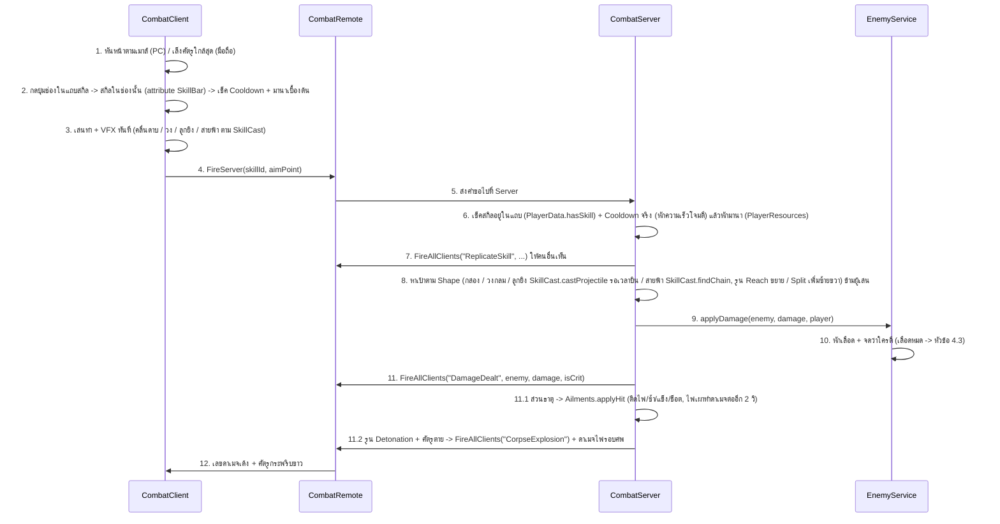
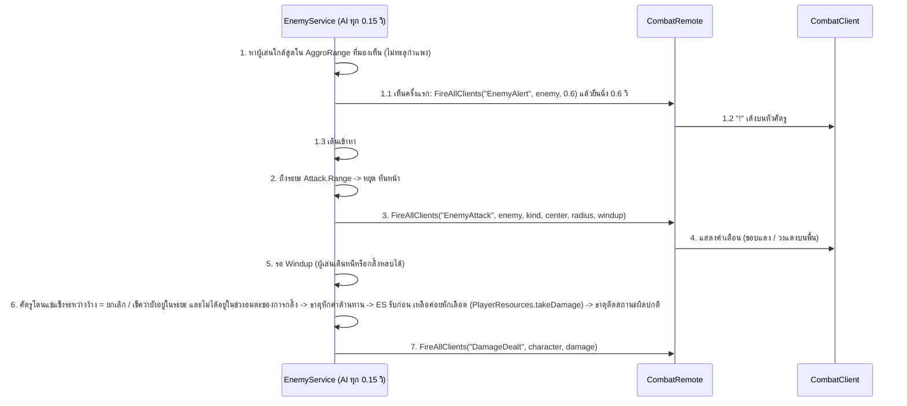

# Project PoE — Game Architecture & Structure

เอกสารสรุปโครงสร้างตัวเกม **Project PoE** (แนว 2.5D Isometric Top-down ARPG สไตล์ Anime / Cel-Shaded) สำหรับใช้อ้างอิงเวลาแก้ไขปรับปรุงระบบหรือเพิ่มฟีเจอร์ใหม่

---

## 0. สถานะ: เวอร์ชันแรก (MVP)

| ขอบเขต MVP | ทำแล้วที่ไหน |
|---|---|
| ตัวละคร 1 แบบ สกิลโจมตี 1-2 อย่าง | `SkillData`: **Slash** (`BasicSlash`) + **Spin Slash** (`SpinSlash`) / `CombatClient` + `CombatServer` |
| ศัตรู 1-2 ชนิด | `EnemyData`: **Stone Grunt** (`Grunt`) + บอส **Stone Guardian** (`Brute`) / `EnemyService` |
| ไอเทมที่มี affix 2-3 แบบ | `ItemData`: ดาเมจ, เลือดสูงสุด (Prefix) + ความเร็วโจมตี (Suffix) / สุ่มใน `Loot` |
| อินเวนทอรีพื้นฐาน | `InventoryClient` (กด **B**) + `PlayerData` (เซิร์ฟเวอร์เป็นคนตัดสิน) |
| บันทึกข้อมูลผู้เล่น | `PlayerData`: DataStore เก็บเลเวล, EXP, กระเป๋า, ของที่สวมใส่ |
| ด่านเล็ก 1 ด่าน | `DungeonMap` + `EnemySpawns` (Lobby + ประตูวาร์ปรีเซ็ตด่าน: `Grunt` 10 + 10 ตัว + บอส `Brute` 1 ตัว) / `EnemyService` |

เพิ่มเติมนอกรายการ MVP ที่จำเป็นต่อการเล่นครบลูป: เลเวล/EXP, ผู้เล่นตายแล้วเกิดใหม่, แถบเลือดศัตรู, มินิแมพ (`MinimapClient` มุมขวาบน + กด `M` ขยายกลางจอ + ปุ่ม `SET` ตั้งค่าแบ่งหมวดหมู่และวาร์ปกลับ Lobby กด `P`), กลิ้งหลบ (Dodge แทนการกระโดด), ปุ่มบนมือถือ

เฟส 7 (ขยายเกม, ไอเดียเรียงไว้ในหัวข้อ "7. ไว้ทีหลัง" ของ Google Doc): **ขวดยาเลือด + ขวดมานา** (กด `1` / `2`), **มานา** (สกิลที่มี `ManaCost` ใช้มานา, Spin Slash = 15), **Energy Shield** (รับดาเมจก่อนเลือด ได้จาก affix ของไอเทม) — ระบบเหล่านี้อยู่ใน `PlayerResources`, **ธาตุ + สถานะผิดปกติ + ค่าต้านทาน** (ไฟ/น้ำแข็ง/สายฟ้า จาก affix → ติดไฟ/ช้า-แข็ง/รับดาเมจเพิ่ม, บอสทุบเป็นไฟ) — ค่าอยู่ใน `Elements`, กฎอยู่ใน `Ailments`, **รูนสลักหิน** (ไอเทมที่ใส่ในช่องของสกิล: Slash 2 ช่อง, Spin Slash 3 ช่อง → วงกว้างขึ้น / แตก 3 ทิศ / แปลงเป็นธาตุ / ศพระเบิด) — ค่าอยู่ใน `RuneData`, ผลอยู่ใน `CombatServer`, **หินคราฟต์** (สกุลเงินนับจำนวน: Ascension = อัปความหายาก, Carving = เพิ่ม affix, Shifting = สุ่ม affix ใหม่) — ค่าอยู่ใน `StoneData`, กฎอยู่ใน `Crafting`, **แผ่นศิลา (endgame)** (Stone Tablet มี Tier 1–10 + ม็อดสุ่ม ใส่ประตูด่านก่อนเข้า → ศัตรูยากขึ้น ของดรอปเยอะและดีขึ้น) — ค่าอยู่ใน `TabletData`, สถานะรอบอยู่ใน `DungeonRun`, **ผังพาสซีฟ + คลาส** (ผังเล็ก 35 จุดใช้ร่วมกัน คลาส Warrior / Ranger / Mystic = จุดเริ่มต่างกัน + โบนัสเริ่มต้น, ได้ 1 แต้มต่อเลเวล, กด `K`) — ผังอยู่ใน `PassiveData`, หน้าต่างอยู่ใน `PassiveTreeClient`

เฟส 8 (แนวคิดใหม่ PoE2 + Torchlight Infinite, ไอเดียเรียงไว้ในหัวข้อ 7 ของ Google Doc): **สกิลเพิ่ม + ศิลาสกิล** (ยังไม่ได้เทสใน Studio) — สกิล 7 แบบ: Slash, Spin Slash, **Ground Slam** (ทุบวงหน้าตัว), **Stone Shot** (ขว้างหินไกล ไม่ใช้มานา), **Fireball** (ลูกไฟระเบิด ธาตุไฟ), **Frost Nova** (วงน้ำแข็งรอบตัว), **Arc** (สายฟ้ากระโดด 4 ตัว) ทุกสกิลเป็นไอเทม **Skill Stone** ที่ดรอปได้ แล้วเอาไปใส่ **แถบสกิล 4 ช่อง** (ปุ่ม `LMB` / `RMB` / `Q` / `R`) ในหน้าต่างกระเป๋า เริ่มเกมมี Slash + Spin Slash — ค่าสกิลอยู่ใน `SkillData`, กฎยิง/สายฟ้าอยู่ใน `SkillCast`, แถบสกิลเก็บใน `PlayerData` (`SkillBar`), **ฮีโร่ + กลไกเฉพาะตัว** (ยังไม่ได้เทสใน Studio) — 3 คลาสเดิมเล่นต่างกัน: Warrior **Fury** (ตีโดนสะสมโทสะ เต็มแล้วสกิลถัดไปแรง ×2), Ranger **Momentum** (เดิน/กลิ้งสะสม +3% ความเร็วโจมตีต่อชั้น ยืนนิ่ง 1 วิหาย), Mystic **Stone Orbs** (ใช้มานาครบ 30 ได้ลูกแก้วลอยรอบตัวยิงศัตรูเอง) เลเวล 10 เลือก **สาย (Hero Path)** ได้ 1 ใน 2 ต่อคลาส (ฟรี เปลี่ยนได้) ในหน้าต่างผังพาสซีฟ — ค่าอยู่ใน `HeroData`, กฎอยู่ใน `HeroService`, มิเตอร์ + ลูกแก้วอยู่ใน `HeroClient`

---

## 1. แผนผังโครงสร้างใน Roblox Studio (Explorer Hierarchy)

```text
📦 game (Project poe - placeId: 840433853)
 ┣ 📂 Workspace                        <-- [โลก 3D ในฉาก: แก้ใน Studio]
 ┃  ┣ 🧱 Baseplate / SpawnLocation     <-- พื้นแมพและจุดเกิดในโซน Lobby
 ┃  ┣ 📂 DungeonMap                    <-- โซนปลอดภัย (Lobby), ประตูวาร์ปเข้าด่าน/กลับเมือง, กำแพงด่าน
 ┃  ┣ 📂 LobbyHub                      <-- เมือง Lobby แบบ blockout (ลาน, แท่นแผ่นศิลา, อนุสาวรีย์ + ธงคลาส, จุดเผื่อ Stash/Merchant/...)
 ┃  ┃                                      สร้างด้วย tools/BuildLobbyHub.luau ใน Command Bar แล้วแก้ต่อใน Studio
 ┃  ┣ 📂 Enemies                       <-- มอนสเตอร์ทั้งหมด (EnemyService สร้างตอนเริ่มเกม/รีเซ็ตด่าน)
 ┃  ┃  ┗ 🧍 TrainingDummy (Model)      <-- หุ่นซ้อมมือ R15 (HP: 500, ตายแล้วรีเลือดเอง, ไม่ให้ EXP/ของ)
 ┃  ┣ 📂 EnemySpawns                   <-- Part บอกจุดเกิดศัตรูในด่าน (Grunt 20 จุด, Brute 1 จุด)
 ┃  ┗ 📂 Drops                         <-- ของที่ดรอปบนพื้น (Loot สร้างตอนเล่น)
 ┃
 ┣ 💡 Lighting                         <-- [แสงและบรรยากาศแมพ]
 ┃
 ┣ 📂 ReplicatedStorage                <-- [โซนกลาง: เห็นทั้ง Client และ Server]
 ┃  ┣ 📂 Remotes
 ┃  ┃  ┣ ⚡ CombatRemote (RemoteEvent)    <-- ใช้สกิล, เลขดาเมจ, ท่าโจมตีศัตรู
 ┃  ┃  ┣ ⚡ InventoryRemote (RemoteEvent) <-- สวมใส่/ถอด/ทิ้งของ + ส่งข้อมูลกระเป๋า
 ┃  ┃  ┣ ⚡ DodgeRemote (RemoteEvent)     <-- พุ่งหลบ (ขอช่วงอมตะจาก Server + ให้คนอื่นเห็นท่าพุ่งหลบ)
 ┃  ┃  ┣ ⚡ FlaskRemote (RemoteEvent)     <-- ดื่มขวดยาเลือด/มานา (Server หักจำนวนแล้วค่อยๆ ฟื้น + ให้คนอื่นเห็นประกาย)
 ┃  ┃  ┣ ⚡ NotifyRemote (RemoteEvent)    <-- ข้อความกลางจอ (ได้ของ, เลเวลอัป, เคลียร์ด่าน)
 ┃  ┃  ┗ ⚡ TeleportRemote (RemoteEvent)  <-- คำขอวาร์ปกลับโซนปลอดภัย (Lobby) จากหน้าต่างตั้งค่า
 ┃  ┗ 📂 Modules                       <-- ข้อมูลกลาง (ปรับตัวเลขเกมที่นี่)
 ┃     ┣ 📜 SkillData                  <-- ค่าสกิล 7 แบบ (ดาเมจ, ธาตุ, คูลดาวน์, มานา, รูปแบบการโดน, ระยะ)
 ┃     ┣ 📜 SkillCast                  <-- กฎลูกยิง (โดนตัวแรก/หยุดที่กำแพง) + สายฟ้ากระโดด + หาศัตรูจาก Part (Server + Client ใช้ร่วมกัน)
 ┃     ┣ 📜 EnemyData                  <-- ค่าศัตรู (เลือด, ความเร็ว, ท่าโจมตี + ธาตุ, EXP, ตารางดรอป)
 ┃     ┣ 📜 PassiveData                <-- ผังพาสซีฟ (จุด, เส้นเชื่อม, คลาส) + กฎการลงแต้ม
 ┃     ┣ 📜 HeroData                   <-- กลไกฮีโร่ของแต่ละคลาส (Fury / Momentum / Stone Orbs) + สาย Lv 10 + ตัวเลข
 ┃     ┣ 📜 StoneData                  <-- หินคราฟต์ 3 แบบ (ชื่อ, ปุ่ม, คำอธิบาย, โอกาสดรอป)
 ┃     ┣ 📜 TabletData                 <-- แผ่นศิลา: ม็อด, ผลต่อ Tier, สูตรผลของรอบ (getEffects / describe)
 ┃     ┣ 📜 RuneData                   <-- รูนสลักหิน (ชื่อ, คำอธิบาย, ใส่สกิลไหนได้, ตัวเลขผลของรูน)
 ┃     ┣ 📜 Elements                   <-- ธาตุ (ไฟ/น้ำแข็ง/สายฟ้า), สี, ตัวเลขสถานะผิดปกติ, ค่าต้านทานสูงสุด
 ┃     ┣ 📜 ItemData                   <-- ไอเทมพื้นฐาน, affix, ความหายาก, รูน/Skill Stone เป็นไอเทม
 ┃     ┣ 📜 PlayerStats                <-- สเตตัสพื้นฐาน, เลือด/มานา/ดาเมจต่อเลเวล, EXP ที่ต้องใช้, ค่ากลิ้งหลบ/ขวดยา/ES
 ┃     ┗ 📜 Ui                         <-- สี/ฟอนต์/ตัวช่วยสร้าง UI (Client ใช้)
 ┃
 ┣ 📂 ServerScriptService              <-- [โซน Server: ความลับ 100% กันโปร]
 ┃  ┣ 📜 CombatServer (Script)          <-- ตรวจคูลดาวน์ + หักมานาจริง, Hitbox, คำนวณดาเมจ, กลิ้งหลบ
 ┃  ┣ 📜 EnemyServer (Script)           <-- สั่ง EnemyService.start()
 ┃  ┣ 📜 PlayerDataServer (Script)      <-- สั่ง PlayerData.start()
 ┃  ┣ 📜 PlayerResourcesServer (Script) <-- สั่ง PlayerResources.start()
 ┃  ┗ 📜 HeroServer (Script)           <-- สั่ง HeroService.start()
 ┃
 ┣ 📂 ServerStorage                    <-- [โซน Server: โมดูลที่ Client ห้ามเห็น]
 ┃  ┗ 📂 Modules
 ┃     ┣ 📜 PlayerData                 <-- เลเวล, EXP, กระเป๋า, เซฟ/โหลด DataStore
 ┃     ┣ 📜 PlayerResources            <-- มานา (ฟื้นเอง/หักตอนใช้สกิล), Energy Shield (รับดาเมจก่อน/ชาร์จคืน), ขวดยาเลือด/มานา
 ┃     ┣ 📜 HeroService                <-- กลไกฮีโร่: Fury (Warrior), Momentum (Ranger), Stone Orbs ยิงเอง/บล็อก (Mystic)
 ┃     ┣ 📜 EnemyService               <-- เกิดศัตรู, AI ไล่ตี, ตาย -> EXP + ขวดยา + ดรอป, รีเซ็ตด่าน & วาร์ปกลับ Lobby
 ┃     ┣ 📜 Ailments                   <-- สถานะผิดปกติ (ติดไฟ/ช้า/แข็ง/ช็อต) ใช้ได้ทั้งศัตรูและผู้เล่น
 ┃     ┣ 📜 Crafting                   <-- สุ่ม affix (ใช้ทั้งตอนดรอปและตอนคราฟต์) + กฎหินคราฟต์
 ┃     ┣ 📜 DungeonRun                 <-- แผ่นศิลาที่รออยู่ในประตู + ผลของรอบที่กำลังเล่น (ทั้งเซิร์ฟเวอร์)
 ┃     ┗ 📜 Loot                       <-- สุ่มไอเทม/รูน/Skill Stone/หิน/แผ่นศิลา, วางของบนพื้นให้เก็บ
 ┃
 ┗ 📂 StarterPlayer
    ┣ 🧍 StarterCharacter (Model)       <-- หุ่น R15 Blocky สไตล์ Anime + เส้นขอบ CelShadeOutline (แก้ใน Studio)
    ┗ 📂 StarterPlayerScripts          <-- สคริปต์ฝั่ง Client
       ┣ 📜 CameraScript (LocalScript)  <-- กล้อง 2.5D Isometric + ซูม
       ┣ 📜 CombatClient (LocalScript)  <-- เล็ง, กดสกิล, กลิ้งหลบ, ขวดยา, แถบสกิล, VFX, เตือนท่าศัตรู, เลขดาเมจ
       ┣ 📜 HudClient (LocalScript)     <-- แถบ ES/เลือด/มานา/EXP, แถบเลือดศัตรู/บอส, ข้อความ, หน้าจอตาย
       ┣ 📜 InventoryClient (LocalScript) <-- หน้าต่างกระเป๋า (กด B)
       ┣ 📜 EnemyVisualsClient (LocalScript) <-- ท่าเดินศัตรู + คุมจำนวน Highlight ไม่ให้เกิน 31
       ┣ 📜 MinimapClient (LocalScript) <-- มินิแมพมุมขวาบน + กด M ขยายกลางจอ + ปุ่มตั้งค่า SET (กด P)
       ┣ 📜 PassiveTreeClient (LocalScript) <-- หน้าต่างผังพาสซีฟ + เลือกคลาส + เลือกสายฮีโร่ (กด K)
       ┗ 📜 HeroClient (LocalScript)    <-- มิเตอร์กลไกฮีโร่เหนือแถบสกิล + ลูกแก้ว Stone Orbs ลอยรอบตัว Mystic
```

> UI ทั้งหมด (แถบเลือด, แถบสกิล, กระเป๋า, มินิแมพ, หน้าต่างตั้งค่า) **สร้างจากโค้ด** ไม่มี ScreenGui ใน StarterGui ถ้าจะแก้หน้าตา UI ให้แก้ในสคริปต์ Client และสีกลางใน `Modules > Ui`

---

## 2. รายละเอียดแต่ละไฟล์ & คู่มือว่า "อยากแก้ตรงไหน ให้ไปที่ไฟล์อะไร"

### ⚡ คู่มือทางลัด (Quick Edit Guide)
* **ความแรงสกิล / ธาตุ / คูลดาวน์ / ระยะโจมตี / มานาที่ใช้ / จำนวนช่องรูน / เพิ่มสกิลใหม่** → `ReplicatedStorage > Modules > SkillData` (สกิลใหม่ได้ Skill Stone ให้เองอัตโนมัติ)
* **แถบสกิล: จำนวนช่อง / ป้ายปุ่ม / สกิลเริ่มต้นของผู้เล่นใหม่** → `ReplicatedStorage > Modules > PlayerStats` (`SKILL_BAR_SLOTS`, `SKILL_BAR_KEYS`, `STARTING_SKILLS`) ปุ่มจริงอยู่ใน `CombatClient` → `SKILL_SLOT_INPUTS`
* **ลูกยิงหยุดที่อะไร / สายฟ้าเลือกเป้ายังไง** → `ReplicatedStorage > Modules > SkillCast`
* **เลือดศัตรู / ความเร็ว / ระยะมองเห็น (`AggroRange`) / ท่าโจมตี + ธาตุ / EXP / โอกาสดรอป** → `ReplicatedStorage > Modules > EnemyData`
* **เพิ่มไอเทมใหม่ / เพิ่ม affix ใหม่ / โอกาสได้ของ Rare / ช่องสวมใส่ 9 ช่อง (`AllowOffHand`)** → `ReplicatedStorage > Modules > ItemData`
* **หินคราฟต์ (ชื่อ, คำอธิบาย, โอกาสดรอป, กฎว่าใช้กับของชิ้นไหนได้)** → `ReplicatedStorage > Modules > StoneData` (ผลของหินอยู่ใน `ServerStorage > Modules > Crafting`)
* **แผ่นศิลา endgame (ผลต่อ Tier, ม็อดความยาก + ของดรอป, Tier สูงสุด, โอกาสบอสดรอป Tier +1)** → `ReplicatedStorage > Modules > TabletData` (สถานะรอบอยู่ใน `ServerStorage > Modules > DungeonRun`)
* **รูนสลักหิน (ชื่อ, คำอธิบาย, ใส่สกิลไหนได้, ตัวเลขผลของรูน)** → `ReplicatedStorage > Modules > RuneData` (ผลอยู่ใน `CombatServer`, หน้าตาอยู่ใน `CombatClient.getSkillLook`)
* **ผังพาสซีฟ + คลาส (จุด, สเตตัสของแต่ละจุด, เส้นเชื่อม, โบนัสเริ่มต้นของคลาส, แต้มต่อเลเวล)** → `ReplicatedStorage > Modules > PassiveData` (หน้าต่างกด **K** อยู่ใน `PassiveTreeClient`)
* **กลไกฮีโร่ (Fury / Momentum / Stone Orbs: ได้เท่าไร ลดเร็วแค่ไหน แรงแค่ไหน), สาย Lv 10, เลเวลที่ปลดสาย** → `ReplicatedStorage > Modules > HeroData` (กฎอยู่ใน `ServerStorage > Modules > HeroService`, มิเตอร์และลูกแก้วอยู่ใน `HeroClient`)
* **สีธาตุ / ความแรงไฟเผา / ช้าเท่าไร / เกณฑ์แช่แข็ง / ช็อตแรงแค่ไหน / เพดานค่าต้านทาน (75%)** → `ReplicatedStorage > Modules > Elements` (ลูปสถานะอยู่ใน `ServerStorage > Modules > Ailments`)
* **เลือดเริ่มต้น / เลือด-มานา-ดาเมจต่อเลเวล / EXP ที่ใช้ขึ้นเลเวล / เลเวลสูงสุด** → `ReplicatedStorage > Modules > PlayerStats`
* **มานาฟื้นเร็วแค่ไหน / ES รอกี่วิถึงชาร์จ / ขวดยาเลือด-มานา (จำนวนครั้ง, ฟื้นกี่ %, นานกี่วิ, ได้คืนต่อการฆ่า)** → `ReplicatedStorage > Modules > PlayerStats` (`FLASKS` ฯลฯ, ปุ่มและสีช่องขวดอยู่ใน `CombatClient` → `FLASK_SLOTS`)
* **พุ่งหลบ (Dash / Dodge): ระยะพุ่ง / เวลาพุ่ง (`0.36` วิ) / คูลดาวน์ (`1` วิ) / ช่วงอมตะ (`0.4` วิ)** → `ReplicatedStorage > Modules > PlayerStats` (ปุ่มและท่าพุ่งหลบอยู่ใน `CombatClient` → `DODGE_KEY`, `DASH_CROUCH`, `DASH_LEAN_ANGLE`, `DASH_MAX_FORCE`)
* **มุมกล้อง / ระยะซูม / ความนุ่มนวลกล้อง** → `StarterPlayerScripts > CameraScript`
* **ท่าสกิล / สีคลื่นดาบ / หน้าตาลูกยิงและสายฟ้า / ปุ่มกดสกิล / ตัวเลขดาเมจเด้ง** → `StarterPlayerScripts > CombatClient`
* **แถบ ES-เลือด-มานา-EXP / แถบเลือดศัตรูและบอส / ข้อความแจ้งเตือน / หน้าจอตาย** → `StarterPlayerScripts > HudClient`
* **หน้าต่างกระเป๋า (กด B) / ช่องสวมใส่ 9 ช่อง / คีย์ลัด Shift+คลิก, X** → `StarterPlayerScripts > InventoryClient`
* **มินิแมพ (มุมขวาบน & กด M ขยายกลางจอ) / หน้าต่างตั้งค่า (กด P หรือปุ่ม SET) / ปุ่มวาร์ปกลับ Lobby** → `StarterPlayerScripts > MinimapClient`
* **ท่าเดินศัตรู / จำนวนเส้นขอบ Highlight สูงสุด (27 จาก 31)** → `StarterPlayerScripts > EnemyVisualsClient`
* **จังหวะ AI ศัตรูคิด / เวลาตกใจ "!" (`ALERT_TIME`) / เลือดเพิ่มตามจำนวนผู้เล่น / ประตูวาร์ปและรีเซ็ตด่าน** → `ServerStorage > Modules > EnemyService`
* **ขนาดกระเป๋า (`INVENTORY_CAPACITY`) / ช่วงเวลาเซฟอัตโนมัติ / ชื่อ DataStore** → `ServerStorage > Modules > PlayerData`
* **สีและฟอนต์กลางของ UI ทั้งเกม** → `ReplicatedStorage > Modules > Ui`

---

### 🟦 ฝั่ง Client (`StarterPlayer > StarterPlayerScripts`)
รันบนเครื่องผู้เล่นแต่ละคน ทำหน้าที่รับ Input, บังคับกล้อง, และแสดงผลภาพ/เอฟเฟกต์ให้ลื่นไหลทันที (0 ms) **ไม่มีสิทธิ์ตัดสินดาเมจ/ของ/เลเวล**

1. **`CameraScript` (`LocalScript`)**
   * **หน้าที่:** ล็อกมุมกล้องแบบ 2.5D Isometric ตามตัวละครแบบนุ่มนวล (Smooth Lerp) และรับลูกกลิ้งเมาส์ / pinch บนมือถือ เพื่อซูมเข้า-ออก
   * **จุดที่ปรับแก้บ่อย:**
     * `BASE_OFFSET`: มุมก้มเงยและทิศทางของกล้อง (`Vector3.new(25, 35, 25)`)
     * `FIELD_OF_VIEW`: ความแบนของมุมมอง Isometric (ค่าเริ่มต้น `40`)
     * `MIN_ZOOM_DISTANCE` / `MAX_ZOOM_DISTANCE`: ระยะซูมใกล้สุด (`20`) และไกลสุด (`50`)
     * `FOLLOW_SMOOTH_SPEED` / `ZOOM_SMOOTH_SPEED`: ความนุ่มนวลเวลาเดินและซูม

2. **`CombatClient` (`LocalScript`)**
   * **หน้าที่:**
     * **PC:** ยิง Raycast จากกล้องผ่านเมาส์ลงพื้น แล้วหมุนตัวละครให้หันตามเมาส์ตลอดเวลา
     * **มือถือ:** ตัวละครหันตามทิศที่เดิน, สกิลเล็งศัตรูที่ใกล้ที่สุดเอง (ไม่เกิน `TOUCH_AUTO_AIM_RANGE`)
     * **แถบสกิล 4 ช่อง:** กด **คลิกซ้าย** / **คลิกขวา** / **Q** / **R** (ตาม `PlayerStats.SKILL_BAR_KEYS`, กดค้างเพื่อใช้ต่อเนื่อง) หรือแตะปุ่มในแถบสกิล → ใช้สกิลที่อยู่ในช่องนั้น สกิลในแต่ละช่องอ่านจาก attribute `SkillBar` ของเรา (`"BasicSlash,SpinSlash,,"`, เปลี่ยนในหน้าต่างกระเป๋า) ช่องว่างขึ้น `Empty` กดแล้วไม่มีอะไร คูลดาวน์นับตามสกิล ไม่ใช่ตามช่อง
     * เช็คคูลดาวน์เบื้องต้น (หารด้วยความเร็วโจมตีจาก attribute `AttackSpeed`) แล้วเล่น VFX ทันที และส่ง `CombatRemote:FireServer(skillId, aimPoint)`
     * ท่าของสกิล (`playPose` ตาม `Animation` ใน SkillData: `Slash` เหวี่ยงสลับซ้ายขวา, `Spin` หมุนตัว, `Slam` ยกแขนก้มตัวทุบ, `Cast` ยื่นแขนร่ายเวท) = เหวี่ยงแขน (`RightShoulder`) + บิดเอว (`Waist`) ด้วย `Motor6D.Transform` ซึ่งต้องเขียนซ้ำทุกเฟรมใน `RunService.PreSimulation` (รันหลัง Animator ไม่งั้นท่าเดิน/ยืนจะทับจนมองไม่เห็น)
     * **หน้าตาสกิลตาม `Shape`:** `Box` = คลื่นดาบ (`spawnCrescent`), `Radius` = วงขยายรอบตัวหรือหน้าตัว `CenterOffset` (Ground Slam), `Projectile` = ลูกเรืองแสงพุ่งไปจุดที่ `SkillCast.castProjectile` บอก (ศัตรูตัวแรก / กำแพง / สุดระยะ) ด้วยความเร็ว `Speed` แล้วแตกเป็นลูกบอลขยาย (ขนาดเท่าวงระเบิดถ้ามี `ExplosionRadius`), `Chain` = สายฟ้าหยักๆ (`spawnBolt`) จากเราไปศัตรูทีละตัวตาม `SkillCast.findChain` (ไม่มีศัตรูในระยะ = สายฟ้าสั้นๆ ไปทางที่เล็ง) — ใช้กฎเดียวกับ Server เลยภาพตรงกับที่โดนจริง (ศัตรูขยับระหว่างทางได้นิดหน่อย)
     * **พุ่งหลบ (Dash / Dodge):** กด **Space** (PC) หรือปุ่ม `Dodge` ขวาล่าง (มือถือ ตรงที่เคยเป็นปุ่มกระโดด) → พุ่งแบบ Burst ("ฟึ้บๆ") ไปทางที่เดินอยู่ (ยืนเฉยๆ = ไปทางเมาส์ / ทางที่หันบนมือถือ) ไกล `DODGE_DISTANCE` (13 studs) ใน `DODGE_DURATION` (`0.36` วิ) ด้วย `LinearVelocity` (`DASH_MAX_FORCE = 18000`, มี Raycast เช็กสิ่งกีดขวางข้างหน้าและล็อกแกน Y ไม่ให้ชนวัตถุแล้วตัวบิน) + ท่าพุ่งหลบที่ล็อกทั้งลำตัว แขน และขา (`lockDashJoint`) ให้พุ่งไปข้างหน้าโดยไม่ซอยเท้าเดินและไม่หมุนตีลังกา ระหว่างพุ่งตีไม่ได้ แล้วส่ง `DodgeRemote:FireServer(direction)` ให้ Server เปิดช่วงอมตะ
     * **ไม่มีกระโดด:** ตั้ง `JumpPower` / `JumpHeight` = 0 + ปิดสถานะ `Jumping` ทุกครั้งที่เกิด (ปุ่มกระโดดของ Roblox บนมือถือหายไปเอง) และผูก Space กับกลิ้งหลบด้วย `ContextActionService` ที่ priority สูงกว่าปุ่มกระโดดเดิม
     * **มานา:** ก่อนใช้สกิลเช็ค attribute `Mana` ≥ `ManaCost` ของสกิล (ไม่พอ = ไม่ตี, Server เช็คซ้ำ) ช่องสกิลที่มานาไม่พอจะมีสีน้ำเงินทึบทับ (`NO_MANA_SHADE`) จนกว่ามานาจะฟื้นพอ
     * **ขวดยาเลือด / มานา:** กด **1** = เลือด (`Life`), **2** = มานา (`Mana`) หรือปุ่ม `Life` / `Mana` ข้างปุ่ม Dodge (มือถือ) → ถ้ายังไม่เต็ม, เหลืออย่างน้อย 1 ครั้ง (attribute `LifeFlaskCharges` / `ManaFlaskCharges`) และขวดนั้นไม่ได้กำลังฟื้นอยู่ → ประกายสีของขวดลอยขึ้นจากตัว (`ParticleEmitter` นาน `Duration` ของขวด) แล้วส่ง `FlaskRemote:FireServer(kind)` ให้ Server หักจำนวนและค่อยๆ ฟื้น ดื่มระหว่างกลิ้งได้
     * แถบสกิลพร้อมแสดงคูลดาวน์ (PC: กลางล่าง มีช่อง Life + Mana + Dodge ต่อท้าย / มือถือ: ขวา เหนือแถวปุ่ม Life, Mana, Dodge) ช่องขวดมีน้ำสีของขวดสูงตามจำนวนที่เหลือ / `MaxCharges` และชื่อบอกจำนวนครั้งที่ใช้ได้ (`Life x2`)
     * รับ `DamageDealt` → เลขดาเมจเด้ง (ศัตรู: ขาว/คริเหลือง/สีธาตุตอนไฟเผา, ผู้เล่นโดน: แดง) + กระพริบขาว
     * **แข็ง (Frozen):** ตัวละครมี attribute `Frozen` → ตีและกลิ้งไม่ได้ (Server เช็คซ้ำ)
     * รับ `ReplicateSkill` → เล่นสกิลของผู้เล่นคนอื่น
     * รับ `EnemyAttack` → เตือนก่อนโดนตี: ศัตรูธรรมดาขอบตัวเป็นสีแดง, บอสมีวงแดงบนพื้นค่อยๆ เต็ม
     * **สีสกิล + รูนสลักหินเปลี่ยนหน้าตาสกิล** (`getSkillLook` อ่าน attribute `SkillRunes_<skillId>` ของเจ้าของสกิล ใช้กับสกิลคนอื่นด้วย): เวทเป็นสีธาตุของมัน (ไฟ/น้ำแข็ง/สายฟ้า), สกิลกายภาพเป็นสีฟ้า (`SLASH_COLOR`), Reach = คลื่นดาบ/วง/ระยะยิง/ระยะสายฟ้า ×1.4, Split = คลื่นดาบหรือลูกยิงเพิ่มซ้ายขวา 35°, Ember/Frost/Storm = สีตามธาตุ (เฉพาะสกิลกายภาพ)
     * รับ `CorpseExplosion` → วงไฟขยายตรงศพที่ระเบิด (รูน Detonation)
     * **กลไกฮีโร่ (HeroService):** รับ `OrbShot` → สายฟ้าสั้นจากลูกแก้วไปศัตรู (สีตามธาตุ), `HeroPulse` → วงสีแดงขยายรอบตัวตอนปล่อย Fury เต็ม (Earthbreaker = ใหญ่เท่าคลื่น 10 studs), `HeroBlock` → ตัวหนังสือ "BLOCK" เหนือผู้เล่นที่ลูกแก้ว Wardstone รับดาเมจแทน, คูลดาวน์สกิลบวก attribute `HeroAttackSpeed` (Momentum ของ Ranger) เข้ากับ `AttackSpeed` เหมือน Server
     * รับ `EnemyAlert` → ศัตรูที่เพิ่งเห็นเรามี "!" สีเหลืองเด้งขึ้นบนหัวช่วงที่ยืนนิ่งก่อนพุ่งเข้ามา
     * รับ `DodgeRemote` → เล่นท่ากลิ้งของผู้เล่นคนอื่น
     * รับ `FlaskRemote` → ประกายของผู้เล่นคนอื่นที่ดื่มขวดยา (แดง = เลือด, น้ำเงิน = มานา)
   * **จุดที่ปรับแก้บ่อย:**
     * `SKILL_SLOT_INPUTS`: ปุ่มของแต่ละช่องในแถบสกิล (เรียงตรงกับป้าย `PlayerStats.SKILL_BAR_KEYS`)
     * `SWING_DURATION`: เวลาเหวี่ยงออกแล้วกลับของท่าฟัน (`0.18` วิ)
     * องศาเหวี่ยงแขนและบิดเอวของแต่ละท่า: `playPose`, หน้าตาลูกยิง/สายฟ้า: `spawnProjectile` / `spawnBurst` / `spawnBolt`
     * `SLASH_COLOR`, `ENEMY_ATTACK_COLOR`, `ENEMY_ALERT_COLOR`: สีคลื่นดาบของเรา / สีเตือนท่าศัตรู / สี "!"
     * `DODGE_KEY` (ปุ่มพุ่งหลบ), `DASH_CROUCH` / `DASH_LEAN_ANGLE` / `DASH_MAX_FORCE` (ท่าพุ่งหลบและแรงพุ่ง) — ระยะ/เวลาพุ่ง/คูลดาวน์/ช่วงอมตะอยู่ใน `PlayerStats`
     * `FLASK_SLOTS` (ลำดับช่องขวด, ปุ่ม, สีน้ำในช่อง, สีประกาย), `NO_MANA_SHADE` (สีทับช่องตอนมานาไม่พอ) — จำนวนครั้ง/ฟื้นเท่าไร/นานแค่ไหนอยู่ใน `PlayerStats.FLASKS`
     * สี / ขนาดตัวเลขดาเมจ: `label.TextColor3` และ `billboard.Size` ใน `showHitFeedback`

3. **`HudClient` (`LocalScript`)**
   * **หน้าที่:** แถบ Energy Shield (ฟ้าอ่อน บนสุด โชว์เฉพาะตอนมี ES จากไอเทม) + เลือด + มานา (น้ำเงิน) + เลเวล + EXP ของเรา (PC: ซ้ายล่าง / มือถือ: ซ้ายบน) อ่านจาก attribute `EnergyShield` / `MaxEnergyShield`, `Mana` / `MaxMana`, สถานะผิดปกติ (`BURN` `CHILL` `FROZEN` `SHOCK` สีตามธาตุ จาก `Elements.formatAilments`) ของเราเหนือแถบ (มือถือ: ใต้แถบ) / เหนือแถบเลือดศัตรูแต่ละตัว / ต่อท้ายชื่อบอส, แถบเลือดเล็กบนหัวศัตรูทุกตัวใน `Workspace.Enemies`, แถบเลือดบอสใหญ่ด้านบนเมื่ออยู่ใกล้บอส, ข้อความจาก `NotifyRemote`, หน้าจอ "YOU DIED" พร้อมนับถอยหลังเกิดใหม่ ("Respawning in Xs") และปิดแถบเลือดเดิมของ Roblox
   * **จุดที่ปรับแก้บ่อย:** `BOSS_BAR_RANGE` (ระยะที่แถบบอสขึ้น), `NOTIFY_DURATION`, `MAX_NOTIFICATIONS`

4. **`InventoryClient` (`LocalScript`)**
   * **หน้าที่:** หน้าต่างกระเป๋า (กด **B** หรือปุ่ม "Inventory") ซ้าย = ช่องสวมใส่อุปกรณ์ 9 ช่อง (`Helmet`, `Amulet`, `MainHand`, `OffHand`, `Cloth`, `Ring1`, `Ring2`, `Special1`, `Special2`) + สเตตัส (เลเวล, เลือด, มานา, ดาเมจ, ความเร็วโจมตี, ES, ความเร็วชาร์จ ES, ดาเมจธาตุ และค่าต้านทาน ไฟ/น้ำแข็ง/สายฟ้า เป็นสีตามธาตุ), กลาง = ช่องของ, ขวา = รายละเอียดไอเทมที่เลือก + ปุ่ม `Equip` / `Unequip` / `Discard` (ทิ้งต้องกด 2 ครั้ง)
   * แค่ **แสดงผล** ข้อมูลล่าสุดที่ Server ส่งมา (`"Sync"`) และส่งคำขอไปให้ Server ตัดสิน
   * **หินคราฟต์ (ใต้ตารางของ ตาราง 4 แถว `GRID_ROWS` แล้วเลื่อนได้):** ช่อง "CRAFTING STONES" 3 ช่องโชว์ตลอด (ชื่อหิน / จำนวนที่มี / ทำอะไร) หินเป็นจำนวนนับไม่ใช่ไอเทม เลยไม่อยู่ในตารางและไม่กินช่อง → เลือกอุปกรณ์หรือแผ่นศิลา (ในกระเป๋าหรือที่สวมอยู่) แล้วคลิกหิน = ใช้ 1 ก้อนกับของชิ้นนั้น (ใช้ไม่ได้ Server แจ้งเหตุผล) ช่องหินเรืองเฉพาะหินที่ใช้กับของที่เลือกได้จริงและยังมีเหลือ (`StoneData.whyNot` กฎเดียวกับ Server)
   * **ดูว่าของชิ้นไหนเพิ่ม affix ได้:** (1) จุด affix ใต้ชื่อของทุกชิ้นทั้งในตารางและช่องสวมใส่ (`renderPips`): จุดทึบ = affix ที่มี, จุดกลวง = ช่องว่างที่ Carving เพิ่มได้, ของ Normal ไม่มีจุด (ต้องใช้ Ascension ก่อน) (2) ชี้เมาส์ที่ช่องหิน = ของทุกชิ้นที่หินนั้นใช้ได้เรืองสีหิน (มือถือ: แตะหินตอนยังไม่เลือกของ = ปักการเรืองไว้ แตะซ้ำ = เลิก, ปิดหน้าต่าง = เลิก) (3) รายละเอียดของบอก "Affixes 1/2: room for more (Carving Stone)" / "full" / "No affix spots"
   * **แผ่นศิลา:** รายละเอียดบอก Tier + ผลรวมของรอบ (`TabletData.describe`) + ม็อดแต่ละอัน, ปุ่ม `Place in Portal` (หรือ Shift + คลิก) = ใส่ประตูด่าน
   * **แถบสกิล + รูน (ล่างสุดของหน้าต่าง "SKILLS + RUNES"):** 4 ช่องเรียงตามแถบสกิลบนจอ แต่ละช่อง = ปุ่มชื่อ `ปุ่ม · ชื่อสกิล` (ว่าง = `Empty`) + ช่องรูนกลมของสกิลนั้น (สร้างไว้ `MAX_SOCKETS` ช่อง ซ่อนช่องเกินจำนวน `Sockets` ของสกิล)
     * **Skill Stone (ไอเทมสีเขียวมิ้นต์ในกระเป๋า):** เลือกแล้วคลิกชื่อช่องในแถบ = ใส่สกิลนั้นในช่องนั้น (สกิลเดิมในช่องกลับเข้ากระเป๋าเป็น Skill Stone) ช่องที่ใส่ได้เรืองสีมิ้นต์, ปุ่ม `Put on Skill Bar` หรือ Shift + คลิก = ใส่ช่องว่างช่องแรก, รายละเอียดบอกชนิด (Melee/Ranged/Spell) + ธาตุ + ดาเมจ + คูลดาวน์ + มานา + จำนวนช่อง + รูนที่ใส่อยู่
     * **คลิกชื่อช่อง (ไม่ได้เลือก Skill Stone):** เลือกช่องนั้น (`selectedId = "SkillSlot:<n>"`) → รายละเอียดสกิล + ปุ่ม `Remove from Skill Bar` (กลับกระเป๋า กระเป๋าต้องมีที่ว่าง), Shift + คลิกชื่อช่อง = เอาออกทันที
     * **รูน:** เลือกรูนในกระเป๋า แล้วคลิกช่องว่างของสกิลในแถบ = ใส่ (ช่องที่ใส่ได้จะเรืองสีส้ม), คลิกรูนที่ใส่อยู่ = ดูรายละเอียด + ปุ่ม `Remove from Skill`, รูนในกระเป๋ามีปุ่ม `Auto-Socket` (ใส่สกิลแรกในแถบที่ใส่ได้ เรียงตามช่อง) แทน `Equip`, รายละเอียดรูนบอกผล + สกิลทั้งหมดที่ใส่ได้
   * **คีย์ลัด (PC, มีป้ายบอกที่หัวหน้าต่าง):** Shift + คลิกรูนในกระเป๋า = Auto-Socket, Shift + คลิกรูนในช่อง = ถอดออกทันที, Shift + คลิก Skill Stone = ใส่แถบสกิล, **Shift + คลิก** ของในกระเป๋า = สวมใส่ทันที / ช่องสวมใส่ = ถอดทันที, ชี้ของในกระเป๋าแล้วกด **X** = ทิ้งทันที**ไม่ถามยืนยัน** (ของที่สวมอยู่ไม่อยู่ในตาราง เลยกด X ทิ้งไม่ได้) หาของใต้เมาส์จากตำแหน่งเมาส์เทียบกับช่อง (attribute `ItemId` บนช่อง) กดรัวที่เดิมได้ของที่เลื่อนมาแทน
   * **จุดที่ปรับแก้บ่อย:** `TOGGLE_KEY`, `DISCARD_KEY`, `GRID_COLUMNS`, `CELL_SIZE`, `SLOT_LAYOUT`, `SKILL_GROUP_WIDTH` (ความกว้างแต่ละช่องในแถบสกิล 4 ช่องต้องพอดีหน้าต่าง)

5. **`EnemyVisualsClient` (`LocalScript`)**
   * **ท่าเดินศัตรู:** แกว่งแขนขา (Motor6D `LeftHip`, `RightHip`, `LeftShoulder`, `RightShoulder` ที่ `EnemyService` สร้าง) ตามความเร็วที่ศัตรูเคลื่อนที่จริง หยุดเดิน = ค่อยๆ กลับท่ายืน ทำใน `RunService.PreSimulation` เหมือนท่าฟันของผู้เล่น
   * **คุม Highlight:** Roblox แสดง Highlight พร้อมกันได้แค่ 31 อัน (เกินแล้วหายเฉยๆ) สคริปต์นี้เรียง Highlight **ทุกอัน** ใน Workspace (ศัตรู, ผู้เล่น, คลื่นดาบ) ตามระยะจากตัวเรา แล้วเปิดแค่ 27 อันที่ใกล้สุด (เหลือ 4 ที่ให้คลื่นดาบที่เกิดระหว่างรอบ) ทุก 0.2 วิ
     * ⚠ อยากซ่อน Highlight ให้ **ลบทิ้ง** อย่าตั้ง `Enabled = false` เพราะสคริปต์นี้จะเปิดกลับ (ยกเว้นอันที่ปิดไว้ตั้งแต่ตอนสร้าง สคริปต์จะไม่ยุ่ง)
   * **จุดที่ปรับแก้บ่อย:** `LEG_SWING` / `ARM_SWING` (องศาแกว่ง), `STRIDE_LENGTH` (ก้าวยาวแค่ไหน), `HIGHLIGHT_HEADROOM`

6. **`MinimapClient` (`LocalScript`)**
   * **หน้าที่:** แสดงแผนที่เรดาร์หมุนตามมุมกล้อง Isometric และปุ่มตั้งค่า `SET` มุมขวาบนข้างมินิแมพ (หรือกดปุ่มลัด **P**)
   * **2 โหมดแผนที่:** โหมดปกติอยู่มุมขวาบน และเมื่อกดปุ่ม **M** (หรือคลิกที่ตัวแผนที่) จะสลับขยายเป็นแผนที่โปร่งใสขนาดใหญ่กลางจอสไตล์ PoE
   * **หน้าต่างตั้งค่า (`SettingsWindow` - ภาษาอังกฤษ, กดเลือกหมวดก่อนเข้าไปปรับด้วยหลอดเลื่อน Slider):**
     * **หน้าหลัก (`MainMenuPage`):** เลือกหมวด `Map Settings >`, `Other Settings >` หรือกดปุ่มลัด `Return to Lobby` (ส่ง `TeleportRemote:FireServer("Lobby")`)
     * **หน้า `Map Settings` (ต้องกดเข้ามาก่อนถึงจะแสดงแถบเลื่อน Slider):** มีปุ่ม `< Back` ย้อนกลับ, ปุ่มสลับโหมดมุมจอ/กลางจอ, และ **หลอดเลื่อน (Sliders)** สำหรับลากปรับค่าแบบละเอียด: `Corner Map Size` (120–260 px), `Overlay Map Size [M]` (300–620 px), `Corner Radar Range` (70–240 studs), `Overlay Radar Range [M]` (140–380 studs), และ `Background Opacity` (10%–95%)
     * **หน้า `Other Settings`:** หมวดหมู่ที่เตรียมโครงสร้างไว้สำหรับใส่ตั้งค่าเพิ่มเติมในอนาคต (มีปุ่ม `< Back` ย้อนกลับ)
   * **สัญลักษณ์ในแผนที่:** จุดตัวเรา (สีขาวพร้อมเข็มชี้ทิศหน้า), ผู้เล่นอื่น (สีฟ้า), มอนสเตอร์ทั่วไป (สีแดง), บอส (สีส้มทองใหญ่), ประตูวาร์ปเข้าด่าน/กลับเมือง (เพชรสีฟ้า/ทอง), แท่งกำแพงด่านใน `Workspace.DungeonMap` และตัวนับจำนวนศัตรูที่เหลือมุมขวาล่าง (`Enemies: X` / `Cleared!`)
   * **จุดที่ปรับแก้บ่อย:** `cornerMapSize` / `overlayMapSize`, `cornerViewRadius` / `overlayViewRadius`, `overlayBgTransparency`, `SELF_COLOR` / `ENEMY_COLOR` / `BOSS_COLOR`

7. **`PassiveTreeClient` (`LocalScript`)**
   * **หน้าที่:** หน้าต่างผังพาสซีฟ (กด **K** หรือปุ่ม `Passives` ข้างปุ่ม Inventory, ปุ่มบอกแต้มที่ยังไม่ใช้ เช่น `Passives [K] (3)`) ซ้าย = ผัง (จุดกลม + เส้นเชื่อม, จุดที่ลงแล้ว/เส้นที่ต่อกันเป็นสีทอง, จุดเริ่มเป็นสีคลาส, จุดที่ลงได้ตอนนี้ขอบเขียว), ขวา = คลาส, แต้มที่เหลือ, รายละเอียดจุดที่เลือก (สเตตัส + ลงได้ไหม/ทำไม), ปุ่ม `Allocate`, `Change Class`, `Reset Tree (free)` (กด 2 ครั้ง)
   * คลิกจุด = ดูรายละเอียด, Shift + คลิก = ลงแต้มทันที (มือถือ: แตะดูแล้วกดปุ่ม Allocate)
   * **เลือกคลาส:** ยังไม่มีคลาส (ตัวละครใหม่หรือเซฟเก่า) = เปิดหน้าต่างพร้อมการ์ดเลือกคลาส 3 ใบเองตอน Sync แรก (บังคับเลือก) การ์ดบอกกลไกฮีโร่ + สาย Lv 10 ด้วย, มีคลาสแล้วกด `Change Class` = เลือกใหม่ได้ (ผังเริ่มใหม่ + สายฮีโร่หาย) หรือ `Cancel`
   * **สายฮีโร่:** บรรทัดใต้แต้มบอก `กลไก · สาย` (ยังไม่ถึง Lv 10 = "path at Lv 10", ถึงแล้วยังไม่เลือก = "choose a path!" และปุ่มเป็น `Hero Path (!)`), ปุ่ม `Hero Path` (ข้าง `Change Class`) เปิดการ์ด 2 ใบของสายในคลาสนี้ → `Choose ...` ส่ง `ChooseHeroPath` (ต่ำกว่า Lv 10 ปุ่มขึ้น "Unlocks at Lv 10" กดไม่ได้), เปลี่ยนสายได้ฟรี
   * ฟัง `InventoryRemote "Sync"` เหมือน InventoryClient (`Class`, `HeroVariant`, `Passives`), แต้ม = เลเวล − 1 จาก attribute `Level`, กฎลงแต้มใช้ `PassiveData.whyNot` เดียวกับ Server
   * **จุดที่ปรับแก้บ่อย:** `TOGGLE_KEY`, `SPACING` (ระยะห่างจุด), `NODE_SIZES`, สี `ALLOCATED_COLOR` / `CAN_TAKE_COLOR`

8. **`HeroClient` (`LocalScript`)**
   * **มิเตอร์กลไกฮีโร่** (โชว์เมื่อมีคลาส, PC: เหนือแถบสกิลกลางล่าง / มือถือ: เหนือปุ่มสกิลขวาล่าง): ชื่อกลไก (+ สาย) สีของคลาส + แถบ + ตัวเลข — Fury `0–100` (เต็ม = "FULL: next skill hits hard", Berserker = +ดาเมจที่ได้อยู่), Momentum `ชั้น +x% attack speed`, Stone Orbs `x / 3 orbs`
   * **ลูกแก้ว Stone Orbs:** ผู้เล่นทุกคนที่ attribute `Orbs` > 0 มีลูกแก้ว Neon หมุนรอบตัว (สีคลาส Mystic / Stormcaller = สีสายฟ้า / Wardstone = สีหินเทาอ่อน) สร้างเฉพาะบน Client (`CanQuery = false` ไม่บังกระสุน)
   * อ่านแค่ attribute ที่ Server ตั้ง (`HeroClass`, `HeroVariant`, `Fury`, `Momentum`, `HeroAttackSpeed`, `Orbs`) ภาพตอนยิง/ปล่อย/บล็อกอยู่ใน `CombatClient`
   * **จุดที่ปรับแก้บ่อย:** `METER_WIDTH`, `ORB_SIZE`, `ORB_RADIUS`, `ORB_SPIN_SPEED`, `WARDSTONE_COLOR`

---

### 🟨 โซนตรงกลาง (`ReplicatedStorage`)
ทั้ง Client และ Server มองเห็นและเรียกใช้ร่วมกันได้

1. **`Remotes`** (ท่อส่งข้อมูล Client ↔ Server)

   | Remote | ทิศทาง | ข้อความ |
   |---|---|---|
   | `CombatRemote` | Client → Server | `(skillId, aimPoint)` เมื่อใช้สกิล |
   | | Server → ทุก Client | `("ReplicateSkill", character, skillId, aimPoint, step)` ให้คนอื่นเห็นสกิลเรา |
   | | Server → ทุก Client | `("DamageDealt", targetModel, damage, isCrit, element?)` เลขดาเมจ (ทั้งศัตรูและผู้เล่น, `element` = `"Fire"` ฯลฯ ตอนเป็นดาเมจธาตุ/ไฟเผา) |
   | | Server → ทุก Client | `("EnemyAttack", enemyModel, kind, center, radius, windup)` เตือนท่าศัตรู |
   | | Server → ทุก Client | `("CorpseExplosion", center, radius)` ศพระเบิดจากรูน Detonation |
   | | Server → ทุก Client | `("OrbShot", from, to, element)` ลูกแก้ว Mystic ยิง, `("HeroPulse", character, radius, color)` ปล่อย Fury เต็ม, `("HeroBlock", character)` ลูกแก้ว Wardstone รับดาเมจแทน (HeroService / EnemyService) |
   | | Server → ทุก Client | `("EnemyAlert", enemyModel, duration)` ศัตรูเพิ่งเห็นผู้เล่น ("!" บนหัว) |
   | `DodgeRemote` | Client → Server | `(direction)` กลิ้งหลบ → Server เช็คคูลดาวน์แล้วเปิดช่วงอมตะ |
   | | Server → ทุก Client | `(character)` ให้คนอื่นเล่นท่ากลิ้ง |
   | `FlaskRemote` | Client → Server | `(kind)` ดื่มขวด `"Life"` / `"Mana"` → Server เช็คยังไม่เต็ม + ขวดนั้นไม่ได้ฟื้นอยู่ + หักจำนวน แล้วค่อยๆ ฟื้น (รับใน `PlayerResources`) |
   | | Server → ทุก Client | `(character, kind)` ให้คนอื่นเห็นประกาย |
   | `InventoryRemote` | Client → Server | `("RequestSync")`, `("Equip", itemId)`, `("Unequip", slot)`, `("Discard", itemId)`, `("Socket", itemId, skillId?)` (ไม่ส่ง skillId = สกิลแรกในแถบสกิลที่ใส่ได้), `("Unsocket", skillId, socketIndex)`, `("SetSkill", itemId, slot?)` (Skill Stone → แถบสกิลช่อง `slot`, ไม่ส่ง = ช่องว่างช่องแรก), `("ClearSkill", slot)`, `("Craft", stoneId, itemId)`, `("PlaceTablet", itemId)`, `("ChooseClass", classId)`, `("ChooseHeroPath", variantId)`, `("AllocatePassive", nodeId)`, `("ResetPassives")` |
   | | Server → Client | `("Sync", { Inventory, Equipped, SkillBar, SkillRunes, Stones, Class, HeroVariant, Passives, Capacity })` ข้อมูลกระเป๋าทั้งหมด + สกิลในแถบสกิล + รูนที่ใส่ในแต่ละสกิล + จำนวนหินคราฟต์ |
   | `NotifyRemote` | Server → Client | `(text, color?)` ข้อความกลางจอ |
   | `TeleportRemote` | Client → Server | `("Lobby")` ขอวาร์ปกลับโซนปลอดภัย (Lobby) และฟื้นฟูเลือด + มานา + ES + ขวดยาเต็ม (รับใน `EnemyService`) |

2. **`Modules > SkillData`** — ค่าสกิลทั้งหมด (ทุกสกิลเป็น Skill Stone ใน `ItemData` ให้อัตโนมัติ)
   * ดาเมจจริง = สุ่ม `MinDamage`–`MaxDamage` + สเตตัส `FlatDamage` ของผู้เล่น เป็นธาตุ `Element` ของสกิล (`Physical` หรือ `Fire` / `Cold` / `Lightning` = เวท ติดสถานะผิดปกติเอง) + ดาเมจธาตุจากไอเทม, คูณ `CritMultiplier` ถ้าติดคริ (`CritChance`)
   * คูลดาวน์จริง = `Cooldown / (1 + AttackSpeed% / 100)`, `ManaCost` = มานาที่ใช้ต่อครั้ง, `Sockets` = จำนวนรูนที่ใส่ได้ (1–3, หน้าต่างกระเป๋าโชว์ได้สูงสุด 3)
   * `Kind` (`Melee` / `Ranged` / `Spell` โชว์ในกระเป๋า), `Description`, `Animation` (ท่าใน CombatClient: `Slash` / `Spin` / `Slam` / `Cast`)
   * **รูปแบบการโดน `Shape`:** `Box` ใช้ `HitboxSize` + `HitboxForwardOffset` (กล่องหน้าตัว), `Radius` ใช้ `Radius` + `CenterOffset` (วงรอบตัว หรือห่างไปข้างหน้า), `Projectile` ใช้ `Range` + `Speed` (ดาเมจลงตอนลูกไปถึง) + `Width` + `ExplosionRadius` (ไม่มี = โดนแค่ตัวแรก), `Chain` ใช้ `Range` (ระยะถึงเป้าแรก) + `Chains` (กระโดดต่ออีกกี่ตัว) + `ChainRange` (ระยะกระโดด)
   * **สกิลตอนนี้ (ยังไม่ได้ playtest):**

     | สกิล | ชนิด / ธาตุ | ดาเมจ | คูลดาวน์ | มานา | ช่องรูน | รูปแบบ |
     |---|---|---|---|---|---|---|
     | Slash (`BasicSlash`) | Melee / กายภาพ | 26–50 | 0.55 | 0 | 2 | Box 9×9 หน้าตัว |
     | Spin Slash (`SpinSlash`) | Melee / กายภาพ | 40–70 | 3 | 15 | 3 | วงรอบตัว 10 |
     | Ground Slam (`GroundSlam`) | Melee / กายภาพ | 60–100 | 4 | 20 | 3 | วง 8 ห่างหน้าตัว 7 |
     | Stone Shot (`StoneShot`) | Ranged / กายภาพ | 18–34 | 0.6 | 0 | 2 | ลูกยิง ไกล 45 เร็ว 110 โดนตัวแรก |
     | Fireball (`Fireball`) | Spell / ไฟ | 30–50 | 1.2 | 10 | 3 | ลูกยิง ไกล 40 เร็ว 60 ระเบิดวง 6 |
     | Frost Nova (`FrostNova`) | Spell / น้ำแข็ง | 30–45 | 5 | 18 | 2 | วงรอบตัว 12 |
     | Arc (`Arc`) | Spell / สายฟ้า | 20–36 | 1 | 8 | 2 | เป้าแรกไม่เกิน 30 + กระโดด 3 ตัว ระยะ 12 |

   * **เพิ่มสกิลใหม่:** เพิ่มแถวใน `SkillData` ด้วย `Shape` ที่มีอยู่ (Server/Client ทำงานให้เอง ได้ Skill Stone + ดรอปได้เลย) ถ้าเป็นรูปแบบใหม่ต้องเขียนเพิ่มใน `CombatServer` + `CombatClient.playSkillVFX` (+ `SkillCast` ถ้าต้องหาเป้าแบบใหม่) และเพิ่มในเทส `tests/test_skill_data.luau`

2.1 **`Modules > SkillCast`** — กฎหาเป้าที่ Server ใช้ตัดสิน และ Client ใช้วาดภาพให้ตรงกัน
   * `collectEnemies(parts, ignore?)` = ศัตรูที่ยังไม่ตาย (ไม่นับตัวละครผู้เล่น ไม่มี friendly fire) จาก Part ที่เจอ, `getMapParams()` = Raycast ที่โดนแค่แมพ (ข้ามโฟลเดอร์ `Enemies` / `Drops` / `EnemySpawns`, ตัวละครผู้เล่น และของที่ `CanCollide = false`)
   * `castProjectile(origin, direction, range, width, ignore?)` → จุดตก, ระยะ, ศัตรูที่โดน: ยิง Raycast หากำแพงก่อน แล้วหาศัตรูในกล่องตามทางยาวถึงกำแพง (สูง `PATH_HEIGHT` = 6) เอาตัวที่ใกล้สุดตามแนวยิง
   * `findChain(origin, aimPoint, range, chains, chainRange)` → รายชื่อศัตรูตามลำดับ: ตัวแรก = ใกล้จุดเล็งที่สุดในระยะ `range` จากผู้ใช้ แล้วกระโดดไปตัวที่ยังไม่โดนที่ใกล้สุดภายใน `chainRange` (นับระยะแนวราบ ไม่เช็คกำแพงบัง)

3. **`Modules > EnemyData`** — ศัตรูแต่ละชนิด (key = ชื่อที่ใช้ตั้งจุดเกิด)
   * `MaxHealth`, `WalkSpeed` (ผู้เล่นเดิน 18), `Scale` (ขนาดตัว), สีตัว/ตา
   * `AggroRange` = ระยะที่เริ่มไล่, `LeashRange` = ถูกล่อไกลจากจุดเกิดเกินนี้จะเดินกลับบ้านและเลือดเต็ม
   * `Attack`: `Kind` (`Melee` ตีคนเดียว / `Slam` ทุบเป็นวง `Radius`), `Element` (`Physical` / `Fire` / `Cold` / `Lightning` — ธาตุโดนค่าต้านทานผู้เล่นหัก + ติดสถานะผิดปกติ, ตอนนี้ Grunt = `Physical`, บอส = `Fire`), `Range`, `Windup` (เวลาเตือนก่อนโดน = เวลาให้หลบ), `Cooldown`, ดาเมจ
   * `Exp` (ทุกคนที่ตีโดนได้เต็มจำนวน), `RespawnTime` (ตอนนี้ไม่ได้ใช้ ศัตรูเกิดใหม่เฉพาะตอนรีเซ็ตด่าน), `Drops` (`Rolls` ครั้ง × โอกาส `Chance`, `RarityWeights` = น้ำหนักความหายาก, `RuneChance` / `SkillChance` / `StoneChance` / `TabletChance` = จำนวนที่คาดว่าจะดรอป (0.1 = 10% ได้ 1 อัน, 2 = 2 อัน) ของรูน / Skill Stone / หินคราฟต์ / แผ่นศิลา: Grunt 0.1 / 0.03 / 0.15 / 0.02, บอส 1 / 0.5 / 2 / 1 — รอบแผ่นศิลาคูณเพิ่มตาม loot ของแผ่น)

4. **`Modules > ItemData`** — ไอเทมและช่องสวมใส่
   * `Slots`: รองรับช่องสวมใส่ทั้งหมด 9 ช่อง (`Helmet`, `Amulet`, `MainHand`, `OffHand`, `Cloth`, `Ring1`, `Ring2`, `Special1`, `Special2`) โดยไอเทมประเภท `Ring` จะเลือกใส่ช่อง `Ring1`/`Ring2` ที่ว่างอัตโนมัติ และ `Special` จะเลือกใส่ `Special1`/`Special2` ที่ว่างอัตโนมัติ
   * `Bases`: ของที่ดรอปได้ (`IronSword` "Iron Sword" → ช่อง `MainHand` ตั้ง `AllowOffHand = false`, `LeatherVest` "Leather Vest" → ช่อง `Cloth`) พร้อม `Implicit` = สเตตัสติดตัวของทุกชิ้น โดยอาวุธ `MainHand` กำหนด `AllowOffHand = true` (ใส่ออฟแฮนด์คู่กันได้) หรือ `AllowOffHand = false` (ถือเดี่ยว ล็อกช่อง `OffHand` และถอดออฟแฮนด์เดิมเก็บเข้ากระเป๋าอัตโนมัติ)
   * `Affixes`: ออปชันสุ่ม `FlatDamage` (+ดาเมจ, Prefix), `MaxHealth` (+เลือด, Prefix), `EnergyShield` (+ES สูงสุด 10–35, Prefix), `AttackSpeed` (+% ความเร็วโจมตี, Suffix), `EnergyShieldRecharge` (+% ความเร็วชาร์จ ES 10–40%, Suffix), `FireDamage` / `ColdDamage` / `LightningDamage` (+ดาเมจธาตุทุกครั้งที่ตี 3–12, Prefix), `FireResistance` / `ColdResistance` / `LightningResistance` (+% ค่าต้านทาน 8–25%, Suffix) แต่ละอันมีช่วงค่า `Min`–`Max` (ยังไม่จำกัดช่อง: ทุก affix ขึ้นได้ทุกไอเทม)
   * `Rarities`: Normal (0 affix, ขาว), Magic (1-2, ฟ้า, Prefix ≤1 Suffix ≤1), Rare (3, เหลือง), Rune (สีส้ม, ใช้กับรูนสลักหินเท่านั้น), Skill (สีเขียวมิ้นต์ "Skill Stone", ใช้กับ Skill Stone เท่านั้น) — Rune / Skill ไม่อยู่ใน `RarityOrder` เลยไม่สุ่มให้อุปกรณ์
   * **แผ่นศิลา:** `Bases.StoneTablet` (`Slot = "Tablet"`) ไอเทมมี `Tier` เพิ่ม, ความหายาก Normal/Magic/Rare = จำนวนม็อดเหมือนอุปกรณ์ แต่ม็อดมาจาก `TabletData.Mods` (`getAffixPool(item)` เลือกตารางให้), ชื่อ = "Stone Tablet (Tier N)", `getLines` บอกผลรวมของรอบ + ม็อดแต่ละอัน, `getStats` ไม่นับ (ม็อดไม่ใช่สเตตัสผู้เล่น), `isTablet(item)`
   * **รูนสลักหิน:** `Bases` มี `Rune<id>` ของทุกรูนใน `RuneData` (สร้างจากโค้ดท้ายตาราง, `Slot = "Rune"`, `Rune = id`) → ดรอป/อยู่ในกระเป๋า/เซฟเหมือนไอเทมปกติ แต่สวมใส่ไม่ได้ ต้องใส่ในช่องของสกิล, `getRuneId(item)` = รหัสรูน (ไม่ใช่รูน = nil)
   * **Skill Stone:** `Bases` มี `Skill<id>` ของทุกสกิลใน `SkillData` (`Slot = "Skill"`, `Skill = id`, ชื่อ = ชื่อสกิล เช่น "Fireball") → ดรอป/อยู่ในกระเป๋า/เซฟเหมือนไอเทม แต่สวมใส่และใช้หินคราฟต์ไม่ได้ เอาไปใส่แถบสกิล, `getSkillId(item)` = รหัสสกิล (ไม่ใช่ = nil), `getSkillStoneBase(skillId)` = รหัสไอเทม
   * ไอเทม 1 ชิ้นเป็นข้อมูลล้วน `{ Id, Base, Rarity, Affixes = { { Id, Value } } }` จึงเซฟลง DataStore และส่งผ่าน Remote ได้ตรงๆ
   * **เพิ่มไอเทม/affix ใหม่:** เพิ่มแถวใน `Bases` (กำหนด `Slot` เป็น `"MainHand"`, `"OffHand"`, `"Cloth"`, `"Helmet"`, `"Amulet"`, `"Ring"`, หรือ `"Special"`) / `Affixes` (ถ้าเป็นสเตตัสใหม่ต้องเพิ่มใน `StatText`, `PlayerStats` และโค้ดที่ใช้สเตตัสนั้นด้วย)

5. **`Modules > PlayerStats`** — สเตตัสผู้เล่น
   * `BASE_MAX_HEALTH` (100), `MAX_HEALTH_PER_LEVEL` (+12/เลเวล), `DAMAGE_PER_LEVEL` (+2/เลเวล), `MAX_LEVEL` (30)
   * พุ่งหลบ (Dash / Dodge): `DODGE_COOLDOWN` (1 วิ, ความเร็วโจมตีไม่มีผล), `DODGE_DURATION` (0.36 วิ พุ่งแบบ Burst), `DODGE_DISTANCE` (13 studs), `DODGE_INVULNERABLE_TIME` (0.4 วิ นับจากตอน Server ได้รับ)
   * มานา: `BASE_MAX_MANA` (50), `MAX_MANA_PER_LEVEL` (+4/เลเวล), `MANA_REGEN_PERCENT` (ฟื้น 4% ของมานาสูงสุดต่อวิ ตลอดเวลา)
   * Energy Shield: ได้จากไอเทมเท่านั้น (เริ่มที่ 0), `ENERGY_SHIELD_RECHARGE_DELAY` (ไม่โดนตี 3 วิ ถึงเริ่มชาร์จ), `ENERGY_SHIELD_RECHARGE_PERCENT` (ชาร์จ 25% ของ ES สูงสุดต่อวิ × (1 + `EnergyShieldRecharge`%))
   * ขวดยา `FLASKS`: `Life` (3 ครั้ง, ฟื้น 40% ของเลือดสูงสุด) / `Mana` (3 ครั้ง, ฟื้น 50% ของมานาสูงสุด) ค่อยๆ ฟื้นใน `Duration` 1.5 วิ และดื่มขวดเดิมซ้ำไม่ได้จนกว่าจะจบ, `FLASK_CHARGE_PER_KILL` (+0.25 ครั้งต่อศัตรู 1 ตัวทุกขวด = ฆ่า 4 ตัวได้คืน 1 ครั้ง), `FLASK_CHARGE_PER_BOSS_KILL` (+1)
   * สเตตัสใน `compute`: `MaxHealth`, `MaxMana`, `MaxEnergyShield`, `EnergyShieldRecharge`, `FlatDamage`, `AttackSpeed`, `FireDamage` / `ColdDamage` / `LightningDamage`, `FireResistance` / `ColdResistance` / `LightningResistance` (affix สเตตัสใหม่ต้องเพิ่มค่าเริ่มต้นที่นี่)
   * แถบสกิล: `SKILL_BAR_SLOTS` (4 ช่อง), `SKILL_BAR_KEYS` (ป้ายปุ่ม `LMB` / `RMB` / `Q` / `R`), `STARTING_SKILLS` (ผู้เล่นใหม่และเซฟเก่าที่ยังไม่มีแถบสกิล: Slash + Spin Slash, `""` = ช่องว่าง)
   * `expToNext(level)` = EXP ที่ต้องใช้ขึ้นเลเวลถัดไป (`60 + level × 40`)
   * `compute(level, equipped, bonus?)` = สเตตัสสุดท้าย (`bonus` = สเตตัสจากผังพาสซีฟ `PassiveData.getStats`), `getCooldown(...)` = คูลดาวน์หลังคิดความเร็วโจมตี (Client และ Server ใช้สูตรเดียวกัน)

6. **`Modules > StoneData`** — หินคราฟต์ (สกุลเงิน: เก็บเป็นจำนวนต่อคน เซฟลง DataStore ไม่กินช่องกระเป๋า)
   * `Stones`: `Ascension` "Upgrade" (Normal → Magic 1 affix, Magic → Rare เติมจนครบ 3), `Carving` "Add Affix" (เพิ่ม 1 affix ถ้ายังมีที่ว่างตามความหายาก, Normal ต้องอัปก่อน), `Shifting` "Reroll" (สุ่ม affix ใหม่ทั้งหมดของ Magic / Rare) แต่ละอันมี `Name`, `Action` (ข้อความปุ่ม), `Description`, `DropWeight` (20 / 45 / 35)
   * ใช้กับอุปกรณ์และแผ่นศิลา (ไม่ใช่รูนหรือ Skill Stone), `Order` = ลำดับปุ่ม, `COLOR` = สีของที่ดรอป/ข้อความ
   * **กฎว่าใช้ได้ไหม (ใช้ร่วม Client + Server):** `whyNot(stoneId, item)` = nil ใช้ได้ / ข้อความเหตุผล (Ascension: ไม่ใช่ Rare, Carving: ไม่ใช่ Normal และ `hasAffixRoom`, Shifting: ไม่ใช่ Normal), `hasAffixRoom(item)` = ยังไม่ครบจำนวน affix ของความหายาก และมี affix ที่ยังไม่มีซึ่งประเภท (Prefix/Suffix) ยังว่าง

7. **`Modules > TabletData`** — แผ่นศิลา (endgame)
   * ต่อ Tier: เลือดศัตรู +15% (`HEALTH_PER_TIER`), ดาเมจ +10% (`DAMAGE_PER_TIER`), ของดรอป +5% (`QUANTITY_PER_TIER`), น้ำหนัก Magic/Rare +15% (`RARITY_PER_TIER`), `MAX_TIER` = 10, บอสรอบแผ่นศิลาดรอปแผ่น Tier +1 โอกาส 50% (`BOSS_TIER_UP_CHANCE`)
   * `Mods`: Prefix = `MonsterSpeed` (เร็ว +10–25%, loot +20%), `MonsterHealth` (เลือด +20–50%, loot +25%), `MonsterDamage` (ดาเมจ +15–35%, loot +25%) / Suffix = `FrostAttacks` / `StormAttacks` (ท่าตีศัตรูเป็นน้ำแข็ง / สายฟ้า, loot +15% — ทำให้ค่าต้านทานน้ำแข็ง/สายฟ้ามีผล, มีทั้งคู่ = ศัตรูแต่ละตัวสุ่มเอา)
   * `getEffects(tablet)` = ผลของรอบ (`Health`, `Damage`, `Speed` คูณ, `Elements`, `Quantity` loot เพิ่ม, `RarityBoost`, nil = ด่านปกติ Tier 0), `describe(effects)` = ข้อความสรุป เช่น "Tier 3: +45% health, +30% damage, +60% loot"

8. **`Modules > RuneData`** — รูนสลักหิน (ไอเทมที่ใส่ในช่องของสกิลแล้วเปลี่ยนการทำงานของสกิล)
   * `Runes`: `Reach` (พื้นที่/วง/ระยะลูกยิง+วงระเบิด/ระยะสายฟ้า +40%), `Split` (ฟันหรือยิงเพิ่มซ้ายขวา 35° ศัตรูแต่ละตัวโดนครั้งเดียว, ใส่ได้แค่สกิล `Box` และ `Projectile`), `Ember` / `Frost` / `Storm` (ดาเมจกายภาพ 50% กลายเป็นไฟ / น้ำแข็ง / สายฟ้า → ติดสถานะผิดปกติของธาตุนั้น, ใส่ได้แค่สกิลที่ `Element = "Physical"`, ใส่หลายอันรวมกันเกิน 100% จะถูกย่อให้รวม 100%), `Detonation` (ศัตรูที่สกิลนี้ฆ่าระเบิด 15% ของเลือดสูงสุดเป็นดาเมจไฟรอบศพ 8 studs, ศัตรูที่ตายจากระเบิดไม่ระเบิดต่อ)
   * แต่ละรูนมี `Name`, `Description` (โชว์ในกระเป๋า), `Shapes` (ใส่สกิลรูปไหนได้, ไม่มี = ทุกสกิล), `Convert` (ธาตุที่แปลงไป)
   * ตัวเลข: `AREA_MULTIPLIER` (1.4), `SPLIT_ANGLE` (35), `CONVERT_PERCENT` (0.5), `EXPLODE_PERCENT` (0.15), `EXPLODE_RADIUS` (8)
   * `fits(runeId, skill)` (ส่งทั้งแถวของ SkillData: เช็ค `Shape` + รูนธาตุต้องเป็นสกิลกายภาพ), `getBaseId(runeId)` = รหัสไอเทม, `parse(text)` = อ่าน attribute `SkillRunes_<skillId>` เป็นเซ็ต
   * กฎ: สกิลเดียวใส่รูนชนิดเดียวกันซ้ำไม่ได้, รูนไม่เปลี่ยนมานาที่ใช้
   * **เพิ่มรูนใหม่:** เพิ่มแถวใน `Runes` (ไอเทมถูกสร้างให้เอง) แล้วเขียนผลใน `CombatServer` + หน้าตาใน `CombatClient.getSkillLook`

9. **`Modules > Elements`** — ธาตุและสถานะผิดปกติ (Server ใช้ตัวเลข, Client ใช้สีและป้าย)
   * `Types` = `Fire`, `Cold`, `Lightning` (นอกนั้น = `Physical`), `Colors` = สีเลขดาเมจ/ป้าย, `AilmentLabels` = attribute → ป้าย (`Ignited` BURN, `Chilled` CHILL, `Frozen` FROZEN, `Shocked` SHOCK)
   * `MAX_RESISTANCE` (75%) ค่าต้านทานผู้เล่นเกินนี้ไม่มีผล
   * **ติดไฟ (Ignite, ไฟ):** เผา `IGNITE_DAMAGE_PERCENT` (100%) ของดาเมจไฟในครั้งนั้น กระจายใน `IGNITE_DURATION` (2 วิ) นับแค่ไฟที่แรงสุด
   * **ช้า (Chill, น้ำแข็ง):** เดินช้าลง `CHILL_SLOW` (30%) นาน `CHILL_DURATION` (2 วิ)
   * **แข็ง (Freeze, น้ำแข็ง):** ดาเมจน้ำแข็งครั้งเดียว ≥ `FREEZE_THRESHOLD` (10%) ของเลือดสูงสุด → ขยับ/ตี/กลิ้งไม่ได้ `FREEZE_DURATION` (1 วิ) และยกเลิกท่าโจมตีที่ศัตรูกำลังง้าง (บอส 1500 HP ต้องโดน 150 ในครั้งเดียว = แทบไม่แข็ง)
   * **ช็อต (Shock, สายฟ้า):** รับดาเมจทุกอย่างเพิ่ม (ดาเมจสายฟ้า ÷ เลือดสูงสุด × `SHOCK_SCALE` 2 อยู่ระหว่าง `SHOCK_MIN` 5% – `SHOCK_MAX` 30%) นาน `SHOCK_DURATION` (3 วิ)
   * `formatAilments(model)` = ข้อความ RichText ของสถานะที่ติดอยู่ (HudClient ใช้)

10. **`Modules > PassiveData`** — ผังพาสซีฟ + คลาส (ผังเดียวใช้ร่วมกันทุกคลาส)
   * `Classes`: `Warrior` (ล่างซ้าย, เริ่ม +20 เลือด +2 ดาเมจ), `Ranger` (ล่างขวา, +5% ความเร็วโจมตี +2 ดาเมจสายฟ้า), `Mystic` (บน, +15 ES +15 มานา) แต่ละคลาสมี `Start` (จุดเริ่มที่ได้ฟรี), `Description`, `Color`, `ClassOrder` = ลำดับการ์ด
   * `Nodes` 35 จุด (`Kind` = `Start` / `Notable` / `Small`, `Stats` ชื่อเดียวกับ affix, `Position` = ช่องในตาราง 11×9): แต่ละคลาสมี 9 จุดของตัวเอง (รวม Notable 1 อัน: Unbreakable / Storm Dancer / Arcane Barrier) → ทางเข้ากลาง (Warrior ผ่าน Vitality, Ranger ผ่าน Precision, Mystic ผ่าน Inner Calm) → Notable กลาง `Heart of Stone` (+8% ต้านทุกธาตุ) + Willpower / Elemental Focus, และสะพาน 3 จุดตามขอบเชื่อมพื้นที่ 2 คลาส (Ironbound Mind, Quickened Wards, Battle Rhythm)
   * `Edges` = เส้นเชื่อม (ไปกลับได้), `getNeighbors(id)`
   * **กฎ (ใช้ร่วม Client + Server):** `getPoints(level)` = เลเวล − 1 (Lv 30 = 29 แต้ม จากที่ลงได้ 32 จุด เลยเอาไม่ได้หมด), `whyNot(classId, allocated, nodeId)` = nil ลงได้ / เหตุผล (ต้องมีคลาส, จุดเริ่มลงไม่ได้, ลงแล้ว, ต้องติดกับจุดที่มีอยู่แล้ว — ไม่นับแต้ม), `getStats(classId, allocated)` = สเตตัสรวมจุดเริ่ม + ทุกจุดที่ลง, `sanitize(...)` = ล้างผังจากเซฟ (เก็บแค่จุดที่ยังต่อกันได้ ไม่เกินแต้ม)
   * **เพิ่ม/แก้จุด:** เพิ่มแถวใน `Nodes` (เลือก `Position` ที่ว่างและเส้นไม่ทับจุดอื่น) + เส้นใน `Edges` หน้าต่างวาดให้เอง

10.1 **`Modules > HeroData`** — กลไกฮีโร่ของแต่ละคลาส (เล่นต่างกันจริง นอกจากโบนัสจุดเริ่มในผัง) — ยังไม่ได้ playtest
   * `Heroes[classId]` = `Mechanic` (ชื่อ), `Description`, `Color` (สีมิเตอร์), `Variants` (สาย 2 แบบ: `Name` + `Description`), `VariantOrder` (ลำดับการ์ด) / `VARIANT_LEVEL` = 10 (เลเวลที่ปลดสาย)
   * **Warrior · Fury:** สกิลโดนศัตรูได้ `FURY_PER_HIT` (6) ต่อตัว สูงสุด `FURY_MAX` (100) ไม่โดนอะไร `FURY_DECAY_DELAY` (4 วิ) แล้วลด `FURY_DECAY_PER_SECOND` (15/วิ), เต็มแล้วสกิลถัดไป (สกิลไหนก็ได้) ใช้ Fury ทั้งหมด → ดาเมจ ×`FURY_RELEASE_MULTIPLIER` (2)
     * สาย **Berserker:** ไม่ใช้ Fury เลย ทุก 10 Fury = +5% ดาเมจ (`BERSERKER_DAMAGE_PER_10_FURY`, สูงสุด +50%) ลดช้าลง (`BERSERKER_DECAY_PER_SECOND` 5/วิ)
     * สาย **Earthbreaker:** ตอนปล่อยดาเมจ ×3 (`EARTHBREAKER_MULTIPLIER`) + โดนทุกตัวรอบตัว `EARTHBREAKER_RADIUS` (10) ด้วย
   * **Ranger · Momentum:** เดินครบ `MOMENTUM_STUDS_PER_STACK` (8 studs) = +1 ชั้น, กลิ้งหลบ +`MOMENTUM_PER_DODGE` (2), สูงสุด `MOMENTUM_MAX` (10), ชั้นละ +`MOMENTUM_ATTACK_SPEED` (3)% ความเร็วโจมตี (สูงสุด +30%), ยืนนิ่ง `MOMENTUM_STILL_TIME` (1 วิ) = หายหมด
     * สาย **Windrunner:** ชั้นละ +2% ความเร็วเดิน (`WINDRUNNER_MOVE_SPEED`)
     * สาย **Deadeye:** ชั้นละ +3% โอกาสคริ (`DEADEYE_CRIT_CHANCE`)
   * **Mystic · Stone Orbs:** ใช้มานาครบ `ORB_MANA` (30) = ลูกแก้ว 1 ลูก (สูงสุด `ORB_MAX` 3, อยู่ `ORB_DURATION` 15 วิ, ได้ตอนเต็มแล้ว = ต่ออายุลูกที่ใกล้หมด), ทุก `ORB_INTERVAL` (1.2 วิ) ทุกลูกยิงศัตรูที่ใกล้สุดในระยะ `ORB_RANGE` (25, เรียงไล่เป้ากันไป) ดาเมจ `ORB_DAMAGE` (8) + ครึ่งหนึ่งของ `FlatDamage` เป็นกายภาพ
     * สาย **Stormcaller:** ยิงเร็วขึ้น (`STORMCALLER_INTERVAL` 0.8 วิ) เป็นธาตุสายฟ้า (ติดช็อต)
     * สาย **Wardstone:** ลูกแก้วไม่ยิง แต่ละลูกรับการโจมตีของศัตรูแทน 1 ครั้งเต็มๆ (รวมธาตุ/สถานะผิดปกติ)
   * `get(classId)` = ข้อมูลฮีโร่ของคลาส (nil = ไม่มีคลาส), `canChoose(classId, variantId, level)` = สายนี้เป็นของคลาสนี้และเลเวลถึง (ใช้ร่วม Client + Server)
   * **แก้ตัวเลข:** แก้ค่าในไฟล์นี้ได้เลย / **เพิ่มสายหรือคลาสใหม่:** เพิ่มใน `Heroes` (ต้องมี 2 สายต่อคลาส เพราะหน้าต่างมีการ์ด 2 ใบ) แล้วเขียนผลใน `HeroService` + มิเตอร์ใน `HeroClient`

11. **`Modules > Ui`** — สี (`Ui.Colors` รวมสีเลือด / มานา / ES / EXP), ฟอนต์, ตัวช่วยสร้าง UI (`Ui.new`, `Ui.text`, `Ui.button`) และ `Ui.isTouchOnly()` (เช็คว่าเป็นมือถือ)

---

### 🟥 ฝั่ง Server (`ServerScriptService` + `ServerStorage > Modules`)
รันบนเซิร์ฟเวอร์ของ Roblox เท่านั้น ผู้เล่นและโปรโกงไม่สามารถมองเห็นหรือแก้ไขได้ **ทุกอย่างที่มีผลต่อเกม (ดาเมจ, ของ, EXP, เลเวล) ตัดสินที่นี่**

`Script` ใน ServerScriptService เป็นแค่ตัวเริ่ม ระบบจริงอยู่ใน ModuleScript ที่ `ServerStorage > Modules` เพื่อให้หลายสคริปต์เรียกใช้กันได้ (เช่น CombatServer เรียก `EnemyService.applyDamage`)

1. **`CombatServer` (`Script`)**
   * **Anti-Exploit Check:** ตรวจชนิดข้อมูลที่ส่งมา, **สกิลต้องอยู่ในแถบสกิลของผู้เล่น** (`PlayerData.hasSkill`), ตัวละครยังมีชีวิต, คูลดาวน์จริงแยกตามสกิล (`playerCooldowns`, หักความเร็วโจมตีจาก `PlayerData.getStats`) → คูลดาวน์พร้อมแล้วค่อยหักมานา `PlayerResources.spendMana(ManaCost)` (ไม่พอ = สกิลไม่ออกและไม่เริ่มคูลดาวน์)
   * **Server Hit Detection ตาม `Shape`** (หา Model ที่มี Humanoid **ข้ามตัวละครผู้เล่น** เล่นด้วยกันไม่ตีกันเอง ผ่าน `SkillCast.collectEnemies`): `Box` = `GetPartBoundsInBox` หน้าตัว, `Radius` = `GetPartBoundsInRadius` รอบตัวหรือห่างไป `CenterOffset`, `Projectile` = `SkillCast.castProjectile` (ตัวแรก / หยุดที่กำแพง) แล้วรอ `ระยะ / Speed` วิค่อยลงดาเมจ (`task.delay`, ใช้สเตตัส+รูนตอนกด) ถ้ามี `ExplosionRadius` โดนทุกตัวในวงตรงจุดตก, `Chain` = `SkillCast.findChain` โดนทุกตัวในสายทันที
   * **Damage (`hitEnemies`):** ดาเมจของสกิลเอง = สุ่มดาเมจสกิล + `FlatDamage` เป็นธาตุ `Element` ของสกิล (กายภาพ หรือ ไฟ/น้ำแข็ง/สายฟ้าสำหรับเวท), บวก `FireDamage` / `ColdDamage` / `LightningDamage` จากไอเทม, คริคูณทั้งหมด → คูณเพิ่มถ้าศัตรูโดนช็อต (`Ailments.getDamageTakenMultiplier`) → `damageEnemy`: ศัตรูของ `EnemyService` ส่งต่อให้ `EnemyService.applyDamage` (จัดการตาย/EXP/ดรอปเอง), ตัวอื่น (TrainingDummy) ใช้ `TakeDamage` ตรงๆ → ส่วนธาตุส่งให้ `Ailments.applyHit` (ไฟเผาที่ตามมาก็ผ่าน `damageEnemy` ของคนที่จุดไฟ = EXP ไปที่คนนั้น)
   * **รูนสลักหิน (`PlayerData.getSkillRunes`):** Reach = กล่อง/วง/ระยะลูกยิง+วงระเบิด/ระยะสายฟ้า ×1.4, Split = กล่องหรือลูกยิงเพิ่มหมุน ±35° (รวมเป้าแล้วนับตัวละครั้งเดียว), Ember/Frost/Storm = ย้ายดาเมจกายภาพไปเป็นธาตุก่อนส่งให้ `Ailments` (เฉพาะสกิลกายภาพ), Detonation = ศัตรูที่ตายจากการตีครั้งนี้ → `explodeCorpse` (ส่ง `CorpseExplosion` + ดาเมจไฟ + ติดไฟศัตรูรอบๆ ไม่ระเบิดต่อเป็นทอด)
   * **กลไกฮีโร่ (`HeroService`):** คูลดาวน์ใช้ `AttackSpeed + getAttackSpeedBonus` (Momentum), หลังหักมานาเรียก `useSkill(player, ManaCost)` ได้ `{ DamageMultiplier, CritChance, PulseRadius }` (Fury เต็ม ×2 / Berserker / Earthbreaker ×3 + คลื่นรอบตัว / Deadeye คริเพิ่ม / มานาไปเป็นลูกแก้ว) → `hitEnemies` คูณดาเมจและบวกคริ แล้วบอก `onEnemiesHit(จำนวนที่โดน)` ให้ Fury, คลื่น Earthbreaker รวมเป้ากับสกิลให้โดนครั้งเดียว (ลูกยิง: คลื่นลงทันที ลูกยิงข้ามตัวที่โดนคลื่นแล้ว), กลิ้งหลบสำเร็จ → `onDodge` (Momentum), และส่งฟังก์ชันทำดาเมจของตัวเองให้ `setDamageHandler` (ลูกแก้ว Mystic ทำดาเมจผ่าน `damageEnemy` + `Ailments` เหมือนสกิล)
   * **แข็ง:** ตัวละครที่แข็งอยู่ (`Ailments.isFrozen`) ใช้สกิลและกลิ้งไม่ได้
   * **กลิ้งหลบ (`DodgeRemote`):** ตรวจทิศ (Vector3, กัน NaN), ตัวละครยังมีชีวิต, คูลดาวน์จริง (`playerDodgeTimes`) → ตั้ง attribute `InvulnerableUntil` บนตัวละคร (= `os.clock()` ของ Server + `DODGE_INVULNERABLE_TIME`) → `FireAllClients(character)` ให้คนอื่นเห็นท่า ตัวละครเคลื่อนที่ฝั่ง Client เอง (Client เป็นเจ้าของ physics ของตัวเองอยู่แล้ว)

2. **`EnemyServer` (`Script`)** → `EnemyService.start()`

3. **`PlayerDataServer` (`Script`)** → `PlayerData.start()`

3.1 **`PlayerResourcesServer` (`Script`)** → `PlayerResources.start()`

3.2 **`HeroServer` (`Script`)** → `HeroService.start()`

4. **`ServerStorage > Modules > EnemyService`**
   * **จุดเกิด:** อ่าน Part ใน `Workspace.EnemySpawns` ถ้าไม่มีโฟลเดอร์นี้จะวางด่านเริ่มต้นให้เอง
   * **ตัวศัตรู:** สร้างหุ่น Blockout จากโค้ด (`BODY_PARTS`: ตัว หัว ตา เชื่อม WeldConstraint กับ HumanoidRootPart, แขนขาต่อด้วย Motor6D ที่หมุนจากหัวไหล่/สะโพก ให้ `EnemyVisualsClient` แกว่งเป็นท่าเดิน) + Highlight เส้นขอบการ์ตูน
   * **AI (ทุก `AI_TICK` = 0.15 วิ):** หาผู้เล่นใกล้สุดใน `AggroRange` **ที่มองเห็นจริง** (ยิง Raycast จากระดับตา `EYE_HEIGHT` ไม่เห็นทะลุกำแพง) → **เห็นครั้งแรก = ยืนนิ่งหันหน้าหา `ALERT_TIME` (0.6 วิ) พร้อมส่ง `EnemyAlert` ให้ขึ้น "!"** → เดินเข้าหา → ถึง `Attack.Range` และคูลดาวน์พร้อม → หยุด หันหน้า ส่ง `EnemyAttack` ให้ Client เตือน → รอ `Windup` → Melee: ตีโดนถ้าเป้ายังอยู่ใน `Range + 1.5`, Slam: โดนทุกคนในวง `Radius` (มี ForceField ตอนเกิด หรือกำลังกลิ้งหลบ = `InvulnerableUntil` ยังไม่หมด → ไม่โดน)
   * โดนตีก่อนเห็นเรา = ไล่ทันทีไม่มีช่วง "!" (ผู้เล่นเห็นมันอยู่แล้ว)
   * ดาเมจที่ลงผู้เล่นผ่าน `PlayerResources.takeDamage` (ES รับก่อน เหลือค่อยหักเลือด) ส่วนเลขดาเมจที่เด้งเป็นดาเมจเต็มก่อนหัก ES
   * **ลูกแก้ว Wardstone (Mystic):** ก่อนหักดาเมจถาม `HeroService.absorbHit(player)` ถ้ามีลูกแก้ว = ลูกแก้วแตก 1 ลูก การโจมตีนั้นไม่โดนเลย (ไม่หัก ไม่ติดสถานะ) + ส่ง `HeroBlock`
   * **ท่าโจมตีธาตุ (`Attack.Element` ไม่ใช่ `Physical`):** หักค่าต้านทานธาตุนั้นของผู้เล่น (ไม่เกิน `MAX_RESISTANCE`) → คูณเพิ่มถ้าผู้เล่นโดนช็อต → ติดสถานะผิดปกติให้ผู้เล่น (`Ailments.applyHit`, ไฟเผาผู้เล่นก็ผ่าน ES ก่อน)
   * **ศัตรูแข็ง:** AI หยุดทุกอย่าง (ความเร็ว 0) และท่าที่ง้างอยู่ถูกยกเลิกตอนจบ windup
   * **การเดิน (`moveToward`):** กวาดกล่องขนาดตัวศัตรู (`Blockcast`) ไปทางเป้า ถ้าโล่ง = เดินตรง ถ้ามีกำแพงขวาง = ขอเส้นทางจาก `PathfindingService` (ขนาดตัวตาม `Scale`, กระโดดไม่ได้) แล้วเดินตาม waypoint คำนวณใหม่เมื่อเป้าขยับเกิน `PATH_GOAL_TOLERANCE` (ไม่ถี่กว่าทุก `PATH_REFRESH_TIME` = 1 วิ) หาทางไม่ได้ = เดินตรงไปเหมือนเดิม ใช้ทั้งตอนไล่และตอนเดินกลับบ้าน
   * โดนตีจากนอกระยะ = หันมาไล่คนตีทันที, ถูกล่อเกิน `LeashRange` = เดินกลับบ้าน เลือดเต็ม
   * **เลือดตามจำนวนผู้เล่น:** `MaxHealth × (1 + HEALTH_PER_EXTRA_PLAYER × (ผู้เล่น − 1))` (+50% ต่อคนที่เพิ่ม) ปรับทุกตัวทันทีตอนมีคนเข้า/ออก โดยคง % เลือดเดิม (EXP และของดรอปไม่เปลี่ยน)
   * **ตาย & รีเซ็ตด่าน (`resetDungeon`) & วาร์ปกลับ Lobby:** EXP + ขวดยาทุกขวด (`PlayerResources.addFlaskCharges`: `FLASK_CHARGE_PER_KILL`, บอส `FLASK_CHARGE_PER_BOSS_KILL`) ให้ทุกคนที่เคยตีโดน → `Loot.rollDrops` → บอสตายประกาศ "Dungeon Cleared!" ทุกคน → ศพจางหาย 1 วิ (ตายแล้วตายเลย ไม่เกิดใหม่ตามเวลา) เมื่อผู้เล่นกดเข้าประตูวาร์ป `LobbyDungeonPortal` ใน Lobby ระบบจะเรียก `EnemyService.resetDungeon()` เพื่อล้างและเสกมอนสเตอร์ทั้งด่านขึ้นมาใหม่ทั้งหมด พร้อมวาร์ปผู้เล่นไปยังจุดเริ่มด่าน (`DungeonEntranceSpawn`) โดยสั่งโหลดพื้นที่รอบจุดนั้นบน Client ก่อนวาร์ป (`RequestStreamAroundAsync` รอไม่เกิน `PORTAL_STREAM_TIMEOUT` = 3 วิ กันศัตรูหน้าประตูโผล่มากลางทาง) ส่วนการกลับ Lobby ทำได้ทั้งผ่านประตู `DungeonReturnPortal` ท้ายห้องบอส หรือกดปุ่มวาร์ปในหน้าต่างตั้งค่า (`TeleportRemote`) ทั้ง 3 ทาง (เข้าด่าน / กลับทางประตู / กลับทางปุ่ม) = เลือดเต็ม + มานา, ES, ขวดยาเต็ม (`PlayerResources.restoreAll`)
   * **รอบแผ่นศิลา (`DungeonRun`):** `resetDungeon` เริ่มรอบใหม่ด้วย `DungeonRun.startRun()` (ใช้แผ่นที่รออยู่ในประตู ไม่มี = ด่านปกติ Tier 0) แล้วเกิดศัตรูด้วยผลของรอบ: เลือด ×`Health` (รวมกับตัวคูณจำนวนผู้เล่น ทั้งตอนเกิดและตอนปรับ), ความเร็ว ×`Speed`, ดาเมจ ×`Damage`, ธาตุท่าตี = ธาตุจากม็อด (`state.Element`), ศัตรูตาย → `Loot.rollDrops(..., รอบปัจจุบัน, isBoss)`, ป้ายประตูโชว์ "Stone Tablet Tier N ready" ตอนมีแผ่นรอ (`DungeonRun.Changed`), เข้าประตูตอนมีแผ่น = แจ้งทุกคน

4.1 **`ServerStorage > Modules > PlayerResources`** (มานา, Energy Shield, ขวดยา — ค่าจริงอยู่ใน memory ของ Server, ไม่เซฟ)
   * **ค่าปัจจุบันอยู่ที่นี่, ค่าสูงสุดมาจาก `PlayerData.getStats`** (`MaxMana`, `MaxEnergyShield`, `EnergyShieldRecharge`) Client เห็นแค่สำเนาใน attribute (`Mana` / `EnergyShield` ปัดลงเป็นจำนวนเต็ม จะได้ส่งเฉพาะตอนเปลี่ยนทีละแต้ม)
   * **ทุก `TICK` (0.1 วิ):** มานาฟื้น `MANA_REGEN_PERCENT`, ES ชาร์จถ้าไม่โดนตีมา `ENERGY_SHIELD_RECHARGE_DELAY` วิ, ขวดที่กำลังฟื้นให้เลือด/มานาทีละนิด, ลดค่าลงถ้าค่าสูงสุดลด (ถอดของ) ตัวละครตาย = หยุดทุกอย่างจนเกิดใหม่
   * `restoreAll(player)`: มานา, ES, ขวดยาเต็ม + ยกเลิกขวดที่ฟื้นค้าง (ตอนเข้าเกม, ทุกครั้งที่เกิด, ผ่านประตูวาร์ป/ปุ่มกลับ Lobby)
   * `spendMana(player, amount)`: หักมานา (ไม่พอ = คืน false ไม่หัก) ใช้ใน CombatServer
   * `takeDamage(player, humanoid, amount)`: ES รับก่อน ที่เหลือ `TakeDamage` ทุกครั้งที่โดนตีนับเวลารอชาร์จ ES ใหม่ ใช้ใน EnemyService
   * `addFlaskCharges(player, amount)`: เพิ่มทุกขวด (ไม่เกิน `MaxCharges`, ปัดทศนิยม 2 ตำแหน่ง) ใช้ตอนศัตรูตาย
   * **ดื่มขวด (`FlaskRemote`):** ชนิดขวดถูกต้อง, ตัวละครยังมีชีวิต, ยังไม่เต็ม (เต็มแล้วไม่ให้ดื่ม กันกดพลาดเสียของ), ขวดนั้นไม่ได้ฟื้นอยู่ (`FlaskTimes`), เหลือ ≥ 1 → หัก 1 → ฟื้นรวม `RecoverPercent` ของเลือด/มานาสูงสุดใน `Duration` วิ → `FireAllClients(character, kind)`
   * **จุดที่ปรับแก้บ่อย:** ตัวเลขทั้งหมดอยู่ใน `PlayerStats` (มานา, ES, `FLASKS`), ที่นี่มีแค่ `TICK`

4.2 **`ServerStorage > Modules > Ailments`** (สถานะผิดปกติ ใช้กับ Model ไหนก็ได้ที่มี Humanoid: ศัตรู, TrainingDummy, ตัวละครผู้เล่น)
   * `applyHit(model, humanoid, { Fire, Cold, Lightning }, dealBurn)`: ดาเมจแต่ละธาตุของการโดนตีครั้งนั้น → ติดไฟ / ช้า / แข็ง / ช็อต ตามค่าใน `Elements` (`dealBurn` = ฟังก์ชันทำดาเมจไฟเผา ส่งมาจากคนตี จะได้รู้ว่า EXP เป็นของใคร)
   * ทุก `TICK` (0.1 วิ): ไฟเผาทีละนิด (ทำดาเมจ + โชว์เลขทุก `BURN_INTERVAL` 0.5 วิ, คูณเพิ่มถ้าโดนช็อต), ตั้ง `WalkSpeed` (ช้า = ×0.7, แข็ง = 0, หมดแล้วคืนค่าเดิม), ตั้ง attribute `Ignited` / `Chilled` / `Frozen` / `Shocked` บน Model, ตาย/หายไป = เลิกติดตาม
   * `getDamageTakenMultiplier(model)` = 1 + ช็อต, `isFrozen(model)` ใช้ใน CombatServer / EnemyService
   * ลูปเริ่มเองตอนมีคนติดสถานะครั้งแรก ไม่ต้อง `start()`

4.3 **`ServerStorage > Modules > Crafting`** (สุ่ม affix ทั้งหมดของเกม + กฎหินคราฟต์, ต้องการแค่ `ItemData` เลย Loot และ PlayerData ใช้ได้ไม่วนกัน)
   * `addRandomAffixes(item, count)`: เพิ่ม affix ที่ยังไม่มี ตามโควตาของความหายาก (รวม / Prefix / Suffix) จากตารางของไอเทมนั้น (`ItemData.getAffixPool` = อุปกรณ์หรือแผ่นศิลา) คืนจำนวนที่เพิ่มได้
   * `rerollAffixes(item)`: ล้างแล้วสุ่มใหม่ตามความหายาก (ใช้ตอนดรอปของใหม่ด้วย)
   * `useStone(stoneId, item)`: เช็ค `StoneData.whyNot` ก่อน แล้วใช้หิน 1 ก้อน (แก้ไอเทมตรงๆ) คืน nil = สำเร็จ / ข้อความเหตุผลที่ใช้ไม่ได้ (ไม่เปลี่ยนอะไร)

4.4 **`ServerStorage > Modules > DungeonRun`** (สถานะของทั้งเซิร์ฟเวอร์ เพราะด่านใช้ร่วมกัน)
   * `placeTablet(item)`: ใส่แผ่นศิลาในประตู (มีแผ่นรออยู่แล้ว = ไม่รับ คืนเหตุผล), `getPending()`
   * `startRun()`: ใช้แผ่นที่รออยู่ (หายไป) → ผลของรอบ (`TabletData.getEffects`), `getCurrent()` = ผลของรอบที่กำลังเล่น
   * `Changed` (event) ยิงตอนแผ่นที่รอเปลี่ยน
   * แผ่นที่ใส่ประตูแล้วเอาคืนไม่ได้ และหายถ้าเซิร์ฟเวอร์ปิดก่อนมีคนเข้าประตู

4.5 **`ServerStorage > Modules > HeroService`** (กลไกฮีโร่ ค่าอยู่ใน memory ของ Server ไม่เซฟ เกิดใหม่ = เริ่มจาก 0, ตัวเลขใน `HeroData`)
   * ทุก `TICK` (0.1 วิ): Fury ลดเมื่อไม่ได้ตีนาน, Ranger วัดระยะเดินแนวราบจาก HumanoidRootPart (ต่อ tick นับไม่เกิน `MAX_STEP` 5 studs กันวาร์ป/ประตูได้ชั้นฟรี, ขยับน้อยกว่า 0.2 = ยืนนิ่ง), Windrunner ตั้ง `WalkSpeed` = ความเร็วปกติ × (1 + ชั้น × 2%) ยกเว้นตอนติด Chilled/Frozen (ให้ `Ailments` คุมความเร็วไป), ลูกแก้วหมดอายุ + ยิงตามรอบ (`OrbShot` + ดาเมจผ่านฟังก์ชันที่ CombatServer ให้มา)
   * **API:** `useSkill(player, manaSpent)` → โบนัสของสกิลนี้ (ใช้ Fury เต็ม), `onEnemiesHit(player, count)`, `onDodge(player)`, `getAttackSpeedBonus(player)`, `absorbHit(player)` (Wardstone), `setDamageHandler(fn)`, `reset(player)` (เปลี่ยนคลาส/สาย → เริ่มใหม่ + คืนความเร็วเดิน, PlayerData เรียกผ่าน `onHeroChanged`)
   * ตั้ง attribute `Fury`, `Momentum`, `HeroAttackSpeed`, `Orbs` (เฉพาะของคลาสตัวเอง ที่เหลือเป็น 0) ให้ HeroClient / CombatClient
   * ไม่ `require` CombatServer / EnemyService (ทำดาเมจผ่าน handler) เลย EnemyService `require` HeroService ได้โดยไม่วนกัน

5. **`ServerStorage > Modules > Loot`**
   * `rollItem(rarity)`: สุ่มฐานไอเทม (ไม่รวมรูน) → จำนวน affix ตามความหายาก → สับ affix แล้วหยิบตามโควตา Prefix/Suffix → สุ่มค่าในช่วง `Min`–`Max`
   * `rollRune()`: รูนสลักหินแบบสุ่ม (ทุกรูนโอกาสเท่ากัน) ดรอปแยกจากของด้วย `Drops.RuneChance`
   * `rollSkillStone()`: Skill Stone แบบสุ่ม (ทุกสกิลโอกาสเท่ากัน รวมสกิลเริ่มต้น) ดรอปแยกด้วย `Drops.SkillChance`, `rollItem` ไม่สุ่มรูน / Skill Stone / แผ่นศิลา
   * `rollTablet(tier, rarity)`: แผ่นศิลา (ม็อดสุ่มผ่าน `Crafting`)
   * `dropItem`: วางก้อน Neon สีตามความหายาก + ชื่อลอย + `ProximityPrompt` "Pick Up" (กด **E** / แตะบนมือถือ) → `PlayerData.addItem` (กระเป๋าเต็ม = เก็บไม่ได้ ของยังอยู่), `dropStone`: แบบเดียวกันแต่ → `PlayerData.addStone` (เก็บได้เสมอ) ทั้งคู่ใช้ `spawnPickup`
   * `rollDrops(drops, ตำแหน่ง, รอบ, isBoss)`: จำนวนครั้งสุ่มของ / รูน / หิน / แผ่นศิลา ×(1 + loot ของรอบ) (`rollCount`: 1.6 = 1 + โอกาส 60% ได้อีก 1), น้ำหนัก Magic/Rare ×(1 + `RarityBoost`), แผ่นศิลา Tier = Tier ของรอบ (ด่านปกติ = 1, บอสรอบแผ่นศิลามีโอกาส +1)
   * **จุดที่ปรับแก้บ่อย:** `DROP_LIFETIME` (ของหายเองหลัง 90 วิ), `PICKUP_DISTANCE`, `SCATTER`

6. **`ServerStorage > Modules > PlayerData`**
   * ข้อมูลผู้เล่นใน memory: `Level`, `Exp`, `Inventory` (สูงสุด `INVENTORY_CAPACITY` = 20), `Equipped` (9 ช่องตาม `ItemData.Slots` ช่องละ 1 ชิ้น), `SkillBar` (รหัสสกิลช่องละ 1 อัน ยาว `SKILL_BAR_SLOTS`, `""` = ว่าง, ห้ามซ้ำ), `SkillRunes` (รูนที่ใส่ในแต่ละสกิล เรียงตามช่องไม่มีช่องว่าง), `Stones` (จำนวนหินคราฟต์แต่ละแบบ), `Stats`
   * **โหลด:** เข้าเกม → `GetAsync` (ลองใหม่ 3 ครั้ง) → ล้างข้อมูลที่เกมไม่รู้จักแล้วทิ้ง (เช่นไอเทมที่ถูกลบออกจาก `ItemData`) → ย้ายของจากช่องชื่อเก่า (`Weapon` → `MainHand`, `Armor` → `Cloth`) → ถ้าอาวุธหลักห้ามถือ OffHand จะย้ายของในช่อง `OffHand` กลับเข้ากระเป๋า → ส่ง `Sync` + ตั้ง attribute
   * **กันข้อมูลหาย:** ถ้าโหลดไม่สำเร็จ จะเล่นได้แต่ `CanSave = false` (ไม่เซฟทับข้อมูลจริงด้วยโปรไฟล์ว่าง) และแจ้งผู้เล่น
   * **เทสใน Studio:** ถ้า Studio ไม่มีสิทธิ์ใช้ DataStore (เช่น `game.rbxl` หรือยังไม่เปิด API Services) จะไม่ลองซ้ำ ขึ้นข้อความ "Studio Test: Playable, but progress will not be saved" และพิมพ์วิธีเปิดสิทธิ์ไว้ใน Output
   * **เซฟ:** ตอนออกเกม, ทุก `AUTOSAVE_INTERVAL` (120 วิ), และตอนเซิร์ฟเวอร์ปิด (`BindToClose` รอเซฟเสร็จสูงสุด 25 วิ) ใช้ `UpdateAsync` ลองใหม่ 3 ครั้ง
   * **กระเป๋า:** สวมใส่ = สลับกับของเดิมในช่องเดียวกัน (แหวน/Special ลงช่อง 1 หรือ 2 ที่ว่างก่อน เต็มทั้งคู่ = สลับกับช่อง 1), ถอด = ต้องมีที่ว่างในกระเป๋า, ทิ้ง = ลบถาวร ทุกคำขอเช็คว่าของเป็นของผู้เล่นคนนั้นจริง
     * **OffHand:** อาวุธหลัก `AllowOffHand = false` → ใส่ของช่อง `OffHand` ไม่ได้ และตอนสวมอาวุธนั้น ของใน `OffHand` จะถูกถอดเข้ากระเป๋าเอง (ถ้ามีอาวุธหลักเดิมอยู่และกระเป๋าเต็ม = สวมไม่ได้)
   * **เลเวลอัป:** EXP ครบ `expToNext` → เลเวล +1, เลือดเต็ม, แจ้งเตือน "Level Up! Lv N (+Passive Point)"
   * **ผังพาสซีฟ:** `Class` + `Passives` (จุดที่ลง ไม่รวมจุดเริ่ม) เซฟลง DataStore, ตอนโหลดคลาสที่ไม่รู้จัก = ไม่มีคลาส และผังผ่าน `PassiveData.sanitize`, `ChooseClass` = ตั้งคลาส + ล้างผัง (ฟรี), `AllocatePassive` = `PassiveData.whyNot` + ต้องเหลือแต้ม, `ResetPassives` = ล้างผัง (ฟรีช่วงเทส), สเตตัสจากผังเข้า `PlayerStats.compute` ทุกครั้งที่คำนวณ
   * **สายฮีโร่:** `HeroVariant` เซฟลง DataStore (ตอนโหลดต้องเป็นสายของคลาสนั้นและเลเวลถึง `HeroData.VARIANT_LEVEL` ไม่งั้นทิ้ง), `ChooseHeroPath` = ตั้งสาย (เช็คคลาส + เลเวล, ฟรีเปลี่ยนได้), `ChooseClass` ล้างสายด้วย, เปลี่ยนคลาส/สายแล้วเรียก listener ของ `onHeroChanged` (HeroService รีเซ็ต), `getHero(player)` = (คลาส, สาย), `sync` ตั้ง attribute `HeroClass` / `HeroVariant`
   * **หินคราฟต์:** `addStone` (ตอนเก็บ, แจ้ง "Obtained ..."), `Craft` = หาไอเทมในกระเป๋าหรือที่สวมอยู่ + มีหิน ≥ 1 → `Crafting.useStone` (ไม่ได้ = แจ้งเหตุผล ไม่เสียหิน) → หักหิน 1 + แจ้ง (สวมอยู่ = สเตตัสเปลี่ยนทันที), เซฟใน DataStore (`Stones`, ตอนโหลดเก็บแค่หินที่รู้จัก จำนวนเต็ม 0–9999)
   * **แผ่นศิลา:** `PlaceTablet` = ย้ายจากกระเป๋าไป `DungeonRun.placeTablet` + แจ้งทุกคน, `Equip` แผ่นศิลา = ปฏิเสธ, ตอนโหลดเก็บ `Tier` (1–`MAX_TIER`) และเช็คม็อดกับตารางของแผ่นศิลา
   * **แถบสกิล:** `SetSkill` = Skill Stone ในกระเป๋า → ช่องที่บอก (หรือช่องว่างช่องแรก, เต็ม = แจ้งให้เลือกช่อง) ไอเทมกลายเป็นแค่รหัสสกิลในช่อง ถ้าช่องนั้นมีสกิลอยู่ สกิลเดิมกลายเป็น Skill Stone ใหม่ (`makeSkillStone`) ใส่แทนที่ในกระเป๋าตรงตำแหน่งเดิม (กระเป๋าเต็มก็สลับได้), สกิลที่อยู่ในแถบแล้วใส่ซ้ำไม่ได้, `ClearSkill` = เอาออกเป็น Skill Stone (กระเป๋าต้องว่าง), `Equip` Skill Stone = ปฏิเสธพร้อมบอกให้ใส่แถบสกิล, รูนอยู่กับสกิลเสมอ (เอาสกิลออกจากแถบ รูนไม่หาย ใส่กลับมาก็ยังอยู่), เซฟใน DataStore (`SkillBar`) ตอนโหลดทิ้งสกิลที่ไม่รู้จัก/ซ้ำ เซฟเก่าที่ไม่มี `SkillBar` ได้ `STARTING_SKILLS`, `hasSkill(player, skillId)` ให้ CombatServer, `sync` ตั้ง attribute `SkillBar`
   * **รูนสลักหิน:** `Socket` = ย้ายรูนจากกระเป๋าไปช่องว่างถัดไปของสกิล (เช็ค: เป็นรูน, สกิลอยู่ในแถบสกิล, ใส่สกิลนี้ได้, ช่องยังว่าง, สกิลนี้ยังไม่มีรูนชนิดนี้ ไม่ผ่าน = แจ้งเหตุผล / ไม่บอกสกิล = ลองสกิลในแถบเรียงตามช่อง), `Unsocket` = ย้ายกลับกระเป๋า (กระเป๋าต้องว่าง), `Equip` รูน = ปฏิเสธพร้อมบอกให้ใส่ช่องสกิล, เซฟใน DataStore (`SkillRunes`) และตอนโหลดทิ้งรูนที่ไม่รู้จัก/ใส่ไม่ได้/ซ้ำ/เกินช่อง, `getSkillRunes(player, skillId)` ให้ CombatServer, `sync` ตั้ง attribute `SkillRunes_<skillId>` ทุกครั้ง
   * `DATASTORE_NAME = "PlayerData_v1"`: **เปลี่ยนชื่อ = ข้อมูลทุกคนเริ่มใหม่หมด**

#### Attribute บนตัว Player (Server ตั้ง → Client อ่าน)

| Attribute | ความหมาย | ใครใช้ |
|---|---|---|
| `Level`, `Exp`, `ExpToNext` | เลเวลและ EXP | HudClient, InventoryClient |
| `MaxHealth`, `FlatDamage`, `AttackSpeed` | สเตตัสสุดท้าย | InventoryClient, CombatClient (คูลดาวน์) |
| `MaxMana`, `MaxEnergyShield`, `EnergyShieldRecharge` | สเตตัสสุดท้าย (PlayerData ตั้ง) | HudClient, InventoryClient, CombatClient (เช็คขวดมานาเต็ม) |
| `FireDamage`, `ColdDamage`, `LightningDamage`, `FireResistance`, `ColdResistance`, `LightningResistance` | ดาเมจธาตุ / ค่าต้านทาน (PlayerData ตั้ง, ค่าต้านทานที่โชว์ยังไม่ตัดที่ 75%) | InventoryClient |
| `Mana`, `EnergyShield` | ค่าปัจจุบัน ปัดลงเป็นจำนวนเต็ม (PlayerResources ตั้ง) | HudClient, CombatClient (เช็คมานาก่อนใช้สกิล) |
| `LifeFlaskCharges`, `ManaFlaskCharges` | ขวดยาที่เหลือ (PlayerResources ตั้ง, มีเศษได้ เช่น `1.75` = ดื่มได้ 1 ครั้ง + เกือบได้อีกครั้ง) | CombatClient (ช่อง Life / Mana) |
| `SkillRunes_<skillId>` | รูนที่ใส่ในสกิลนั้น เช่น `SkillRunes_BasicSlash = "Reach,Ember"` (ว่าง = ไม่มี) | CombatClient (หน้าตาสกิลของทุกคน) |
| `SkillBar` | สกิลในแถบสกิล คั่นด้วยจุลภาค ช่องละอัน เช่น `"BasicSlash,SpinSlash,,"` (ว่าง = ช่องว่าง) (PlayerData ตั้ง) | CombatClient (ชื่อบนปุ่ม + ปุ่มไหนใช้สกิลอะไร) |
| `HeroClass`, `HeroVariant` | คลาสและสายฮีโร่ (`""` = ยังไม่มี) (PlayerData ตั้ง) | HeroClient (มิเตอร์, สีลูกแก้ว) |
| `Fury`, `Momentum`, `HeroAttackSpeed`, `Orbs` | ค่ากลไกฮีโร่ตอนนี้ (HeroService ตั้ง, ไม่ใช่คลาสนั้น = 0) | HeroClient (มิเตอร์ + ลูกแก้ว), CombatClient (`HeroAttackSpeed` เข้าคูลดาวน์) |
| `DataStatus` | `Loading` / `Loaded` / `Failed` / `NoAccess` (Studio ไม่มีสิทธิ์ DataStore) | (ไว้เช็คตอน debug) |

#### Attribute บนตัวละครผู้เล่น
`InvulnerableUntil` (CombatServer ตั้งตอนกลิ้งหลบ → EnemyService ข้ามการโจมตีจนถึงเวลานั้น, เป็นเวลา `os.clock()` ของ Server ใช้เทียบบน Server เท่านั้น), `Ignited` / `Chilled` / `Frozen` / `Shocked` (Ailments ตั้งเป็น `true` ตอนติด ไม่มี = ไม่ติด → HudClient โชว์ป้าย, CombatClient ห้ามตี/กลิ้งตอน `Frozen`)

#### Attribute บนตัวศัตรู
`DisplayName`, `IsBoss` (EnemyService ตั้ง → HudClient ใช้แสดงชื่อและแถบบอส), `Ignited` / `Chilled` / `Frozen` / `Shocked` (Ailments ตั้ง → HudClient โชว์ป้ายเหนือแถบเลือด)

---

### 🛠️ เครื่องมือสร้างแมพ (`tools/` — ไม่ได้อยู่ใน Rojo ไม่เข้าเกม)
* สคริปต์สำหรับวางใน **Studio Command Bar** (View → Command Bar → วางทั้งไฟล์ → Enter) สร้าง blockout ลง Workspace ครั้งเดียว แล้วแก้ต่อด้วยมือใน Team Create ได้ตามปกติ (แมพยังอยู่ใน Studio ตามกฎแยกงาน)
* **`tools/BuildLobbyHub.luau`** → `Workspace.LobbyHub`: หาตำแหน่งเอง (กลางลาน = `SpawnLocation` ตัวแรก, หันไปทาง `DungeonMap.LobbyDungeonPortal`, ความสูงพื้นยิงหาจากใต้ SpawnLocation)
  * พื้น (โฟลเดอร์ `Floor`): ลานหินวงกลมรัศมี 34 + ลวดลายกลางลาน + ทางปูไปประตูด่าน — แบนราบ ไม่มีชน/ไม่โดนคลิก (ผู้เล่นกระโดดไม่ได้)
  * ของแข็งตามขอบลาน: อนุสาวรีย์ + คริสตัลเรืองแสง (หลังจุดเกิด), ธงคลาส Warrior / Ranger / Mystic, `TabletAltar` (ข้างประตูด่าน, ป้าย "Place tablets from your Inventory" — ยังไม่มีโค้ดผูก), แผง `Stash` / `Merchant` / `CraftingBench` + `NoticeBoard` (ป้าย "Coming soon"), เสาไฟ 8 ต้น (ตะเกียงเหล็กกระจก + เปลวไฟ Neon ชิ้นเล็ก + PointLight ไม่มีเงา — Neon ก้อนใหญ่สีสว่างจะเรืองจนเป็นก้อนขาว)
  * แต่ละชิ้นที่เผื่อไว้มี attribute `HubSpot` (= `TabletAltar`, `Stash`, `Merchant`, `CraftingBench`, `NoticeBoard`) ให้โค้ดหาเจอทีหลัง
  * ปลอดภัย: สร้างแค่ `Workspace.LobbyHub` (รันซ้ำ = แทนที่โฟลเดอร์นี้ทั้งหมด ของที่แก้มือในนั้นหาย), ชิ้นไหนจะทับของที่มีอยู่แล้วจะข้าม (บอกใน Output), Ctrl+Z ย้อนได้ทั้งก้อน, ไม่ใส่ใน `DungeonMap` เพราะมินิแมพวาด Part ใน DungeonMap เป็นกำแพง
  * **จุดที่ปรับแก้บ่อย:** `PLAZA_RADIUS`, `LAMP_RADIUS`, `PATH_WIDTH`, สี, ตำแหน่งในบรรทัด `build...(toWorld(x, z))` (x = ขวา, z = ไปทางประตูด่าน)

### ⚙️ ค่าใน `default.project.json` (Rojo ตั้งให้ตอน Connect)
* `StarterPlayer.EnableMouseLockOption = false`: ปิด Shift Lock ของ Roblox (กล้องเกมนี้ล็อกมุมอยู่แล้ว และถ้าผู้เล่นเปิด Shift Lock ไว้ กด Shift แล้วเมาส์จะค้างกลางจอ ทำให้เล็งไม่ได้และ Shift + คลิกในกระเป๋าใช้ไม่ได้)

### 🧍 หุ่นตัวละครพื้นฐาน (`StarterPlayer > StarterCharacter`)
* **หน้าที่:** บังคับให้ผู้เล่นทุกคนที่เข้าเกมใช้หุ่น R15 Blocky สัดส่วน Anime เดียวกันทั้งหมด
* **องค์ประกอบสำคัญในตัวหุ่น:**
  * `CelShadeOutline` (`Highlight`): เส้นตัดขอบสีดำรอบตัวละคร (กระพริบขาวตอนโดนตีด้วย)
  * `Humanoid`: ตั้งค่า `WalkSpeed = 18` และปิดการแสดงชื่อบนหัว — `MaxHealth` ถูก `PlayerData` ตั้งใหม่ทุกครั้งที่เกิดตามเลเวล + ของที่สวมใส่, `JumpPower` / `JumpHeight` ถูก `CombatClient` ตั้งเป็น 0 (ไม่มีกระโดด)
  * ข้อต่อที่โค้ดใช้ทำท่า (ต้องเป็น R15): `RightUpperArm.RightShoulder` + `UpperTorso.Waist` (ท่าฟัน), `LowerTorso.Root` (ท่ากลิ้ง)

---

## 3. กฎแยกงาน (แมพ = Studio / โค้ด = VS Code + GitHub) & สิ่งที่โค้ดต้องการจากแมพ

### 3.1 แยกงานกันไม่ให้ทับกัน
* **🗺️ แมพ → แก้ใน Roblox Studio (อยู่ใน Team Create, ไม่ขึ้น GitHub):**
  * ทุกอย่างใน `Workspace` (`Enemies/TrainingDummy`, ด่านและประตูวาร์ป `DungeonMap`, จุดเกิดศัตรู `EnemySpawns`, พื้น, Terrain, ของตกแต่ง ฯลฯ)
  * `StarterPlayer > StarterCharacter` (หุ่น R15 + เส้นขอบ `CelShadeOutline`)
  * `Lighting`, `SoundService`, `Teams`
* **💻 โค้ด → แก้ใน VS Code (โฟลเดอร์ `src/`) แล้ว push ขึ้น GitHub:**
  * ทุกสคริปต์ใน `ReplicatedStorage > Modules`, `ServerScriptService`, `ServerStorage > Modules`, `StarterPlayer > StarterPlayerScripts` และ `ReplicatedStorage > Remotes`
  * ⚠️ **ห้ามแก้สคริปต์เหล่านี้ใน Studio โดยตรง** เพราะจะถูก Rojo เขียนทับทันทีที่มีคนกด Connect (ลบใน Studio → Rojo สร้างกลับมา, เปลี่ยนชื่อใน Studio → ได้ไฟล์ซ้ำ 2 ตัว)
  * สร้างสคริปต์ใหม่: สร้างเป็นไฟล์ใน `src/` เสมอ (`.server.luau` สำหรับ ServerScriptService, `.client.luau` สำหรับ StarterPlayerScripts, `.luau` สำหรับ ModuleScript)

### 3.2 สิ่งที่โค้ดต้องการจากแมพ (คนแต่งแมพต้องอ่าน)

* **`Workspace.Enemies`**: โฟลเดอร์ศัตรู (ถ้าไม่มี โค้ดสร้างให้) — Model ที่มี Humanoid + HumanoidRootPart ข้างในจะมีแถบเลือดและโดนตีได้
* **`Workspace.DungeonMap`**: โฟลเดอร์เก็บโครงสร้างโซนปลอดภัย (Lobby), กำแพงด่าน, จุดเริ่มด่าน (`DungeonEntranceSpawn`) และประตูวาร์ป (`LobbyDungeonPortal` สำหรับรีเซ็ตด่าน+เข้าด่าน, `DungeonReturnPortal` สำหรับกลับ Lobby)
  * ในประตูแต่ละบานต้องมี `ProximityPrompt` ชื่อ `PortalPrompt` (อยู่ลึกแค่ไหนก็ได้) ไม่มี = เดินเข้าประตูแล้วไม่มีอะไรเกิดขึ้น
  * จุดกลับ Lobby = `SpawnLocation` ตัวแรกที่เจอใน Workspace
  * ข้อความบนป้ายประตู (`TextLabel` ตัวแรกในประตู) และ `ObjectText` / `ActionText` ของ `PortalPrompt` โค้ดตั้งทับตอนเริ่มเกม แก้ใน Studio ไม่มีผล ต้องแก้ใน `EnemyService` (`setupDungeonPortals`)
  * ไม่มีโฟลเดอร์ `DungeonMap` = ประตูวาร์ป **และ** ปุ่ม `Return to Lobby` ในหน้าตั้งค่าใช้ไม่ได้ทั้งคู่ (`TeleportRemote` ต่ออยู่ในฟังก์ชันเดียวกัน)
* **ด่าน = `Workspace.EnemySpawns`** (โฟลเดอร์): ใส่ Part วางบนพื้นตรงจุดที่อยากให้ศัตรูเกิด (ปัจจุบันวาง `Grunt` 20 จุด แบ่งเป็น 2 กลุ่ม กลุ่มละ 10 ตัว และ `Brute` 1 ตัวท้ายด่าน)
  * ตั้งชื่อ Part เป็นชนิดศัตรู (`Grunt` หรือ `Brute`) หรือใส่ Attribute `EnemyType` = ชื่อนั้น
  * Part ซ่อนตัวเองตอนเริ่มเกม ตั้ง Anchored ไว้ จะใส่ Part ในโฟลเดอร์ย่อยก็ได้
  * ถ้าไม่มีโฟลเดอร์นี้ (หรือไม่มี Part ที่ถูกต้องเลย) จะใช้ด่านเริ่มต้นรอบ SpawnLocation
  * ศัตรูหาพื้นด้วยการยิง Raycast ลงจาก 10 studs เหนือ Part ห้ามมีหลังคา/สิ่งกีดขวางอยู่ในระยะนั้น
* **ทางเดินต้องกว้างพอ** ให้บอส (`Scale = 2.4`, pathfinding ต้องการทางกว้าง ~10 studs) ศัตรูเดินอ้อมกำแพงได้ แต่ **กระโดดไม่ได้** ทางที่ต้องกระโดดขึ้น = ศัตรูตามไปไม่ได้
* **ผู้เล่นก็กระโดดไม่ได้แล้ว** (Space = กลิ้งหลบ) ทุกจุดที่ต้องไปให้ถึงต้องเดินขึ้นได้ (ทางลาด / ขั้นเตี้ยๆ) ห้ามมีขอบที่ต้องกระโดดข้าม
* กำแพงบังสายตาศัตรู: ผู้เล่นหลังกำแพงที่ชนได้ (`CanCollide = true`) ศัตรูจะยังไม่เห็น ของตกแต่ง `CanCollide = false` ไม่บัง
* ของตกแต่งที่ไม่อยากให้ขวางทางศัตรู (หญ้า, ป้าย) ตั้ง `CanCollide = false` ศัตรูจะมองข้าม
* Highlight ที่ใส่ในแมพจะถูก `EnemyVisualsClient` เปิด/ปิดตามระยะด้วย อยากซ่อนให้ลบทิ้ง
* `TrainingDummy` เป็นศัตรูที่ทำใน Studio เอง (ไม่ได้อยู่ใน EnemyData) → โดนตีได้ แต่ไม่ให้ EXP/ของ
* **`Workspace.LobbyHub`** (ไม่บังคับ): ตอนนี้โค้ดเกมยังไม่อ่านอะไรจากมัน แต่จุดที่มี attribute `HubSpot` เผื่อไว้ให้ระบบในอนาคต (Stash, ร้านค้า, แท่นแผ่นศิลา) เปลี่ยนชื่อ/ย้ายได้ แต่อย่าลบ attribute

---

## 4. ลำดับการทำงาน (Flows)

### 4.1 ผู้เล่นใช้สกิล



### 4.2 ศัตรูโจมตีผู้เล่น



### 4.3 ฆ่าศัตรู → EXP → ดรอป → เก็บของ → เซฟ

1. `Humanoid.Died` ของศัตรู → `EnemyService` ให้ EXP + ขวดยาทุกคนที่ตีโดน (`PlayerData.addExp` → อาจเลเวลอัป, `PlayerResources.addFlaskCharges`)
2. `Loot.rollDrops(EnemyData.Drops, ..., รอบแผ่นศิลา)` → สุ่มไอเทม / รูน / หินคราฟต์ / แผ่นศิลาบน Server (รอบแผ่นศิลาได้มากขึ้นและดีขึ้น) → วางก้อนของบนพื้น
3. ผู้เล่นกด **E** / แตะ "Pick Up" → `PlayerData.addItem` → `InventoryRemote "Sync"` + ข้อความ "Obtained ..."
4. เปิดกระเป๋า → กดสวมใส่ → `InventoryRemote ("Equip", id)` → Server สลับของ → คำนวณสเตตัสใหม่ → ตั้ง attribute + MaxHealth → `Sync`
5. ทั้งหมดถูกเซฟลง DataStore ตอนออกเกม / ทุก 2 นาที / ตอนเซิร์ฟเวอร์ปิด

---

## 5. ข้อจำกัดที่รู้แล้ว

* **ทดสอบการเซฟใน `game.rbxl` ไม่ได้** (Studio ไม่มีสิทธิ์ DataStore) เกมจะเล่นได้แต่ไม่เซฟ ทดสอบการเซฟใน Team Create ที่เปิด Game Settings → Security → **Enable Studio Access to API Services**
* **บาลานซ์:** playtest ครบลูปผ่านแล้ว (30 ต.ค. 2569) ตารางนี้เป็นตัวเลขที่คำนวณไว้ ใช้อ้างอิงตอนปรับค่า (เลเวล 1 ไม่มีของ, ตีโดนทุกครั้ง, ฟันเฉลี่ย ~47 ดาเมจรวมคริ):

  | สถานการณ์ | เวลาโดยประมาณ |
  |---|---|
  | ฆ่า Stone Grunt (120 HP) | 3 ฟัน ~1.1 วิ |
  | บอสคนเดียว (1500 HP) | ~14 วิ ถ้ายืนตีตลอด, ~15-20 วิ รวมเวลาหลบทุบ |
  | บอส 2 คน (2250 HP) | ~10-15 วิ |
  | Stone Grunt 3 ตัวรุมเรา (เลือด 100) | ตายใน ~7 วิ ถ้ายืนเฉยๆ |
  | Stone Grunt 10 ตัวรุมพร้อมกัน (กลุ่มในด่านตอนนี้) | ตายใน ~2 วิ ถ้ายืนเฉยๆ |
  | ขวดยาเลือดเต็ม 3 ครั้ง (เลเวล 1, ยังไม่ได้ playtest) | ฮีลรวม 120 HP ≈ โดน Stone Grunt ตี 12 ครั้ง หรือบอสทุบ 4 ครั้ง, ฆ่า Grunt กลุ่มละ 10 ตัว = ได้คืน 2.5 ครั้ง |
  | มานาเลเวล 1 (50, ฟื้น 2/วิ, ยังไม่ได้ playtest) | หมุนฟันติดกันได้ ~4 ครั้ง (ทุก 3 วิ) แล้วเหลือ ~1 ครั้งทุก 7.5 วิ, ขวดมานา 1 ครั้ง = +25 มานา ≈ หมุนฟันเพิ่ม 2 ครั้ง |
  | ES จาก affix (10–35 ต่อชิ้น, ยังไม่ได้ playtest) | Rare 2 ชิ้นที่ได้ ES สูงสุด ≈ 70 ES ≈ รับ Grunt ได้อีก 7 ครั้งก่อนเลือดลด, ชาร์จเต็มใน 4 วิ หลังไม่โดนตี 3 วิ |
  | ธาตุจาก affix (3–12 ต่อชิ้น, ยังไม่ได้ playtest) | ไฟ 12 = เผาอีก 12 ใน 2 วิ, น้ำแข็ง ≥ 12 ครั้งเดียว = Grunt แข็ง (คริ ×2 ช่วย), สายฟ้า 12 ใส่ Grunt = ช็อต +20% |
  | บอสทุบไฟ (25–40 + เผาอีกเท่าเดิมใน 2 วิ) | ไม่มีค่าต้านทาน ≈ 65 ต่อครั้งรวมไฟเผา, ต้านไฟ 25% ≈ 49 |
  | ผังพาสซีฟ (ยังไม่ได้ playtest) | Warrior สายเลือดล้วนถึง Unbreakable + Vitality ≈ +97 เลือด (รวมจุดเริ่ม) ใช้ 4 แต้ม, Lv 10 = 9 แต้ม ≈ ครึ่งพื้นที่คลาสตัวเอง + ถึงกลาง |
  | หินคราฟต์ + แผ่นศิลา ด่านปกติ (ยังไม่ได้ playtest) | Grunt 20 ตัว × 0.15 ≈ หิน 3 ก้อน + บอส 2 ก้อน ≈ 5 ก้อนต่อรอบ, แผ่นศิลา ≈ บอส 1 + Grunt 0.4 ≈ 1–2 แผ่นต่อรอบ |
  | แผ่นศิลา Tier 3 Rare (เร็ว 20%, เลือด 40%, ดาเมจ 30%) | ศัตรูเลือด ×1.45×1.4 ≈ ×2, ดาเมจ ×1.3×1.3 ≈ ×1.7, ของดรอป +85% (Tier 15 + ม็อด 20 + 25 + 25) และ Magic/Rare หนัก +45% |
  | รูนสลักหิน (ยังไม่ได้ playtest) | Grunt 20 ตัว × 10% ≈ ได้รูน 2 อันต่อรอบ + บอส 1 อัน, Ember ใน Slash ≈ ครึ่งหนึ่งของดาเมจ (~19) เป็นไฟ + ไฟเผา ~9.5/วิ ระหว่างฟันต่อเนื่อง (ฟันใหม่รีเซ็ตไฟเผา ไม่ซ้อน), Detonation: Grunt ตาย = ระเบิด 18 (คนเดียว) |
  | สกิลใหม่เลเวล 1 (ยังไม่ได้ playtest, ดาเมจเฉลี่ย + FlatDamage 2) | Slash ≈ 40/0.55 วิ ≈ 72/วิ ตัวเดียวระยะประชิด, Stone Shot ≈ 28/0.6 วิ ≈ 47/วิ ยิงไกล 45 ไม่ใช้มานา, Fireball ≈ 42 + ไฟเผา 42 ต่อทุกตัวในวง 6 ทุก 1.2 วิ (มานา 10 → ยิงติดกันได้ ~5 ลูกแล้วรอมานา), Frost Nova ≈ 40 น้ำแข็ง ≥ 10% ของเลือด Grunt = แข็งทั้งวง 12, Arc ≈ 30 × 4 ตัว ทุก 1 วิ + ช็อต |
  | Skill Stone ด่านปกติ (ยังไม่ได้ playtest) | Grunt 20 ตัว × 3% + บอส 50% ≈ 1.1 อันต่อรอบ, 7 สกิลโอกาสเท่ากัน (ได้ซ้ำของที่มีแล้วได้) |
  | กลไกฮีโร่ (ยังไม่ได้ playtest) | **Fury:** Spin Slash โดน Grunt 5 ตัว = +30, เต็มใน ~3–4 ครั้งที่ตีกลุ่ม หรือ ~17 ฟันเดี่ยว → ฟันถัดไป ×2 (Earthbreaker ×3 + วง 10), Berserker เต็ม = +50% ตลอด · **Momentum:** เดิน 18 studs/วิ = +2 ชั้น/วิ เต็ม 10 ใน ~5 วิ = +30% ความเร็วโจมตี (Slash 0.55 → 0.42 วิ) · **Stone Orbs:** Fireball 10 มานา × 3 = 1 ลูก, 3 ลูกยิงลูกละ ~9 ทุก 1.2 วิ ≈ +22 ดาเมจ/วิ (Stormcaller ≈ +34/วิ เป็นสายฟ้า) |

* **เข้าประตูวาร์ปจาก Lobby = รีเซ็ตทั้งด่าน** แม้มีเพื่อนกำลังเล่นอยู่ในด่าน ศัตรูที่เพื่อนกำลังสู้จะหายแล้วเกิดใหม่หมด
* ศัตรูยังไม่มีท่าง้างตอนโจมตี (มีแค่ท่าเดิน + ขอบแดง/วงแดงเตือน) และ pathfinding ไม่กระโดด
* **ช่วงอมตะของการกลิ้งเริ่มตอน Server ได้รับ** ไม่ใช่ตอนกดปุ่ม ถ้าการโจมตีลงในช่วงที่คำสั่งกลิ้งยังเดินทางไปไม่ถึง Server (~ครึ่งหนึ่งของ ping) จะยังโดน
* ศัตรูที่ไกลกว่า Highlight อันที่ 27 จะไม่มีเส้นขอบ (ตั้งใจ เพื่อไม่ให้เกินขีดจำกัด 31 ของ Roblox)
* **ศัตรูตีเป็นน้ำแข็ง/สายฟ้าเฉพาะในรอบแผ่นศิลาที่มีม็อด `FrostAttacks` / `StormAttacks`** ด่านปกติ affix ต้านน้ำแข็ง/สายฟ้ายังไม่มีผล (มีแค่บอสที่ตีเป็นไฟ)
* **รอบแผ่นศิลาก็โดนรีเซ็ตได้:** ใครเข้าประตูจาก Lobby ระหว่างรอบแผ่นศิลา = เริ่มรอบใหม่ทันที (ใช้แผ่นถัดไปที่รออยู่ หรือกลับเป็นด่านปกติ) รอบเดิมหายไปด้วย
* แผ่นศิลาที่ใส่ประตูแล้วเอาคืนไม่ได้ และหายถ้าเซิร์ฟเวอร์ปิดก่อนมีคนเข้าประตู
* **รีเซ็ตผังและเปลี่ยนคลาสฟรี (ตั้งใจช่วงเทส)** ถ้าจะให้มีราคาทีหลัง แก้ใน `PlayerData` (`ResetPassives` / `chooseClass`) เช่นใช้หินคราฟต์แบบใหม่
* ผังเล็ก (35 จุด) ไม่มีเลื่อน/ซูม ถ้าขยายผังเกินตาราง 11×9 ต้องทำหน้าต่างให้เลื่อนได้
* บอสโดนแช่แข็งตอนง้างทุบ = ทุบไม่ลง แต่วงแดง + คลื่นกระแทกบน Client ยังเล่นจนจบ (Client ไม่รู้ว่าถูกยกเลิก)
* ค่าต้านทานในหน้าต่างกระเป๋าโชว์ค่ารวมจริง เกิน 75% ได้ แต่ตอนคำนวณใช้แค่ 75%
* แถบสกิลยังไม่บอกว่าใส่รูนอะไรไว้ (ดูได้ในหน้าต่างกระเป๋าเท่านั้น)
* **ลูกยิงตัดสินว่าโดนใครตั้งแต่ตอนกด** แล้วค่อยลงดาเมจตอนลูกไปถึง (ระยะ / `Speed`) ถ้าศัตรูเดินหลบระหว่างนั้นก็ยังโดน และศัตรูที่เดินเข้ามาขวางทางทีหลังไม่โดน
* **สายฟ้า Arc ไม่เช็คกำแพง** กระโดดข้ามกำแพงบางๆ ได้ถ้าศัตรูอยู่ในระยะ
* ระหว่างโหลดข้อมูลตอนเข้าเกม (`DataStatus = Loading`, ~1 วิ) ยังใช้สกิลไม่ได้ เพราะ Server ยังไม่รู้ว่าแถบสกิลมีอะไร
* สกิลเดียวกันใส่แถบได้ช่องเดียว Skill Stone ที่ซ้ำเก็บไว้หรือทิ้งได้อย่างเดียว (ยังไม่มีอะไรให้ใช้)
* รูนผูกกับสกิล ไม่ใช่กับ Skill Stone: ทิ้ง Skill Stone แล้วได้สกิลเดิมใหม่ รูนเดิมก็กลับมา, รูนในสกิลที่ไม่ได้อยู่ในแถบดึงออกไม่ได้จนกว่าจะใส่สกิลนั้นกลับเข้าแถบ
* **กลไกฮีโร่ไม่เซฟและเริ่มใหม่ทุกครั้งที่เกิด** (Fury / Momentum / ลูกแก้วหายตอนตาย เปลี่ยนคลาส หรือเปลี่ยนสาย), เปลี่ยนสายฮีโร่ฟรีตั้งใจช่วงเทส (ถ้าจะให้มีราคา แก้ใน `PlayerData.chooseHeroPath`)
* **Momentum บน Client ช้ากว่า Server นิดหน่อย** (attribute ส่งตาม tick): ตอนชั้นเพิ่งหาย Client อาจคิดว่าคูลดาวน์หมดก่อน → เล่นท่า/VFX แต่ Server ไม่รับ (ไม่มีดาเมจครั้งนั้น)
* ลูกแก้ว Mystic ยิงทะลุกำแพง (ไม่เช็คแนวสายตา) และปล่อย Fury เต็มใช้กับสกิลถัดไปเสมอแม้สกิลนั้นไม่โดนใคร
* Windrunner ตั้ง `WalkSpeed` เอง ถ้ามีระบบอื่นมาเปลี่ยนความเร็วเดินผู้เล่น (นอกจาก `Ailments`) ต้องคุยกับ `HeroService` ก่อน

---

## 6. มาตรฐานวิศวกรรม, การทดสอบอัตโนมัติ (Unit Tests) และ CI/CD

โปรเจกต์นี้ใช้เอกสาร [`ARCHITECTURE.md`](ARCHITECTURE.md) ไฟล์นี้เป็น **Single Source of Truth** เพียงไฟล์เดียวสำหรับโครงสร้างเกมทั้งหมด ส่วนประวัติการแก้ไข (Changelog) จะถูกบันทึกอัตโนมัติผ่าน **Git Commit History (Conventional Commits)** และ **Pull Requests** บน GitHub

### 6.1 เครื่องมือมาตรฐาน (Toolchain — `rokit.toml`)
จัดการเวอร์ชันเครื่องมือให้ตรงกันทั้งทีมและบน GitHub Actions ด้วย **Rokit**:
* **Rojo `7.7.1`**: ซิงก์โค้ดจากโฟลเดอร์ `src/` เข้าสู่ Roblox Studio (`default.project.json`)
* **StyLua `2.6.0`**: จัดรูปแบบโค้ด Luau อัตโนมัติ (`stylua.toml`)
* **Selene `0.32.0`**: ตรวจสอบความถูกต้องของโค้ด Luau และหาบั๊กเบื้องต้น (`selene.toml` + `roblox.yml`)
* **Lune `0.11.1`**: รันชุดทดสอบ Unit Tests ของระบบคำนวณเกมนอก Roblox Studio โดยตรง

### 6.2 ระบบตรวจสอบอัตโนมัติก่อน Commit & Push (`.githooks/`)
เปิดใช้งานด้วยคำสั่ง `git config core.hooksPath .githooks` (ตั้งค่าครั้งเดียวต่อเครื่อง):
* **`.githooks/commit-msg`**: บังคับใช้ **Conventional Commits** เช่น `feat: ...`, `fix: ...`, `docs: ...`, `refactor: ...`, `test: ...`, `style: ...`, `chore: ...`
* **`.githooks/pre-push`**:
  1. ป้องกันการ Push ขึ้น `main` โดยตรง (ต้องสร้าง Branch แยกแล้วเปิด Pull Request)
  2. บังคับชื่อ Branch ให้ขึ้นต้นด้วย `feat/`, `fix/`, `refactor/`, `test/`, `docs/`, `style/` หรือ `chore/`
  3. รันชุดทดสอบ `lune run tests/runner.luau` อัตโนมัติ — ถ้ามีเทสไม่ผ่านแม้แต่ข้อเดียวจะไม่อนุญาตให้ Push

### 6.3 ชุดทดสอบอัตโนมัติ (Unit Tests — `tests/`)
รันด้วยคำสั่ง `lune run tests/runner.luau` (ทั้งหมด **36 ชุดทดสอบ ใน 6 ไฟล์** ครอบคลุมระบบคำนวณหลัก):
1. **`tests/test_player_stats.luau` (7 tests)**: ทดสอบสูตร `expToNext`, สเตตัสพื้นฐานตามเลเวล, โบนัสจากอุปกรณ์และผังพาสซีฟ, กฎอาวุธถือเดี่ยว `AllowOffHand = false` ที่ไม่นับสเตตัส `OffHand`, สูตรลดคูลดาวน์สกิลจาก `AttackSpeed`, และค่าแถบสกิล (`STARTING_SKILLS` / `SKILL_BAR_KEYS` ยาวเท่า `SKILL_BAR_SLOTS` และสกิลมีจริง)
2. **`tests/test_tablet_data.luau` (3 tests)**: ทดสอบการคำนวณตัวคูณความยากและของดรอปของแผ่นศิลา (`TabletData.getEffects`), ม็อดความยากและธาตุโจมตีศัตรู, และข้อความสรุป `TabletData.describe`
3. **`tests/test_item_data.luau` (7 tests)**: ทดสอบการแยกประเภทอุปกรณ์/แผ่นศิลา/รูนสลักหิน, การรวมสเตตัส Implicit + Affix (`ItemData.getStats`), การสร้างชื่อไอเทมตามความหายาก, การดึงตาราง Affix, และ Skill Stone ของทุกสกิล (`getSkillId`, ชื่อ, ไม่อยู่ใน `RarityOrder`)
4. **`tests/test_crafting_and_loot.luau` (12 tests)**: ทดสอบกฎหินคราฟต์ทั้ง 3 ชนิด (`Ascension`, `Carving`, `Shifting`) และห้ามใช้กับ Skill Stone, การตรวจช่องว่าง Prefix/Suffix (`StoneData.hasAffixRoom`), การสุ่มไอเทม/รูน/Skill Stone/แผ่นศิลาใน `Loot` (ผ่าน Roblox API Mock สำหรับรันบน Lune), และ `RuneData.fits` (รูปแบบสกิล + รูนธาตุใส่ได้แค่สกิลกายภาพ)
5. **`tests/test_skill_data.luau` (4 tests)**: ทุกสกิลมีตัวเลขพื้นฐานครบ, `Kind` / `Element` / `Animation` เป็นค่าที่รู้จัก, แต่ละ `Shape` มีฟิลด์ที่ `CombatServer` ต้องใช้, และมีสกิลพื้นฐานที่ไม่ใช้มานา
6. **`tests/test_hero_data.luau` (3 tests)**: ทุกคลาสใน `PassiveData.ClassOrder` มีกลไกฮีโร่และสายครบ 2 แบบ, `HeroData.canChoose` (เลเวลถึง + สายต้องเป็นของคลาสนั้น), และตัวเลขกลไกสมเหตุสมผล (เช่น Earthbreaker แรงกว่า Fury ปกติ, Stormcaller ยิงเร็วกว่า)
* **ไฟล์เทสโหลดโมดูลเองแบบ mock:** ถ้าโมดูลไหนเพิ่ม `require` ใหม่ (เช่น `ItemData` ต้องใช้ `SkillData`) ต้องเพิ่ม mock ในไฟล์เทสที่โหลดโมดูลนั้นด้วย (`WaitForChild` + `require` + `Vector3` ถ้าใช้)

### 6.4 GitHub Actions CI (`.github/workflows/ci.yml`)
ทำงานอัตโนมัติทุกครั้งที่มีการ Push หรือเปิด Pull Request เข้าสู่ `main`:
1. ติดตั้ง Rokit และเครื่องมือตาม `rokit.toml`
2. ตรวจสอบ Linter ด้วย `selene src`
3. ตรวจสอบการจัดรูปแบบโค้ดด้วย `stylua --check tests`
4. รัน Unit Tests ทั้งหมดด้วย `lune run tests/runner.luau`
5. ทดสอบประกอบไฟล์เกมด้วย `rojo build default.project.json -o build.rbxl`
